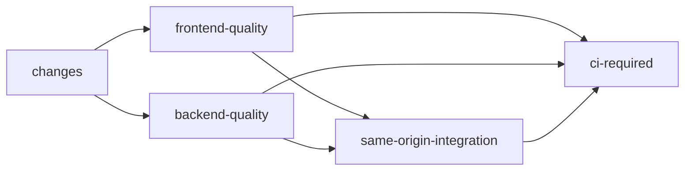
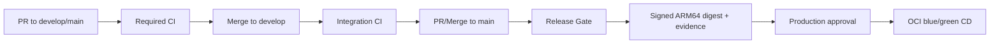

# BokriLog MVP CI 계획

## 1. 목적과 범위

이 문서는 BokriLog의 CI 설계 정본이다. 현재 React/Vite 진입 화면의 자동 검증부터 Spring Boot·PostgreSQL·Bybit·계산 기능, 최종 ARM64 release candidate까지 품질 게이트가 언제 어떻게 확장되는지를 고정한다.

CI는 코드를 운영 환경에 배포하지 않는다. CI의 마지막 책임은 검증된 release evidence와 불변 image digest를 만드는 것이다. Production CD는 운영자 승인 뒤 그 digest를 다시 빌드하지 않고 OCI의 inactive 슬롯에 전달한다.

이번 문서 작업의 범위에는 GitHub Actions workflow, package script, branch protection 또는 OCI 설정의 구현이 포함되지 않는다. 구현 계약은 후속 `spec-ci-foundation.md`가 소유한다.

### 최종 권장 실행 프로필

현재 frontend만 있는 동안에는 이름이 고정된 `ci-required` **단일 job**을 사용한다. 제품 변경 PR에서는 install, typecheck, build, Vitest와 Chromium E2E를 순서대로 실행하고 문서-only PR은 같은 job 안에서 가벼운 문서 경로만 탄다. 별도 classifier나 aggregator job을 만들지 않아 checkout·설치와 최소 과금 단위의 중복을 피한다.

Backend가 생기는 Story 1.2부터는 다음 구조로 전환한다.

- Backend가 도입된 뒤 두 영역 검사가 모두 필요한 PR에서는 `frontend-quality`와 `backend-quality`를 각각 단일 job으로 즉시 병렬 실행한다. 한 영역만 관련된 변경은 반대편 job을 승인된 비적용 상태로 처리한다.
- WebKit을 별도 job으로 분리하기 전 기본 PR 경로의 최대 동시 GitHub-hosted runner는 2개다. 다른 PR은 서로 취소하지 않으며 계정 동시 실행 한도 안에서 병렬 실행할 수 있다.
- `same-origin-integration`은 관련 변경일 때만 두 품질 job의 현재 실행 산출물을 받아 실행하고, `ci-required`는 모든 예상 결과를 집계한다.
- 8분 기준은 병렬화를 시작할 조건이 아니다. Backend 도입 시 병렬화는 기본이며, 측정 시간이 기준을 넘을 때 캐시·suite 배치·job 내부 단계·sharding을 추가로 최적화한다.
- Branch protection이 참조하는 이름은 전환 전후 모두 `ci-required`로 유지한다.

## 2. 상속하는 아키텍처 불변식

이 계획은 다음 결정을 재해석하거나 약화하지 않는다.

| 상속 결정 | CI가 보존하는 계약 |
| --- | --- |
| AD-2·AD-3 | Java/Spring과 Spring Modulith 경계를 빌드·구조 시험으로 검증한다. |
| AD-4 | React/Vite 정적 SPA와 같은 origin의 `/api` 경계를 통합 시험한다. |
| AD-9 | 금융 계산은 `BigDecimal` 기반 고정 정책과 승인 예제로 재현한다. |
| AD-10·AD-11 | 인증·자격정보는 실제 secret 없이 stub으로 실패 경로와 redaction을 먼저 검증한다. |
| AD-12 | Worker drain, 단일 expand migration, inactive API 검증, Nginx cutover와 rollback 호환 순서를 보존한다. |
| AD-14 | JUnit, Testcontainers, provider stub, promtool, k6와 log 검증은 개발·CI 또는 통제된 배포 runner에서만 실행한다. |
| AD-15 | OCI A1 2 OCPU/12GB 운영 VM에서 build와 무거운 시험을 실행하지 않는다. |
| AD-20 | 모든 사용자 소유 aggregate의 교차 사용자 접근 차단을 통합 시험한다. |

## 3. 현재 기준선

2026-09-04 기준 구현 상태는 다음과 같다.

- 제품 코드는 `frontend/`의 React 19.2.x, Vite 8.2.x, TypeScript strict SPA뿐이다.
- Node major는 `frontend/.nvmrc`와 `package.json`에서 24로 고정한다.
- `package-lock.json`이 실제 프런트엔드 의존 버전의 권위 원본이다.
- Vitest 단위·화면 시험 9개와 Playwright Chromium E2E 13개가 있다.
- `backend/`, `deploy/`, `.github/workflows/`는 아직 없다.
- Story 1.1은 검토 중이며 Story 1.2 이후의 제품·운영 기능은 백로그 상태다.
- GitHub 원격 저장소는 private, 기본 브랜치는 `main`이고 Actions는 활성화됐지만(`allowed_actions: all`) workflow와 `main`·`develop` 보호 규칙은 없다.
- 계정은 GitHub Pro다. private 저장소에서도 branch protection과 ruleset을 쓸 수 있다.

로컬 기준선에서 `npm ci`, typecheck, production build, Vitest와 Chromium E2E가 모두 성공한다. 2026-09-04 Windows 재측정에서 `CI=1` 직렬 실행과 기본 병렬 실행 모두 exit 0으로 정상 종료했다. 이전 초안이 적었던 "프로세스가 종료되지 않는다"는 재현되지 않으므로 철회한다.

| 단계 | 실측 |
| --- | ---: |
| `vite build` | 1.6초 |
| Vitest 9개 | 최초 실행 24.3초 (그중 17.7초가 jsdom 환경 준비), 재실행 1.5초 |
| Chromium E2E 13개, `CI=1` 직렬 | 6.5초 |

이 값이 §6 timeout과 §17 재보정의 출발점이다. GitHub-hosted Ubuntu 첫 실행에서 같은 항목을 다시 측정해 갱신한다.

## 4. 채택한 CI 운영 모델

### CI-D1 — 실행 기반

- **결정:** GitHub-hosted Actions를 사용한다.
- **금지:** OCI production VM을 self-hosted runner로 사용하지 않는다.
- **이유:** 소스·PR·status check를 한 시스템에서 연결하고, 매 실행을 깨끗한 runner에서 재현하며, Jenkins controller·agent·plugin을 1인 운영 범위에 추가하지 않는다. PR 코드를 production 자원·Docker socket·배포 secret과도 분리한다.

OCI를 배포 대상으로 쓰는 것과 CI runner를 GitHub에 두는 것은 충돌하지 않는다. CI가 검증·빌드·서명한 불변 artifact를 만들고, 별도 권한의 CD가 OCI로 전달한다.

| 개발자 관점 | GitHub Actions | Jenkins | BokriLog 판단 |
| --- | --- | --- | --- |
| PR 연동 | GitHub check·ruleset과 직접 연결 | webhook, credential과 plugin 구성이 필요 | Actions 우세 |
| 운영 부담 | hosted runner와 관리형 실행기 | controller, agent, plugin, backup·patch 운영 | 1인 MVP에는 Actions 우세 |
| 격리·재현 | 실행마다 깨끗한 hosted 환경 | agent image와 workspace 청소를 직접 보장 | Actions 우세 |
| 특수 환경 | hosted runner 제약, 필요 시 전용 runner | 폐쇄망·특수 hardware·복잡한 사내 연동에 유연 | 현재는 불필요, 성장 시 Jenkins 재검토 |
| OCI 배포 | OIDC/credential을 분리한 후 OCI 호출 가능 | OCI 호출 가능 | 둘 다 가능하며 배포 대상은 선택 기준이 아님 |
| 비용 | 사용량과 private repo quota 관리 | 인프라·운영시간까지 직접 부담 | 현재 작은 팀·짧은 CI에는 Actions 우세 |

따라서 Jenkins가 기능적으로 부족해서 제외한 것이 아니다. 현재 팀 규모와 코드 호스팅 위치에서는 Jenkins의 자유도보다 운영 표면적이 더 큰 비용이므로 GitHub Actions를 선택한다.

### CI-D2 — 세 실행 경로

| 경로 | 목적 | 배포 권한 | 초기 시간 목표 |
| --- | --- | --- | ---: |
| PR 필수 CI | 병합 전 빠른 결함 차단 | 없음 | 중앙값 3분 이하, p95 5분 이하; 현재 job timeout 8분 |
| `develop` 통합 CI | 실제 merge commit과 넓은 호환성 검증 | 없음 | p95 10분, timeout 20분 |
| `main` Release Gate | CD가 소비할 불변 artifact와 증거 생성 | registry write만 | p95 20분, timeout 40분 |

시간 목표는 첫 10회 실행의 GitHub Actions 측정값으로 재보정한다. 예산을 넘는다는 이유로 필수 보안·계산 계약을 제거하지 않고 job 경계, 캐시, 실행 빈도와 병렬 구조를 조정한다.

### CI-D3 — 기능과 함께 성장하는 게이트

존재하지 않는 backend, container 또는 Terraform을 미리 흉내 내지 않는다. 새 기능의 완료 PR은 그 기능 코드, 자동시험과 필요한 CI 게이트를 함께 추가한다. 구현되지 않은 미래 게이트는 이 문서의 계약으로만 유지한다.

### CI-D4 — 하나의 검증 가능한 release identity

- **정본:** `registry/repository@sha256:<digest>` 형식의 `linux/arm64` 단일 OCI manifest가 release subject다.
- API와 Worker는 역할 인자만 다르고 같은 subject를 실행한다.
- migration은 같은 image의 불변 경로에서 실행하며 그 bytes의 `migration_artifact_digest`를 별도로 기록한다. CD 서버의 checkout이나 이동 가능한 tag에서 migration을 가져오지 않는다.
- SBOM, provenance, 시험 요약과 migration attestation은 모두 이 subject를 참조한다.
- versioned canonical JSON evidence를 승인된 CI workload identity로 서명한다. CD는 evidence 문자열이 아니라 digest, 서명, issuer, workflow identity와 subject를 검증한다.

### CI-D5 — 고정된 required gate 판정

Branch protection은 이름이 고정된 `ci-required` 하나를 참조한다. 현재에는 이 job 자체가 frontend 검사를 수행한다. Backend 도입 뒤에는 `needs`에 모든 선행 job을 명시하고 `if: always()`로 실행되는 짧은 aggregator로 바뀐다. 계획의 `not_applicable`은 GitHub 고유 상태가 아니라 classifier가 출력한 승인 사유 enum이다. 실제 `skipped`는 그 사유와 예상 목록이 일치할 때만 허용하며 `failure`, `cancelled`, `not_run`, 빈 값과 예상하지 않은 `skipped`는 실패다.

PR에서는 첫 job이 이벤트가 고정한 `github.sha`를 checkout하고 이를 `merge_sha`로 기록한다. `pull_request` 이벤트의 `github.sha`가 곧 그 시점의 merge commit이다. `refs/pull/<PR 번호>/merge`를 다시 해석하지 않는다. 그 ref는 움직이므로 이벤트보다 새 merge commit을 집을 수 있다. 이 commit의 두 parent가 `base_sha`와 `head_sha`인지 확인하며, 부모를 읽으려면 checkout의 `fetch-depth`가 2 이상이어야 한다. merge commit이 없거나 부모가 일치하지 않으면 실패한다. 모든 후속 job은 움직이는 ref가 아니라 이 정확한 `merge_sha`를 checkout한다. Aggregator는 최소 `pull-requests: read` 권한으로 현재 head와 target base를 다시 조회하고 둘 중 하나가 바뀌었거나 조회가 실패하면 fail-closed한다. Aggregator timeout은 1분이다. `develop`·`main` push 경로는 synthetic merge 없이 event의 정확한 `commit_sha`를 사용한다.

### CI-D6 — release 생성과 production 배포의 분리

여러 release candidate build는 병렬로 수행할 수 있다. Production promotion/CD는 environment별 durable deployment lease와 fencing token으로 직렬화하고, migration 직전부터 관찰 성공 또는 rollback 완료까지 lock을 유지한다. 실행 중인 production job은 더 새 commit 때문에 자동 취소하지 않는다.

## 5. 이벤트와 브랜치 정책

| 이벤트 | 실행 경로 | 설명 |
| --- | --- | --- |
| feature branch push, PR 없음 | 실행하지 않음 | 로컬 반복까지 hosted minute을 소비하지 않는다. |
| PR → `develop` | PR 필수 CI | feature·fix·chore·docs 병합 전 검증이다. |
| push → `develop` | 통합 CI | 실제 merge commit을 재검증한다. |
| PR → `main` | PR 필수 CI + release validation | release·hotfix의 출시 가능성을 검증한다. |
| push → `main` | Release Gate | 배포하지 않고 release candidate를 만든다. |
| 수동 진단 | 배포 권한 없는 선택 검사 | 임의 ref를 진단할 수 있지만 release evidence나 배포 입력이 될 수 없다. |
| 수동 release 재생성 | 보호된 `main` SHA의 Release Gate | 임의 ref·외부 evidence URL을 금지하고 최초 실행과 같은 계약을 적용한다. |

Story 3.8에서 여는 `main` PR의 `release-validation`은 일반 품질·same-origin 검사가 끝난 뒤 한 job으로 실행한다. WebKit, migration/rollback 호환과 ARM64 build 가능성을 검증하되 registry push·서명·production secret 사용은 금지한다. Timeout은 15분이며 선행 단계 뒤에 실행하므로 기본 peak runner 2개를 늘리지 않는다. `ci-required`는 이 결과까지 기다린다. WebKit 필수 검사가 준비되기 전에는 Production Release Gate를 활성화하지 않는다.

일반 release PR은 target이 최신 `develop`의 descendant이고 해당 통합 CI가 성공했음을 검증한다. 긴급 hotfix는 별도 승인과 사유를 요구하고 merge 뒤 `develop` backport를 추적한다. 상태 조회 실패, ancestry 불일치 또는 실패한 통합 상태는 `main` aggregator와 Release Gate를 중단한다.

`pull_request.branches`는 source branch가 아니라 PR의 target branch를 뜻한다. 기본 trigger는 `pull_request`와 `push`의 `develop`, `main`, 그리고 `workflow_dispatch`다.

Required workflow 전체에는 top-level `paths` 필터를 적용하지 않는다. workflow가 생략돼 status가 생성되지 않는 분기를 막는다. 현재 frontend-only 단계는 단일 `ci-required` 안에서 변경을 분류한다. 문서-only 변경은 secret scan과 문서/BMAD 검증만 실행하고 제품 변경은 frontend 검사를 실행한다. Backend 도입 뒤에는 별도 `changes` job과 `ci-required` 아래에서 변경 경로를 분류한다.

| 변경 분류 | PR 필수 job | `develop` 통합 job | `main` release job |
| --- | --- | --- | --- |
| 제품 frontend | frontend 품질·Chromium | frontend 품질·Chromium·활성화 후 WebKit | frontend 품질·Chromium·WebKit·release validation |
| backend/API/DB | backend 품질·관련 통합 | backend·DB·same-origin 통합 | 전체 제품·migration·release validation |
| deploy/image/migration | 관련 전체 제품·배포 정적 검증 | 전체 통합 | 전체 release gate |
| 문서만 | 문서/BMAD 검사, 제품 job은 승인된 비적용 | 동일 | release artifact를 만들지 않음 |

Workflow, classifier, lockfile, Dockerfile, migration, deploy 또는 build/test script가 바뀌면 `문서만`으로 분류할 수 없고 관련 전체 gate를 강제한다. 분류 규칙과 허용 사유 enum은 workflow 구현 SPEC의 시험 대상이다.

하나의 변경이 여러 분류에 속하면 예상 job의 합집합을 실행하며 우선순위로 범위를 줄이지 않는다. Rename·삭제는 변경 전 경로와 변경 후 경로를 모두 평가한다. 분류 실패나 알려지지 않은 경로는 관련 전체 gate를 실행하는 fail-closed 상태다. Frontend-only와 backend-only 변경은 반대편을 승인된 비적용 상태로 둘 수 있지만 API 계약, 공통 설정, workflow, lockfile, build/test script는 양쪽 관련 gate를 강제한다. Classifier와 그 규칙을 바꾸는 PR은 target base의 승인된 정의로 감지해 전체 관련 gate를 실행하며, PR이 수정한 classifier가 자기 검사를 축소할 수 없다.

같은 PR에 새 commit이 오면 이전 PR 검사는 concurrency group으로 취소한다. Group key는 workflow identity와 target branch·PR 번호를 함께 포함해 같은 PR의 이전 실행만 취소하고 다른 PR은 독립적으로 진행한다. `develop` push, `main` Release Gate, 수동 진단과 production CD는 서로 다른 group을 사용한다. 취소된 이전 실행 결과는 merge 판단이나 artifact 발행에 사용할 수 없으며, production CD에는 자동 취소를 적용하지 않는다.

## 6. 현재 단계의 필수 CI

첫 구현은 하나의 `ci-required` job이다. 현재 규모에서 별도 품질·집계 job을 나누면 checkout, Node setup과 의존 설치가 중복되고 짧은 aggregator도 별도 runner 사용량을 만들기 때문이다.

실행 순서는 다음과 같다.

1. 저장소 checkout
2. 모든 PR에서 committed-secret 검사와 job 내부 변경 분류
3. 문서-only면 문서/BMAD 검사 후 11번으로 이동
4. `frontend/.nvmrc` 기준 Node 24 준비
5. `frontend/package-lock.json` 기준 npm 다운로드 캐시 복원
6. `npm --prefix frontend ci --prefer-offline --no-audit --fund=false`
7. `npm --prefix frontend run typecheck`
8. `npm --prefix frontend run build`와 Vitest
9. `npm --prefix frontend exec -- playwright install chromium --with-deps --only-shell`로 Chromium headless shell과 Linux 의존성 설치
10. 이미 생성한 `dist`를 대상으로 CI 모드 Playwright 실행
11. 실패·timeout·취소 시 report, trace와 screenshot 업로드

`test:e2e`는 `vite build && playwright test`이므로 CI에서 명시적인 build 단계와 함께 실행하면 동일한 build가 중복된다. 그래서 로컬 완결 명령 `test:e2e`를 유지한 채 `playwright test`만 수행하는 `test:e2e:run`을 분리했다(2026-09-04 적용). CI는 10번 단계에서 `test:e2e:run`을 쓴다.

### 초기 실행 설정

- Hosted image는 구현 시점의 Playwright 지원 Ubuntu 고정 버전을 사용한다.
- Workflow token은 `contents: read`가 기본이다.
- 변경 분류에는 변경 파일 목록이 필요하다. `fetch-depth: 0`으로 `git diff base...head`를 쓰거나 job token에 `pull-requests: read`를 더한다. SPEC이 둘 중 하나를 고르고 그 근거를 남긴다.
- 분류 규칙을 target base에서 읽으려면 base commit을 fetch해 `git show <base_sha>:<경로>`로 확인해야 한다. 얕은 checkout만으로는 불가능하다.
- PR에는 repository, environment 또는 provider secret을 전달하지 않는다.
- `pull_request_target`에서 PR 코드를 실행하지 않는다.
- npm 다운로드 캐시만 사용하고 `node_modules`는 캐시하지 않는다.
- Playwright browser cache는 처음부터 추가하지 않고 실제 다운로드 시간과 cache 복원 비용을 측정한 뒤 판단한다.
- `--only-shell` 설치는 어느 project도 `channel`을 지정하지 않을 때만 성립한다. Playwright는 channel 없는 headless Chromium을 `chromium-headless-shell`로 해석한다. `channel: 'chromium'`을 추가하거나 headed 실행을 필수 경로에 넣으면 설치와 실행이 어긋나므로 그때는 전체 Chromium을 설치한다.
- PR build의 `dist`는 보관하지 않는다.
- 실패 진단 artifact만 7일 보관한다.
- Required Playwright 실행은 retry 0으로 고정하고 최초 실패부터 trace를 `retain-on-failure`로 보존한다. 재시도는 배포 권한 없는 별도 진단 실행에서만 허용한다.
- `playwright.config.ts`에 `retries: 0`, `trace: 'retain-on-failure'`, `globalTimeout: 180_000`을 적용했다(2026-09-04). 두 값은 한 묶음이다. `on-first-retry`인 채로 retry만 0이 되면 trace가 하나도 남지 않는다. 진단용 재시도는 `--retries=N`으로만 덮어쓴다.
- 외부 action은 허용 목록과 full commit SHA로 고정하며 정확한 SHA는 구현 시점의 공식 release에서 확인한다.
- 시작 timeout은 frontend job 8분, Vitest 2분, Playwright 4분이다. 시험 명령의 내부 deadline은 job timeout보다 짧게 두어 하위 프로세스 종료와 진단 업로드 시간을 확보한다. Timeout은 실패이며 report·trace·screenshot 등 비밀정보가 없는 자료를 업로드한다.

현재 저장소에 ESLint·stylelint·formatter 설정과 명령은 없으므로 초기 CI는 현재 존재하는 명령만 자동화한다. Story 1.2 완료 전 별도 품질정책 PR에서 도구·규칙·예외를 합의하고 lint, stylelint와 format check를 required gate로 승격한다. 그 전까지 코드 리뷰가 해당 표류를 확인하며, “검사가 없음”을 “검사 성공”으로 기록하지 않는다.

## 7. 브라우저 실행 정책

| 실행 경로 | Chromium | WebKit | Firefox·OS matrix |
| --- | --- | --- | --- |
| PR → `develop` | 필수 | 미실행 | 미실행 |
| push → `develop` | 필수 | 초기 advisory, 승격 후 필수 | 미실행 |
| PR → `main` | 필수 | 필수 | 미실행 |
| Release Gate | 필수 | 필수 | 미실행 |

Chromium은 모든 PR의 빠른 회귀 게이트다. 초기 CI에서는 Chromium만 required로 둔다. WebKit은 `develop`에서 advisory로 시작하고, 10회 실행에서 제품 실패를 가리지 않는 안정성과 통합 p95 10분 예산을 확인한 뒤 required로 승격한다. 이 측정에서 critical path, 브라우저 설치 중복과 billed runner-minute을 비교해 frontend job 내부 실행과 별도 browser job 중 더 작은 방식을 선택하며, 별도 job이면 최대 동시 runner 예산도 따로 정한다. `main` release 전에는 반드시 required여야 한다. 모바일 우선 UX의 `100dvh`, safe-area, `focus-visible`, 확대·리플로 위험을 다루되 실제 iPhone Safari 검증을 대체했다고 간주하지 않는다.

Firefox나 Windows·macOS runner는 지원 브라우저 정책, 실제 결함 또는 사용자 비율이 필요성을 보일 때 추가한다. 단순한 조합 확대는 CI 시간 예산을 소비할 근거가 아니다.

## 8. 기능 구현 단계별 확장

| 도입 시점 | CI에 추가하는 검증 | 실행 위치 |
| --- | --- | --- |
| 현재 Story 1.1 | TypeScript, Vite build, Vitest, Chromium 접근성·키보드·리플로·네트워크·저장소 E2E | 단일 `ci-required` |
| Story 1.2 완료 전 | 합의된 ESLint·stylelint·format check와 정책 시험 | frontend 품질 |
| Story 1.2 | Java 25, Gradle, Spring Boot build/test, Nginx root·`/api`·오류, Story 1.1 회귀 | `backend-quality`, `same-origin-integration` |
| Story 1.3 이후 | PostgreSQL Testcontainers, migration, schema validation, 교차 사용자·삭제 상태 | backend/integration |
| Story 1.4~1.11 | OIDC stub, state·nonce·PKCE·JWS, 세션 회전, redaction, 삭제 경로 | backend/integration |
| Epic 2 | Bybit stub, pagination·rate limit·미인식 사건, 결정적 `BigDecimal` 계산, publication·fencing | backend/integration |
| Story 3.7 | telemetry golden, 고카디널리티·민감정보 누출, promtool rule test | observability 검사 |
| Story 3.8 | ARM64 build·boot smoke, SBOM·서명, migration·rollback 호환, 제한된 k6 | Release Gate |
| Epic 4~5 | 광고 fail-open과 삭제·복원 자동시험; 실제 승인·훈련은 별도 launch gate | integration/release |

### Story 1.2 이후 job 구조

상단 실행 프로필의 두 품질 job은 첫 job이 검증한 동일한 `head_sha`, `base_sha`와 PR merge-ref의 실제 `merge_sha`를 입력받아 그 commit을 checkout한다. Frontend는 기존 `dist`와 identity·producer·digest metadata를, backend는 실행 가능한 artifact와 같은 metadata를 전달한다. 이름에는 workflow run ID, run attempt, PR 번호와 `merge_sha`를 포함하고 overwrite를 금지한다. 시험 성공뿐 아니라 필요한 digest 생성과 upload까지 producer 성공 조건이며 하나라도 실패하면 job을 실패시킨다.

`same-origin-integration`은 현재 run의 두 artifact만 내려받아 producer, run, SHA와 checksum을 검증하며 다시 build하지 않는다. 취소되거나 대체된 실행의 artifact는 재사용하지 않는다. Integration 입력은 해당 검사가 필요한 run에만 만들고 retention은 1일로 제한한다.

Same-origin 검사는 API schema, controller·DTO, CORS·proxy, auth cookie·session, frontend API client, runtime config 또는 Nginx route가 바뀌면 필수다. 이때 양쪽 품질 job은 integration 입력을 생성해야 한다. `ci-required`는 모든 선행 job을 `needs`로 참조해 예상 결과와 evidence를 검증하고, 개별 job 이름이 바뀌어도 branch protection 대상 이름은 유지한다.

Backend 단일 job은 관련 코드에서 compile, unit test와 Modulith 경계 검사를 항상 실행한다. PostgreSQL Testcontainers와 migration 검사는 DB·repository·migration 변경에 실행하고, 인증·사용자 격리·금융 계산 경계 변경은 연관 통합 검사를 강제한다. 시작 timeout은 backend job 10분, Testcontainers 단계 5분, same-origin job 5분이다. Gradle 다운로드 cache는 npm과 별도 namespace를 쓰고 OS, toolchain과 lockfile을 key에 포함한다.

`changes` job은 target base의 승인된 분류 규칙으로 경로 분류와 모든 PR의 secret scan을 순서대로 처리한 뒤 품질 job을 연다. SAST·dependency 검사는 해당 품질 job 안에서 실행하고 container·공급망 전체 검사는 Release Gate에 둔다. 따라서 보안 검사가 추가돼도 기본 PR의 peak runner는 2개를 넘지 않는다.

## 9. 테스트 환경과 외부 의존성 경계

### PR과 일반 통합 CI

- PostgreSQL은 Testcontainers로 실행한다.
- OAuth, Bybit와 광고 제공자는 결정적인 local stub을 사용한다.
- production credential, 사용자 금융자료와 실제 광고 요청을 사용하지 않는다.
- 부하 테스트는 stub 또는 BokriLog가 소유한 endpoint만 대상으로 실행한다.
- 같은 commit과 lockfile은 외부 서비스 상태와 무관하게 같은 판정을 낼 수 있어야 한다.

### 정기·출시 검증

Bybit API 변경과 지원 사건 유형 재검증은 PR의 필수 성공 여부와 분리한다. 실제 provider test account가 필요하면 승인된 격리 환경에서 최소 권한과 별도 secret을 사용하고 실패 원인을 제품 회귀와 외부 가용성으로 구분한다.

다음 항목은 green CI로 대체하지 않는다.

- production OAuth client와 redirect URI 승인
- 실제 Bybit read-only account와 reserved IP 확인
- 광고 provider·소재·데이터 흐름·접근성 승인
- 개인정보·법률 검토
- OCI entitlement와 예상 비용 확인
- 실제 백업 복원과 비상정지 훈련
- production inactive 슬롯의 smoke와 telemetry 도착

## 10. 속도와 재현성 정책

1. 타입·구성·build처럼 빠른 실패를 browser·container 준비보다 먼저 찾는다.
2. lockfile을 항상 사용하고 CI에서 의존 버전을 갱신하지 않는다.
3. cache miss에서도 완전히 재생성할 수 있는 cache만 사용한다.
4. cache에 secret, build credential 또는 사용자 데이터를 넣지 않는다.
5. PR마다 ARM64 image를 registry에 push하지 않는다.
6. release가 아닌 PR의 성공 `dist`, test DB와 container layer를 장기 보존하지 않는다.
7. Required Playwright는 retry 0이다. flaky 조사용 재시도는 별도 비필수 진단에서 수행하고 원본 실패를 지우지 않는다.
8. fail-fast는 job 시간을 줄이는 수단이지 필수 결과를 생략하는 수단이 아니다.

속도와 비용은 같은 값으로 취급하지 않는다. 최근 10회와 월간 추세에서 PR wall-clock 중앙값·p95, queue 대기, job별 실행시간, PR당 총 billed runner-minute, 취소된 이전 실행의 소비 시간과 월간 예상량을 따로 기록한다. GitHub-hosted runner 사용량은 job별 실행시간을 기준으로 계산되므로 작게 나눈 job과 별도 aggregator도 비용을 늘릴 수 있다.

Foundation SPEC은 적용 시점 private repository의 월간 Actions 한도를 확인해 수치 예산을 고정한다. 예상 사용량 70%에서 경고하고 90%에서 advisory·정기 검사의 빈도와 cache를 먼저 조정한다. Required gate를 조용히 생략하지 않으며 한도 부족이 예상되면 추가 hosted 사용량과 production과 분리된 ephemeral self-hosted runner의 총소유비용을 비교한다.

시간 예산을 넘으면 다음 순서로 조정한다.

1. 중복 build·설치 제거
2. cache hit율과 다운로드 병목 측정
3. 느린 suite의 job 내부 배치와 Testcontainers 범위 조정
4. release 전용 검사를 PR 경로에서 분리
5. fail-closed 변경 분류를 유지한 관련 job skip
6. 시험 수가 충분히 커진 뒤 Playwright sharding 검토

Backend 도입 후 PR wall-clock p95가 8분을 반복적으로 넘으면 병렬화 여부가 아니라 cache hit율, 중복 설치, suite 배치, job 내부 단계와 sharding을 재검토한다. 필수 계약을 줄여 시간을 맞추지는 않는다.

## 11. 보안과 공급망 정책

- PR workflow의 기본 권한은 read-only다.
- Build와 test job은 production environment를 참조하지 않는다.
- Release Gate의 package write와 Production CD의 배포 권한을 분리한다.
- Production secret은 승인된 environment에만 두며 PR context에서 사용할 수 없다.
- Action은 full commit SHA로 고정하고 GitHub Actions와 npm/Gradle 의존 업데이트를 별도 review PR로 관리한다.
- Privileged workflow는 default branch의 승인된 정의만 사용하고, 보호된 `main`의 서명 evidence digest만 입력받는다. PR head artifact, 임의 ref와 외부 evidence URL을 배포 입력으로 금지한다.
- 처음에는 package-manager 다운로드 cache만 허용한다. Release Gate는 PR이 쓴 실행 가능 cache나 build output을 소비하지 않으며, 향후 build cache는 content hash와 신뢰 영역을 분리한다.
- CI 로그, artifact와 cache에는 token, session, credential, email, provider payload와 금융값을 기록하지 않는다.
- Committed secret 검사는 모든 PR에서 실행한다. 빠른 incremental SAST는 관련 제품 코드 PR에서, dependency·license 검사는 lockfile 변경과 정기/main 경로에서, container 검사는 Dockerfile·image 변경 또는 Release Gate에서, 전체 공급망 검사는 `main` Release Gate에서 실행한다. 검증된 Critical 취약점은 차단하고 High는 owner·사유·보완책·만료일이 있는 시간 제한 waiver만 허용한다. 정확한 도구는 foundation SPEC에서, container scan은 Story 3.8에서 선택한다.
- `npm audit`처럼 결과가 시간에 따라 바뀌는 외부 검사를 단독 merge gate로 두지 않고 고정된 advisory snapshot, triage와 위 waiver 정책을 함께 적용한다.
- Release image는 SBOM과 signature를 포함하고 배포 전 둘을 다시 검증한다.

## 12. Release Gate와 CD 인계 계약

Release Gate는 성공한 보호 `main` commit에서 canonical JSON release evidence를 생성한다. Schema와 정책은 versioned이며 canonical serialization의 digest를 승인된 CI workload identity로 서명한다.

| 필드 | 계약 |
| --- | --- |
| `schema_version` | evidence JSON schema와 canonicalization 규칙 버전 |
| `commit_sha` | 검증한 정확한 Git commit |
| `release_version` | 변경 불가능한 release 식별자 |
| `image_subject` | `registry/repository@sha256:<digest>` 형식의 `linux/arm64` API·Worker 공통 subject |
| `migration_artifact_digest` | 같은 image의 불변 migration bundle bytes digest |
| `attestations` | 동일 subject를 참조하는 SBOM·provenance·migration·시험 attestation의 digest/URI |
| `tested_predecessor_subjects` | old binary+new schema를 검증한 정확한 predecessor subject 목록 |
| `compatible_schema_range` | startup과 rollback이 허용하는 schema 범위 및 정책 버전 |
| `test_evidence` | 필수 suite별 `passed/failed/not_run`, count, report digest와 정책 버전 |
| `workflow_identity` | workflow path, protected ref, issuer, run ID와 attempt |
| `evidence_digest` | canonical JSON의 digest와 그 digest에 대한 서명 참조 |
| `created_at` | UTC 생성 시각 |

필수 suite가 하나라도 `failed` 또는 `not_run`이면 evidence를 release 가능 상태로 서명하지 않는다. 같은 SHA의 제품 시험 실패는 코드 또는 시험 변경이 있는 새 commit으로만 해소한다. 확인된 infrastructure failure만 수동 재실행할 수 있고 최초 attempt, actor, 사유와 모든 결과를 evidence에 남긴다. Candidate tag와 evidence key는 commit SHA와 run attempt를 포함해 유일하며 overwrite하지 않는다. 탐색용 mutable tag는 promotion이 성공한 뒤에만 갱신한다. Candidate 승인 유효기간은 image·signature·attestation 보존기간보다 짧아야 하며 만료된 candidate는 promotion하지 않고 보호된 `main`에서 다시 생성한다.

CD는 다음을 모두 만족할 때만 시작한다.

1. evidence가 성공한 보호 `main` commit과 default branch의 승인된 workflow identity에 귀속된다.
2. evidence 서명, issuer, workflow identity, digest와 모든 attestation subject가 `image_subject`와 일치한다.
3. migration과 rollback compatibility가 성공했다.
4. 운영자가 production environment 배포를 승인했다.
5. OCI resource·비용·restriction 사전검사가 성공했다.
6. 공개 기능에 필요한 versioned launch-readiness manifest의 외부 승인·훈련 결과·approver·만료일이 유효하다. 없거나 만료된 기능은 flag 또는 공개 베타에서 차단한다.

PR → `main`은 기능·호환성만 검증하며 image push나 서명을 하지 않는다. Merge 뒤 `main` Release Gate만 clean build, ARM64 image push, 서명과 evidence 생성을 수행한다. Candidate에서 production registry로 옮길 때는 재빌드 없는 digest-preserving copy만 허용하고 대상 registry에서 subject, signature와 attestations를 다시 검증한다. Registry write principal과 production deploy principal은 분리하며 current와 rollback window 안의 predecessor evidence는 보존한다.

CI는 실제 운영의 predecessor나 배포 성공을 결정하지 않는다. CD는 위 조건을 다시 검증하고 동일 digest만 OCI inactive 슬롯에 전달한다. Durable lease, migration 복구, predecessor CAS, Nginx cutover, 관찰 상태와 append-only deployment record의 상세 계약은 [PORTFOLIO-SOLUTION-DESIGN.md의 배포 구조](./PORTFOLIO-SOLUTION-DESIGN.md#8-배포-구조)가 소유한다. `VERIFIED` 전에는 출시 완료로 표시하지 않는다. `develop` 통합 CI 실패는 main promotion과 Release Gate를 차단하고 담당자와 revert 또는 수정 결정을 추적 가능한 기록에 남긴다.

Registry, GitHub-to-OCI 인증과 signing/attestation 공급자는 Story 3.8 구현 SPEC에서 당시 공식 지원과 위협 모델을 확인해 결정한다. Private repository의 GitHub-native 기능을 무료라고 가정하지 않으며, 도구 선택으로 subject·identity·서명 검증 계약을 약화하지 않는다.

## 13. Branch protection

Workflow를 먼저 `develop`에 올리고 GitHub-hosted Ubuntu에서 정상 실행한 뒤 보호 규칙을 건다. `pull_request`의 workflow 정의는 PR head에서 읽는다. 따라서 workflow보다 먼저 분기한 토픽 브랜치는 `ci-required`를 만들지 않고 필수 검사가 영구 대기로 남는다. 열려 있는 토픽 브랜치는 workflow 병합 뒤 rebase한다.

### `develop`

- PR 필수
- 전후 모두 고정 이름 `ci-required` 필수
- direct push, force push와 삭제 차단
- 최신 대상 브랜치와 통합한 merge 결과 검증

### `main`

- direct push 금지
- release 또는 hotfix PR 필수
- Chromium·WebKit과 release validation 필수
- Production 배포 성공은 merge 조건으로 만들지 않는다. Merge 뒤 생성된 release candidate를 별도 승인한다.

계정이 GitHub Pro이므로 이 private 저장소에서 branch protection과 ruleset을 쓸 수 있다. 2026-09-04 확인: `branches/main/protection`이 요금제 403이 아니라 `404 Branch not protected`를 반환하고 `environments`가 정상 응답한다.

Story 3.8이 요구하는 environment required reviewer와 artifact attestation은 private 저장소에서 Team 이상을 요구할 수 있다. 그 시점에 실제 제공 범위를 다시 확인한다. 강제 수단이 없으면 동일한 효과의 ruleset 또는 immutable release ref와 검증된 승인 체계를 마련할 때까지 Production CD를 fail-closed로 비활성화한다. 수동 PR 규칙만으로 production release 신뢰를 대체하지 않는다.

## 14. BMAD 도구와 문서 검증

BMAD Python은 제품 runtime이 아니다. `scripts/check-bmad-env.sh`를 모든 제품 PR에 실행하지 않는다. 다음 경로가 바뀔 때만 별도 `bmad-contract` 검사 대상으로 삼는다.

- `_bmad/**`
- `.agents/skills/**`
- `.claude/skills/**`
- `.codex/**`
- `scripts/check-bmad-env.sh`
- `uv.toml`

의미·정책 판단이 필요한 PRD, UX, Architecture와 Epic 문서는 lint 통과만으로 승인하지 않고 사람 또는 지정된 review workflow가 검토한다.

## 15. 문서와 구현 소유권

| 관심사 | 권위 원본 |
| --- | --- |
| CI 원칙·단계·시간 예산·CD 인계 | 이 `CI-PLAN.md` |
| 시스템과 배포 불변식 | `ARCHITECTURE-SPINE.md` |
| 상세 운영·배포 순서 | `PORTFOLIO-SOLUTION-DESIGN.md` |
| 기능별 Acceptance Criteria | `epics.md`와 Story SPEC |
| 첫 CI 구현 계약 | 후속 `implementation-artifacts/spec-ci-foundation.md` |
| 실행 workflow | 후속 `.github/workflows/*.yml` |
| 로컬 재현 명령 | 구현 후 갱신할 `DEVELOPMENT.md` |
| 미결 항목 해소 | 구현 검증 뒤 `deferred-work-resolutions.md` |

문서와 workflow가 충돌하면 아키텍처 불변식을 먼저 지키고, 이 계획과 구현 SPEC을 함께 갱신한다. Workflow에만 새로운 정책을 숨기지 않는다.

### 추적 위치

첫 CI 구현은 제품 스토리가 아니라 저장소 정비 작업이다. `epics.md`의 45개 스토리와 `sprint-status.yaml`은 승인된 제품 범위만 추적하며, `sprint_plan.py`는 `epics.md`와 매칭되지 않는 `development_status` 항목을 orphan으로 삭제한다. 따라서 CI 작업을 그 파일에 손으로 추가하지 않는다.

`spec-ci-foundation.md`는 `spec-bmad-environment-setup.md`와 같은 스토리 밖 SPEC으로 두고 `chore/ci-foundation` 브랜치에서 구현한다. 완료 근거는 `deferred-work.md`의 CI workflow 항목을 `deferred-work-resolutions.md`로 옮겨 남긴다. 이 결정은 `epics.md`와 `ERD-1.0.0`을 변경하지 않는다.

## 16. 도입 순서와 완료 조건

### 계획 문서 완료

- 이 문서가 Architecture Spine의 companion으로 연결된다.
- 기존 PRD·Architecture·Epic·CD 순서와 충돌하지 않는다.
- 현재와 미래 CI를 구분하고 미구현 기능을 성공으로 가장하지 않는다.
- 시간 예산, secret 경계와 CI-CD artifact 계약이 명시돼 있다.

### 첫 CI 구현 완료

- `spec-ci-foundation.md`가 승인된다.
- PR과 `develop`·`main` push에서 의도한 경로가 실행된다.
- 깨끗한 Node 24 환경에서 install, typecheck, build, Vitest와 Chromium E2E가 성공한다.
- 현재 frontend-only 프로필은 별도 classifier·aggregator 없이 단일 `ci-required` job으로 실행된다.
- Ubuntu에서 E2E process가 timeout 없이 정상 종료된다.
- 실패 진단 artifact가 secret 없이 생성된다.
- `ci-required`가 기대 job의 `success`만 허용하고 취소·미실행·예상 밖 skip을 차단한다.
- Required Playwright retry가 0이고 실패 trace가 남는다.
- 최근 10회의 실행시간을 측정하고 목표와 비교한다.
- 실패한 `ci-required`가 병합을 강제로 차단한다. 강제 수단이 없으면 보호가 필요한 branch에 CI 완료를 선언하지 않는다.
- 검사가 실제로 성공한 뒤에만 해당 deferred CI 항목을 해결된 것으로 기록한다.

### 장기 CI-CD 인계 완료

- Release Gate가 동일 canonical ARM64 subject에 묶인 SBOM, provenance, migration, 시험 attestation과 서명 evidence를 만든다.
- CD가 evidence 없는 image나 이동 가능한 tag를 배포할 수 없다.
- Production 승인이 CI 권한과 분리된다.
- 실제 inactive 슬롯 smoke와 telemetry 확인 뒤에만 Nginx를 전환한다.
- Durable lock, predecessor CAS, 멱등 deployment ID와 append-only production record가 검증된다.
- `VERIFIED` 전에는 production 출시 완료로 표시하지 않는다.

## 17. 재검토 조건

- 현재 PR p95 5분 또는 `ci-required` timeout 8분을 반복적으로 초과하면 queue·job·runner-minute을 분리 측정하고 cache, 중복 설치, suite 배치와 sharding을 재검토한다. Backend 도입 뒤에는 wall-clock p95 8분을 같은 최적화 trigger로 사용한다.
- WebKit이 10회 측정에서 안정성과 통합 p95 시간 예산을 충족하면 비용이 더 작은 job 배치로 `develop` required에 승격한다. Browser 결함이나 실제 지원 정책이 요구하면 PR 승격, Firefox 또는 OS matrix를 검토한다.
- Rollback window 종료와 contract migration은 운영 승인, retention 확인과 복구훈련 증거가 있을 때만 진행한다.
- GitHub Actions 사용량이 별도 runner의 총소유비용보다 커지면 전용 ephemeral runner를 비교한다. Production VM은 후보에서 제외한다.
- 다중 repository·폐쇄망·특수 hardware·전담 DevOps 조직이 생기면 Jenkins를 재평가한다.
- 유료 사용자 또는 가용성 계약이 생기면 CI뿐 아니라 OCI host와 CD 신뢰 경계도 함께 재설계한다.

## 18. 구현 시 확인할 공식 기준

정확한 action version과 플랫폼 기능은 구현 시점에 다음 공식 문서에서 다시 확인한다.

- GitHub Actions Node.js CI: <https://docs.github.com/en/actions/tutorials/build-and-test-code/nodejs>
- GitHub Actions workflow와 job 개념: <https://docs.github.com/en/actions/get-started/understand-github-actions>
- GitHub-hosted runner 선택: <https://docs.github.com/en/actions/how-tos/write-workflows/choose-where-workflows-run/choose-the-runner-for-a-job>
- GitHub Actions cache: <https://docs.github.com/en/actions/reference/workflows-and-actions/dependency-caching>
- GitHub workflow artifact 전달: <https://docs.github.com/en/actions/concepts/workflows-and-actions/workflow-artifacts>
- GitHub job 실행시간과 과금 확인: <https://docs.github.com/en/actions/how-tos/monitor-workflows/view-job-execution-time>
- GitHub Actions Java/Gradle CI: <https://docs.github.com/en/actions/tutorials/build-and-test-code/java-with-gradle>
- GitHub Actions secure use: <https://docs.github.com/en/actions/reference/security/secure-use>
- GitHub required status checks: <https://docs.github.com/en/repositories/configuring-branches-and-merges-in-your-repository/managing-protected-branches/about-protected-branches>
- GitHub Actions concurrency: <https://docs.github.com/en/actions/how-tos/write-workflows/choose-when-workflows-run/control-workflow-concurrency>
- GitHub artifact attestations: <https://docs.github.com/en/actions/how-tos/secure-your-work/use-artifact-attestations/use-artifact-attestations>
- GitHub deployments and environments: <https://docs.github.com/en/actions/reference/workflows-and-actions/deployments-and-environments>
- Playwright CI: <https://playwright.dev/docs/ci>
- Playwright best practices: <https://playwright.dev/docs/best-practices>
