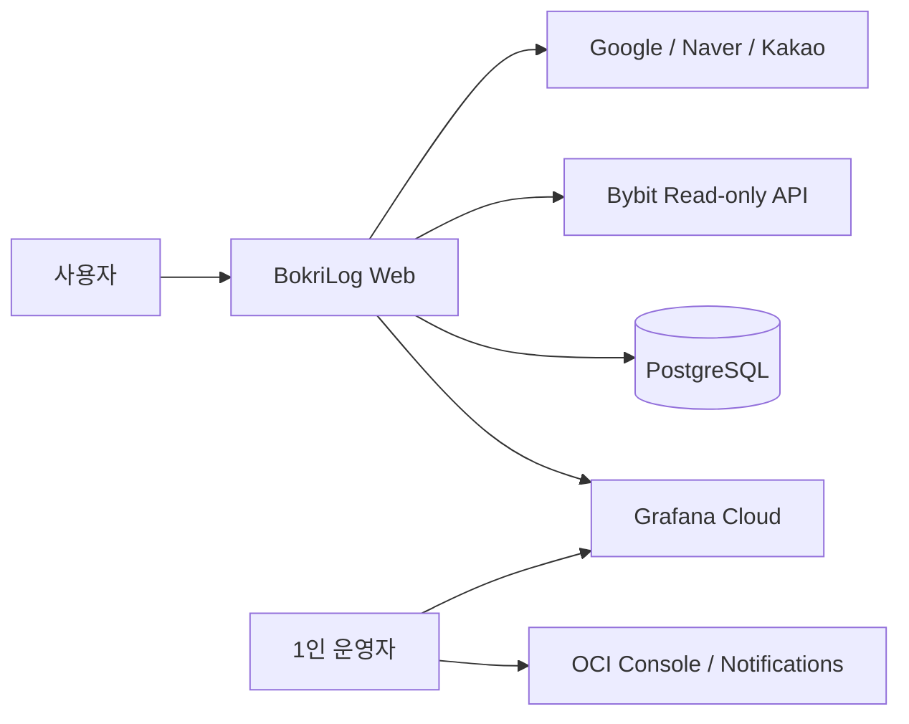
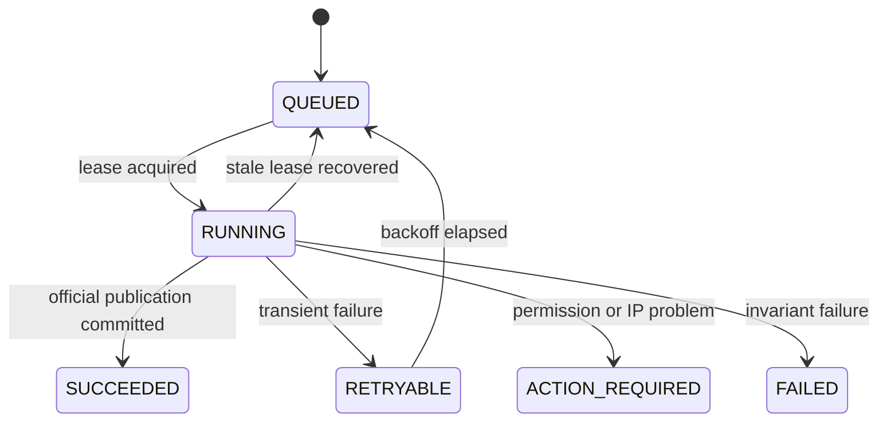
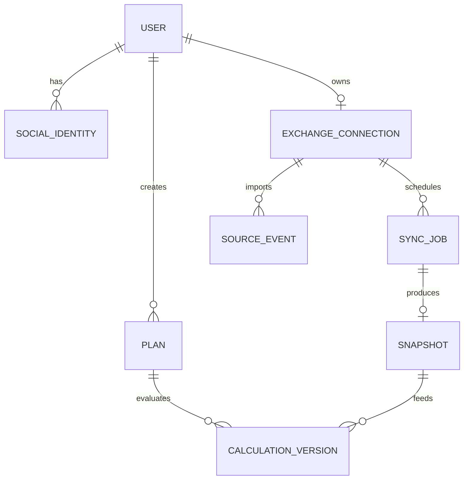

# BokriLog MVP 상세 설계

## 1. 설계 요약

BokriLog는 사용자의 읽기 전용 Bybit UTA 데이터를 가져와 거래소가 제공한 현재자산 `totalEquity`와 외부 자금흐름을 기준으로 복리 계획의 진행 상태를 계산하는 서비스다. 거래를 실행하거나 투자 판단을 추천하지 않는다.

초기 운영 구조는 한 명이 관리할 수 있는 모듈형 모놀리스다. API와 Worker는 같은 Spring Boot 코드베이스와 이미지로 만들되 서로 다른 프로세스로 실행한다. PostgreSQL 하나가 업무 데이터, 세션, 동기화 작업 큐를 담당한다. 운영 서버에는 Nginx, Spring API, Worker, PostgreSQL, Grafana Alloy만 상주시킨다.

핵심 전략은 단일 서버를 복잡한 분산 시스템으로 만들지 않되, 나중에 분리할 경계를 코드와 데이터 소유권으로 미리 증명하는 것이다.

## 2. 시스템 컨텍스트와 신뢰 경계

- 브라우저는 공식 금액과 상태를 계산하지 않는다.
- Bybit는 현재 UTA 가치와 거래 원문의 권위 제공자다.
- BokriLog는 계획·계산·검증 상태의 권위 제공자다.
- Grafana Cloud에는 운영 telemetry만 전송하며 금융·식별·자격 증명 데이터는 보내지 않는다.
- OCI 계정을 잃어도 복구할 수 있도록 키와 백업 사본 하나는 OCI 밖에 둔다.

## 3. 모듈 설계

| 모듈 | 소유 데이터 | 공개 책임 | 금지 사항 |
| --- | --- | --- | --- |
| identity | social_identity, user, session 연계 | 로그인 사용자 식별과 계정 생명주기 | 이메일만으로 계정 병합 |
| exchange | exchange_connection, encrypted_credential | 연결 검증, Bybit 조회 port | 계산·계획 상태 변경 |
| sync | sync_job, watermark, source_event, snapshot, calculation_version, official pointer | 작업 수락, Worker 조정, 공식 결과 승격 | 외부 호출 중 DB 트랜잭션 유지 |
| plan | plan, plan_revision | 불변 계획 입력과 활성 계획 단일성 | 거래소 원문 수정 |
| calculation | policy_version, pure value object | 재현 가능한 복리 지표 결정 함수 | 영속화, `double`/`float`, 코인별 현재가치 재산출 |
| engagement | consent, ad_attempt, frequency_cap | 수동 동기화 광고 trigger와 provider 경계 | 광고를 결과 성공 조건으로 사용 |
| operations | restriction, service_notice, audit_record | 범위별 정지·수동 복구·공지·지원 상태 | 자동 복구, 다른 모듈 데이터 직접 변경 |

Spring Modulith 테스트는 모듈 간 허용되지 않은 의존과 순환 참조를 빌드 단계에서 실패시킨다. 각 모듈은 다른 모듈의 공개 application API만 호출하며 entity, repository, 내부 패키지와 소유 테이블에 직접 접근하지 않는다.

인증 세션이 유일한 내부 `user_id`를 정한다. 모든 사용자 소유 query, command, job과 publication은 application API와 repository query에서 이 ID로 scope하며 client가 보낸 owner ID는 신뢰하지 않는다. 타 사용자 target과 미존재 target은 동일한 외부 오류 계약을 사용한다. CI는 각 aggregate에 대해 두 사용자 간 수평 권한 상승 통합 테스트를 실행한다.

## 4. 동기화 처리

### 요청 경로

1. API는 인증 사용자와 연결 상태를 확인한다.
2. 동일 연결의 실행 중 작업이 있으면 그 작업 ID를 반환한다.
3. 없으면 `sync_job`을 짧은 트랜잭션으로 생성하고 HTTP 202를 반환한다.
4. Worker가 lease와 heartbeat로 작업을 선점한다.
5. 외부 호출은 DB 트랜잭션 밖에서 수행한다.
6. 원 사건, 스냅샷 후보, 계산 버전을 추가 전용으로 기록한다.
7. 검증이 모두 끝났을 때만 공식 포인터를 짧은 트랜잭션으로 교체한다.

`sync`가 sync run, 정규화 source fact, 계산 결과와 공식 포인터를 함께 소유한다. `exchange`는 source DTO만 반환하고 `calculation`은 부작용 없는 결정 함수로 결과 값만 반환한다. 따라서 공식 발행은 하나의 Spring `REQUIRED` 트랜잭션이며 내부 호출은 별도 트랜잭션이나 비동기 발행을 시작하지 않는다.

상태 전환에는 예상 이전 상태를 조건으로 넣어 두 Worker가 동시에 성공 처리하지 못하게 한다. 모든 write에는 `lease_generation` fencing token을 포함한다. 공식 포인터는 connection별 `sync_sequence`가 현재보다 클 때만 CAS로 전진하며 lease를 잃은 Worker는 `LOST_LEASE` 또는 `SUPERSEDED`로 끝난다.

source fact의 정체성은 provider, account, category, stable source ID 조합이다. 원문 hash와 source/observed/effective time, revision/supersedes를 함께 저장한다. 동일 페이지 재수집은 no-op이고 제공자 정정은 기존 행 수정이 아니라 superseding fact 추가다. stable ID가 없는 endpoint의 fallback은 공개 베타 전 문서화한 allowlist로만 허용한다.

### 신선도 정책

Bybit의 wallet balance와 transaction log에는 공통 스냅샷 토큰이 없다. BokriLog는 다음 두 시간을 분리한다.

- `measured_at`: 현재 `totalEquity`가 측정된 시각
- `cashflow_verified_through`: 외부 자금흐름을 확인한 마지막 시각

일상 조회는 전체 이력을 다시 읽지 않는다. 마지막 watermark 이전의 안전 중첩 구간부터 닫힌 상한까지 모든 페이지를 수집한 뒤에만 watermark를 전진시킨다. 최근 입출금이 아직 보이지 않으면 사용자가 다시 동기화한다. 계획 종료, 공백·중복 의심, 장기 미접속, 운영 조사 때만 전체 검증을 수행한다. Bybit의 조회 가능 범위 때문에 2년을 넘는 이력을 거래소에서 재구성할 수 있다고 약속하지 않는다.

## 5. 계산 계약

권위 입력은 Bybit `totalEquity` 원문 문자열, 검증된 외부 자금흐름, 불변 계획 입력이다. BokriLog는 코인별 잔액과 가격으로 현재가치를 다시 계산하지 않고 다음 서비스 고유 지표만 계산한다.

- 현재 계획금액
- 계획 대비 차이
- 외부 자금흐름을 반영한 조정 최종 목표
- 남은 기간의 필요 등가수익률
- 목표 수익 달성도

모든 숫자는 문자열에서 `BigDecimal`로 파싱한다. 내부 계산은 DECIMAL128 34자리와 HALF_EVEN을 사용하고, 표시 단계에서만 HALF_UP 2자리로 반올림한다. 입력, 결과, 계산 정책 버전을 함께 저장해 동일 입력을 재현한다.

## 6. 데이터 저장과 무결성

- 사용자당 활성 계획 최대 1개: 조건부 유일 인덱스
- 연결당 실행 중 동기화 최대 1개: 조건부 유일 인덱스와 lease
- 외부 사건 중복 방지: `(connection_id, category, stable_source_id, revision)` 유일성; 동일 revision 재수집은 no-op
- 계산 결과 불변성: 계정의 허용 보존기간에는 update 대신 새 version
- 공식 결과: 검증된 snapshot/calculation을 가리키는 포인터만 교체
- 시간: 원본 UTC `timestamptz`, 계획 경계 해석은 `Asia/Seoul`

PostgreSQL을 작업 큐로 사용하면 DB와 작업 요청을 같은 짧은 트랜잭션에 기록할 수 있다. 작업 완료까지 트랜잭션을 유지하지 않으므로 장시간 잠금 병목은 만들지 않는다. broker와 transactional outbox는 독립 Worker 확장이나 다중 소비자가 실제 필요해질 때 도입한다. 검증된 계정 삭제는 추가 전용 규칙의 명시적 예외다.

## 7. 인증과 자격 증명 보안

### 사용자 인증

- Google/Naver/Kakao Authorization Code + PKCE
- `(issuer, subject)`를 전역 유일 외부 사용자 키로 사용하고 이메일 일치 자동 병합 금지
- 한 user에 여러 provider identity를 연결할 수 있으나 연결·해제는 최근 재인증과 원자적 확인 필요
- 마지막 로그인 수단 제거 금지, 실패 시 기존 매핑 유지
- HttpOnly, Secure, SameSite=Lax opaque 세션 쿠키
- Spring Session JDBC, session fixation 방어, CSRF 보호
- JWT 또는 금융 데이터를 localStorage에 저장하지 않음

### Bybit 연결 검증

연결 저장 전에 `/v5/user/query-api` 결과의 `readOnly=1`, supported UTA, expected user ID, 최소 조회 권한, OCI reserved IP whitelist와 실제 wallet read를 하나의 accepted result로 모두 검증한다. write capability, 모호하거나 초과된 permission, UID/IP 불일치와 live read 실패는 자격 증명·연결을 저장하지 않는다. API secret은 최초 입력 후 다시 반환하지 않고 교체 시 재입력만 허용한다. 권한·IP·만료 문제는 무한 재시도하지 않고 `ACTION_REQUIRED`로 전환한다.

### 암호화와 키

- AES-256-GCM과 CSPRNG 96-bit nonce
- `(key_version, nonce)` 유일성
- AAD: user, connection, credential, key version, algorithm version
- active key와 과거 decrypt-only key로 구성된 key ring
- DB·Git·로그·Terraform state에서 key/secret 제외
- 애플리케이션 key ring과 별도 백업 키의 복구 사본을 OCI 밖 비밀번호 관리자에 보관

단일 서버의 root 권한이 탈취되면 실행 중인 애플리케이션과 주입된 키가 함께 노출될 수 있다는 잔여 위험은 MVP에서 수용한다. 외부 KMS는 보안 등급이 높아질 때 도입한다.

## 8. 배포 구조

### 운영 자원

- OCI home region A1 Flex 2 OCPU/12GB를 무과금 기준으로 사용
- boot volume 50GB와 별도 data volume을 사용하되 실제 무료 한도는 콘솔에서 확인
- regional reserved public IPv4를 Nginx와 Bybit egress에 사용
- 80/443만 공개하고 관리 접근은 제한
- 모든 운영 이미지는 `linux/arm64`로 CI 검증하고 digest로 고정

| 서비스 | 시작 상한 | 운영 방식 |
| --- | ---: | --- |
| Spring API | 슬롯당 768MiB | 평상시 한 슬롯, 배포 중 잠시 두 슬롯 |
| Worker | 512MiB | 배포 전 drain, 새 버전 하나만 재개 |
| PostgreSQL | 3GiB | `shared_buffers` 512MiB~1GiB에서 시작 |
| Alloy | 256MiB | 영속 queue/storage 경로 사용 |
| Nginx | 128MiB | 고정 진입점 |

2 OCPU 환경에서는 메모리보다 배포 중 CPU 경합을 먼저 검증한다. 서버에서 이미지를 빌드하거나 Testcontainers/k6를 실행하지 않는다.

### 배포 순서

1. CI에서 unit, Modulith, redaction, Testcontainers PostgreSQL + Bybit stub, promtool 검사를 통과한다.
2. 동일 ARM64 image digest를 서버에 전달한다.
3. 기존 Worker를 drain한다.
4. 별도 단일 migration job이 expand migration을 한 번 적용한다. API/Worker startup은 schema를 검증만 한다.
5. 제한된 내부 경로로 readiness와 k6 smoke를 실행한다.
6. 배포 식별 metric/log가 Grafana Cloud에 도착했는지 확인한다.
7. Nginx upstream을 바꾸고 무중단 reload한다.
8. 새 Worker 하나를 기동하고 관찰 기간 후 이전 API를 종료한다.
9. contract migration은 rollback 창이 닫히고 이전 버전이 제거된 뒤 다음 배포에서 수행한다.

이 blue/green은 배포 실패만 완화한다. VM, PostgreSQL, volume, Nginx, OCI 리전 장애를 이중화하지 않는다.

## 9. 백업과 재해복구

일일 자동 작업은 다음 순서다.

`pg_dump custom → 종료 검사 → 별도 키 암호화 → SHA-256 → pg_restore --list → OCI 업로드 → 외부 저장소 업로드 → 성공 metric`

두 저장소 업로드까지 끝나야 성공이다. 계정 삭제의 30일 파기 요구를 지키기 위해 모든 backup generation은 30일 안에 회전 삭제하고 저장 개수와 총 byte를 함께 제한한다. OCI 무료 전용 계정 Object Storage는 합산 20GB를 기준으로 70% 경고를 둔다.

- 공개 베타 RPO: 24시간 이하
- RTO: Always Free capacity의 영향을 받는 best-effort
- A1을 8시간 내 확보하지 못하면 PAYG 또는 유료 VPS로 전환

OCI 밖 versioned recovery manifest에는 image digest, Terraform source와 state 복구법, DNS/TLS/OAuth/Grafana/backup 설정, 암호화 operational secret, key version과 bootstrap 순서를 둔다. plaintext secret은 Terraform state에 넣지 않는다.

월 1회 이 manifest만으로 격리 서비스를 재구축하고 key ring/백업 키, PostgreSQL, role/extension/migration, 불변식, 표본 Bybit 자격 증명 복호화, 로그인, Spring Session 폐기, reserved IP와 safe sync까지 검증한다.

OCI 밖 서버로 복구하면 기존 reserved IP를 가져갈 수 없다. 이때 사용자는 새 송신 IP를 Bybit에 등록해야 하며 서비스는 그 전까지 `BYBIT_IP_REBIND_REQUIRED`를 표시한다.

## 10. 관측성과 테스트

| 환경 | 관측 구성 | 테스트 실행 |
| --- | --- | --- |
| 개발 | Prometheus + Loki + Grafana + Alloy, 필요할 때만 | JUnit, Modulith, Testcontainers, stub, promtool, k6, logcli |
| CI | 임시 테스트 의존성 | 전체 품질 게이트와 ARM64 image 검사 |
| 운영 | Alloy → Grafana Cloud | 외부 synthetic와 제한된 배포 smoke만 |

metric label과 로그 필드는 allowlist한다. user ID, 계획 ID, request ID, 계정 ID, 원시 URL을 metric label로 사용하지 않는다. API key/secret, session/token, email, 자산 금액, Bybit payload/query string은 모든 telemetry에서 제거한다.

필수 경보는 외부 `/health/live` 5분 검사, Alloy heartbeat 부재, backup age 26시간 초과, 동기화 실패율·queue age, DB connection, disk 70%/85%, memory pressure, Grafana Cloud 사용량 70%/85%다.

보안·사용자 행동 감사 원장은 PostgreSQL 추가 전용 테이블이 권위 원본이다. 원격 로그는 일시 손실 가능한 관측 자료이지 감사 원장의 대체물이 아니다.

## 11. 광고, 계정 삭제와 운영 통제

### 광고

`engagement` 모듈은 광고 동의, 수동 동기화 성공 trigger, 30분 및 일 3회 빈도 제한과 provider adapter를 소유한다. 자동·탭 재활성화 동기화에는 광고를 요청하지 않는다. 광고는 공식 결과가 저장된 뒤 금융값·계획값·신뢰 상태가 없는 중립 화면에서만 시도한다. 미채움, 차단, 오류, 비동의, 접근성 실패는 재요청 없이 같은 결과 화면으로 fail-open한다.

### 계정 삭제

`identity`가 삭제 상태와 orchestration을 소유하고 각 모듈의 deletion port를 호출한다. 최근 재인증 후 시작하며 즉시 모든 세션, 자격 증명과 민감 화면 접근을 차단한다. 일부 모듈이나 저장소 삭제가 실패하면 완료로 표시하지 않고 실패 범위와 재시도를 기록한다.

암호화된 최소 deletion tombstone을 서비스 데이터와 backup 밖에 backup 최대 수명 이상 유지하고 모든 restore 전에 적용한다. 운영 데이터와 해당 계정을 포함한 backup은 요청일부터 30일 안에 접근 불가·파기 상태가 되어야 한다. 법정 분리 보존의 정확한 필드, 법적 근거, 목적과 기간은 공개 베타 전 확정하지 못하면 출시를 차단한다.

### 비상정지와 공지

`operations`가 신규 연결, 동기화, 계산 표시, 광고의 durable restriction과 사용자 service notice를 소유한다. scope는 plan, calculation policy version, exchange connection, sync, advertising, global feature이며 구체 scope가 global보다 우선한다. 관련 read, admission, lease, publication, display는 effective restriction을 fail-closed로 검사한다. 강한 신호는 60초 안에 설정 범위를 자동 정지하고, 범위를 특정할 수 없으면 신규 연결과 동기화를 전역 정지한다. 자동 복구는 금지하며 운영자가 사유, 증거와 복구 조건을 기록한 보호된 명령으로만 재개한다. 수행자, 시작·종료 시각, 영향 범위는 감사 원장에 남긴다.

사용자 문의 접수와 장애·복구 공지는 operations의 공개 상태로 연결하고, 영업일 3일 답변 목표를 운영 지표로 측정한다.

## 12. 운영 등급과 비용 통제

서비스는 하루 24시간 실행을 목표로 하지만 Always Free에는 SLA, capacity 보장, 정식 지원이 없다. 공개 베타 운영 등급은 `24×7 상시 실행 목표, best-effort, SLA 없음`이다. 주 2시간 목표는 서비스 제공 시간이 아니라 안정화 후 경보 확인·문의·복구 훈련·점검에 드는 운영 노동시간이다.

프로비저닝 전 home region, A1 제공 여부, 무료 전용 계정 2 OCPU/12GB entitlement, `Always Free eligible`, 예상 월 비용 0, reserved IP와 volume/object storage 실제 한도, 비용 경보와 quota를 확인한다.

최초 idle 회수, A1 capacity 8시간 실패, 유료 사용자 발생, 가용성 약속 필요 중 하나가 발생하면 Always Free를 주 운영 호스트에서 제외한다.

## 13. 실패 시나리오

| 실패 | 사용자 영향 | 자동 대응 | 운영자 대응 |
| --- | --- | --- | --- |
| Bybit 일시 오류 | 동기화 지연, 이전 공식값 유지 | backoff 후 제한 재시도 | 장기화 시 공지 |
| API 권한/IP 오류 | 연결 갱신 필요 | `ACTION_REQUIRED` | 사용자 안내 |
| Worker 중단 | queue 지연 | lease 만료 후 재선점 | queue age 확인 |
| 새 배포 실패 | 기존 버전 계속 제공 | upstream 전환 금지 | 로그·smoke 확인 |
| VM 전체 중단 | 서비스 불가 | 외부 synthetic 경보 | 재기동 또는 재생성 |
| A1 회수/capacity 부족 | 복구 지연 | 외부 경보 | 8시간 후 유료 호스트 전환 |
| data volume 손상 | 최신 DB 손실 | 없음 | 이중 백업 복원 |
| OCI 계정 접근 상실 | OCI 자원 접근 불가 | 없음 | 외부 키·백업으로 타 호스트 복원 |
| Grafana Cloud 장애 | 관측 일부 불가 | OCI 보조 경보 | 로컬 회전 로그 확인 |
| 일부 계정 삭제 실패 | 민감 접근은 차단, 삭제 진행 상태 유지 | 완료 처리 금지 | 실패 저장소 재시도·증거 기록 |
| 강한 보안/계산 신호 | 영향 범위 기능 정지 | 60초 내 restriction 설정 | 검증 후 수동 복구 |
| 광고 공급자 장애 | 광고 없이 결과 표시 | 즉시 fail-open | 장기화 시 광고 기능만 정지 |

## 14. 고도화 경로

| 관찰 신호 | 다음 단계 |
| --- | --- |
| DB polling 또는 다중 소비자 요구 | broker + transactional outbox |
| Worker가 API 자원을 지속 압박 | Worker를 별도 호스트로 이동 |
| RPO 24시간 불충분 | base backup + WAL PITR |
| 유료 사용자/가용성 계약 | 유료 주 호스트 + 복구 호스트/고정 egress |
| key 순환과 감사 요구 증가 | 외부 KMS/Vault |
| PostgreSQL 세션 병목 | Redis 세션 검토 |
| 거래소 추가 | exchange port별 adapter와 제공자별 원 사건 namespace |

## 15. 출시 전 확정 항목

- 안전 중첩 길이와 장기 미동기화 기준
- 지원 Bybit 사건 allowlist, stable ID가 없는 사건의 fallback, 비-USDT 환산 정책
- 강한 보안·계산 신호 판정표와 자동 정지 범위
- 광고 공급자, 실제 데이터 흐름, 동의 문구와 접근성 승인
- 법정 분리 보존 필드·근거·목적·기간
- Day 90 기존 IP 미제한 연결의 유지·유예·중단 정책

미인식 사건이나 필수 환산 누락은 공식 결과 발행을 기본 거부한다. Day 90 이후 신규 IP 미제한 Bybit 연결은 거부한다.

## 16. 포트폴리오에서 설명할 핵심

- Spring Modulith로 모듈 경계를 코드와 테스트로 강제한 점
- DB 작업 큐에서 요청 커밋과 장시간 외부 호출을 분리해 병목을 피한 점
- Bybit의 서로 다른 기준시각을 두 freshness timestamp로 표현한 점
- 거래소 현재가치는 재계산하지 않고 서비스 고유 계획 지표만 계산한 점
- append-only 버전과 공식 포인터로 늦은 사건을 재현 가능하게 정정한 점
- 단일 서버 blue/green의 효용과 고가용성이 아니라는 한계를 구분한 점
- OCI 계정 상실까지 고려해 키와 백업을 별도 신뢰 영역에 둔 점
- 개발 관측 스택과 운영 Grafana Cloud를 분리해 학습 가치와 운영 비용을 맞춘 점
- 무료 인프라 정책 변경을 검증하고 4/24 가정을 2/12로 교정한 점
- fencing token과 단조 sequence로 lease 만료 Worker의 stale publication을 차단한 점
- 계정 삭제 요구에 맞춰 append-only와 backup retention의 예외를 명문화한 점

이 문서의 수치와 서비스 버전은 초기 seed다. 구현 이후 실제 Compose, migration, module test, load test와 운영 대시보드가 상세 상태의 권위 원본이 된다.
