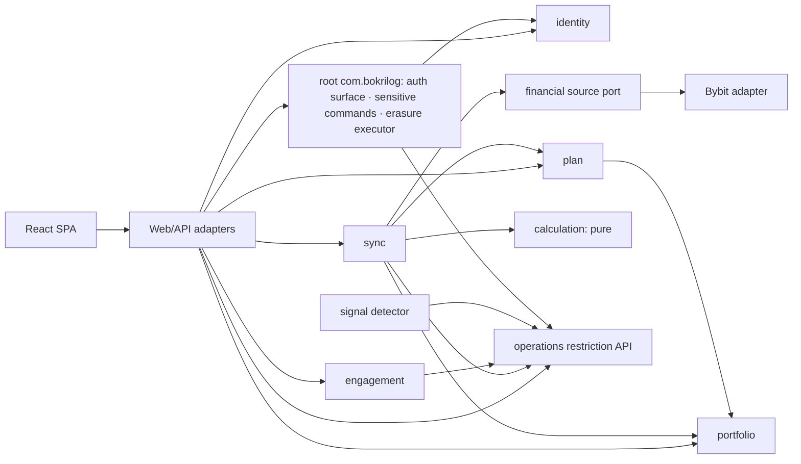
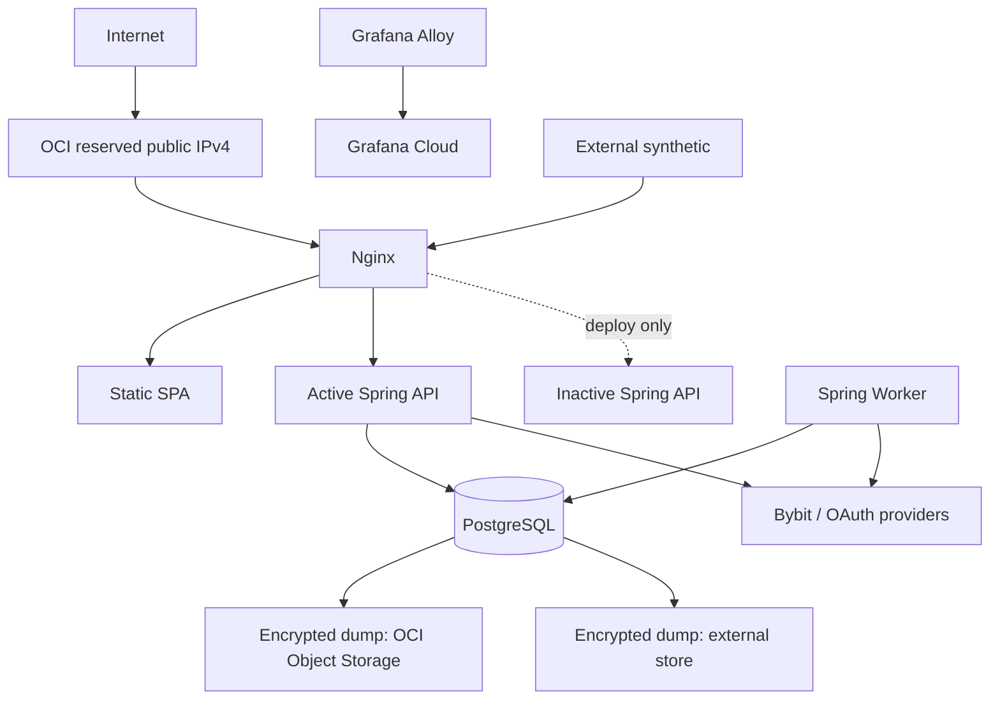
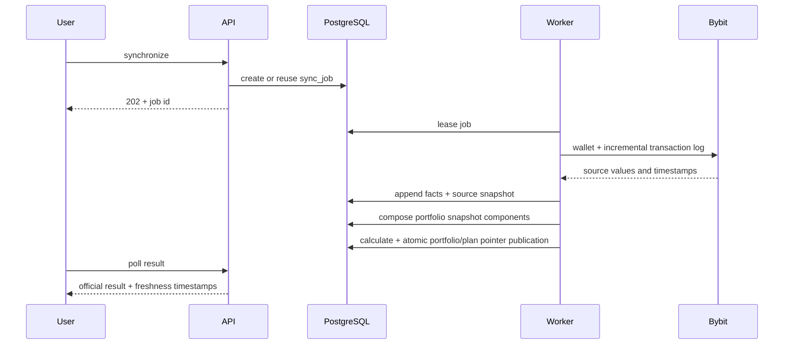

# Architecture Spine — BokriLog MVP (1.1)

> 1.1은 Epic 1~5의 as-built를 반영한 새 버전이다. AD 번호와 정책 버전 이름은 1.0과 같고, 바뀐 AD는 제목에 `[ADOPTED · 1.1 개정]`을 단다. 바뀐 곳마다 근거는 문서 끝 `## 1.0 → 1.1 변경 기록`에 있다. CI-PLAN은 1.0 폴더의 것이 그대로 정본이다(새 버전은 deferred 185).

## Design Paradigm

모듈형 모놀리스가 배포와 트랜잭션 경계를 단순하게 유지하고, 포트/어댑터가 Bybit·소셜 로그인·관측 제공자를 도메인에서 분리한다. 하나의 코드베이스와 이미지에서 API와 Worker 역할을 분리 실행한다.



모듈은 다른 모듈의 공개 API에만 의존한다. 다른 모듈의 `internal` 패키지(그 안의 `JdbcClient` 저장소 클래스) 또는 소유 테이블에 직접 접근하지 않는다. 모듈 여덟과 별도로 루트 패키지 `com.bokrilog`가 HTTP 표면과 모듈을 잇는 조립 계층이다(AD-24).

## Invariants & Rules

### AD-1 — 모듈형 모놀리스와 소유권 경계 [ADOPTED · 1.1 개정]

- **Binds:** identity, source, portfolio, sync, plan, calculation, engagement, operations, 루트 패키지(AD-24)
- **Prevents:** 같은 엔티티에 복수 소유자와 상충하는 상태 변경 경로가 생기는 것
- **Rule:** 각 모듈은 자기 데이터와 상태 변경을 소유하고 공개 application API로만 협력한다. 외부 제공자는 port 뒤의 adapter로 구현한다. 공개 API는 모듈 루트 패키지, 구현은 package-private `internal`이고, 데이터 접근은 ORM entity가 아니라 `internal`의 저장소 클래스가 쓰는 `JdbcClient` SQL이다. 표는 소유 모듈 이름을 접두사로 갖고(`identity_*`·`source_*`·`portfolio*`·`sync_*`·`plan_*`·`operations_*`·`support_*`(operations)·`engagement_*`), 루트 패키지가 소유한 업무 표는 `action_grant` 하나다(AD-24). `spring_session*`은 루트가 구성하는 Spring Session 프레임워크 스키마이고 identity가 그 표에 직접 SQL을 쓰는 결합은 deferred 27이다. 모듈 경계·HTTP 비노출은 `ModuleBoundaryTest`(Spring Modulith, 시험 classpath)가 강제한다.

### AD-2 — Java/Spring 단일 백엔드 [ADOPTED]

- **Binds:** backend, API, Worker, domain calculation
- **Prevents:** 서로 다른 런타임·정밀도·트랜잭션 규칙이 생기는 것
- **Rule:** 백엔드는 Java 25와 Spring Boot 4.1을 사용한다. 금액·비율은 `BigDecimal`, 공식 상태 승격은 Spring 트랜잭션으로 구현하며 `double`과 `float`를 금융 계산에 사용하지 않는다.

### AD-3 — Spring Modulith는 경계 검증 도구 [ADOPTED]

- **Binds:** backend module structure and tests
- **Prevents:** Modulith를 분산 이벤트 시스템으로 오해하거나 모듈 의존이 암묵적으로 순환하는 것
- **Rule:** Spring Modulith는 패키지 경계 검증, 모듈 통합 테스트, 문서 생성에 사용한다. MVP에서 외부 broker와 분산 이벤트 전달을 도입하지 않는다.

### AD-4 — SPA와 백엔드 권위 분리 [ADOPTED]

- **Binds:** frontend, API, authentication, financial display
- **Prevents:** 브라우저와 서버가 서로 다른 공식 금액·상태를 만드는 것
- **Rule:** React/Vite 정적 SPA는 Nginx가 제공하고 같은 오리진 `/api`만 프록시한다. 공식 계산·권한·신뢰 상태는 백엔드만 변경하며 브라우저 저장소에 금융 원본이나 인증 토큰을 영속화하지 않는다.

### AD-5 — PostgreSQL 단일 영속 저장소 [ADOPTED]

- **Binds:** all persistent modules
- **Prevents:** 저장소별로 다른 트랜잭션·십진수·시간·단일성 규칙이 생기는 것
- **Rule:** PostgreSQL 18을 사용한다. 금액·비율은 `numeric`, 사건 시각은 UTC `timestamptz`, 상태 기반 단일성은 조건부 유일 인덱스, 동기화 직렬화는 트랜잭션 범위 잠금과 작업 lease로 강제한다.

### AD-6 — 추가 전용 사실과 공식 버전 포인터 [ADOPTED]

- **Binds:** provider facts, cash flows, source snapshots, portfolio snapshots, calculation versions, audit
- **Prevents:** 늦게 발견한 사건이 과거 계산을 덮어써 재현성을 잃는 것
- **Rule:** 원 사건·외부 자금흐름·정상 스냅샷·계산 버전·감사 기록은 계정의 허용 보존기간 안에서 추가 전용으로 보존한다. 현재 공식 상태는 검증된 버전 포인터로 표현하고 수정은 새 버전으로 수행한다. 검증된 계정 삭제는 이 규칙의 명시적 예외다.

### AD-7 — PostgreSQL 작업 큐와 짧은 트랜잭션 [ADOPTED]

- **Binds:** sync request, Worker, retry, official publication
- **Prevents:** 웹 요청과 외부 API 호출 동안 DB 잠금을 유지하거나 동일 연결 작업이 중복 실행되는 것
- **Rule:** 요청은 `sync_job` 생성 또는 기존 실행 ID 반환까지만 짧게 커밋하고 HTTP 202를 반환한다. Worker는 lease·heartbeat·idempotency key로 선점하며 외부 호출 중 DB 트랜잭션을 열어두지 않는다. 동일 연결은 직렬, 다른 연결은 제한된 동시성으로 처리하고 공식 결과는 별도 짧은 트랜잭션으로 승격한다.

### AD-8 — 증분 동기화와 명시적 신선도 [ADOPTED]

- **Binds:** Bybit wallet balance, transaction log, user-visible freshness
- **Prevents:** 매 조회의 전체 이력 재검증 비용과 서로 다른 시점의 데이터를 하나의 완전한 스냅샷처럼 표시하는 것
- **Rule:** 일상 동기화는 `totalEquity` 1회와 `ERD-1.1.0`(§2.2 — 1.0.0과 같다)이 정한 24시간 또는 7일 중첩 구간부터 닫힌 상한까지 거래 로그의 모든 페이지를 조회한다. 모든 page가 영속화된 뒤에만 watermark를 전진시킨다. 화면과 API는 `measured_at`과 `cashflow_verified_through`를 분리 표시한다. 30일 초과 장기 미접속은 사용자의 계속/새 계획 선택 뒤 하나의 catch-up 작업으로 처리한다. 계획 종료는 전체 이력을 무조건 다시 읽지 않고 기존 완전성 증거의 공백과 마지막 미확정 구간만 검증한다. Bybit 재구성 가능 범위는 최대 2년을 넘는다고 약속하지 않는다.

### AD-9 — 제공자 현재가치·포트폴리오와 BokriLog 계산 경계 [ADOPTED]

- **Binds:** provider current value, source snapshot, portfolio snapshot, compounding plan, return calculations
- **Prevents:** BokriLog가 제공자의 공식 현재가치를 임의로 재계산하거나 계산 모듈이 Bybit 전용 타입에 결합되는 것
- **Rule:** Bybit adapter는 `totalEquity` 원문 십진 문자열을 USD 기준 source snapshot의 권위 입력으로 보존한다. `portfolio`는 같은 기준통화로 검증된 구성 source snapshot ID와 합계가 담긴 불변 portfolio snapshot을 만들고, 계획의 `P0`·`t0`·`E(t)`는 이 portfolio snapshot을 참조한다. 계산 모듈은 제공자 DTO가 아니라 portfolio value와 검증된 외부 자금흐름만 받아 계획금액, 차이, 조정 목표, 남은 필요 등가수익률, 목표 달성도를 계산한다. MVP portfolio는 `USD` 기준통화와 활성 `BYBIT` source 정확히 하나만 허용하므로 합계는 해당 `totalEquity`와 같다. 내부는 DECIMAL128 34자리 HALF_EVEN, 화면 반올림은 HALF_UP 2자리의 버전된 정책을 사용한다.

### AD-10 — 서버 세션 기반 소셜 로그인 [ADOPTED]

- **Binds:** Google/Naver/Kakao login, browser session, CSRF
- **Prevents:** 이메일 계정 병합 오류와 브라우저 토큰 탈취 범위 확대
- **Rule:** OIDC Authorization Code + PKCE를 사용하고 한 `user`는 여러 provider identity를 가질 수 있다. `(issuer, subject)`는 전역 유일하며 이메일 일치로 병합하지 않는다. 연결·해제는 최근 재인증과 원자적 확인을 요구하고 마지막 로그인 수단은 제거하지 못한다. 브라우저에는 HttpOnly/Secure/SameSite=Lax opaque 쿠키만 두고 Spring Session JDBC로 세션을 저장하며 상태 변경 요청은 CSRF 보호를 적용한다.

### AD-11 — Bybit 자격 증명과 키 복구 [ADOPTED]

- **Binds:** Bybit API key/secret, application key ring, backup key
- **Prevents:** DB 유출 시 평문 자격 증명 노출과 서버 상실 후 암호문 복구 불능
- **Rule:** 자격 증명은 AES-256-GCM, 무작위 96-bit nonce, `user_id/connection_id/credential_id/key_version/algorithm_version` AAD로 암호화한다. active/decrypt-only key ring은 DB·Git·로그와 분리해 주입하고 서버·DB·OCI 밖에 복구 사본을 둔다. 백업 키는 애플리케이션 키와 분리하며 관련 데이터와 백업 보존 종료 전 과거 키를 폐기하지 않는다.

### AD-12 — 단일 서버 안전 배포 [ADOPTED · 1.1 개정]

- **Binds:** Nginx, API slots, Worker, DB migration, one-shot roles, rollback
- **Prevents:** 배포 실패가 즉시 전체 중단으로 이어지거나 두 Worker가 같은 작업을 실행하는 것
- **Rule:** Nginx를 고정 진입점으로 두고 평상시 API 한 슬롯만 실행한다. 배포 때 Worker를 drain하고 inactive API를 기동해 readiness·smoke·telemetry를 확인한 뒤 Nginx를 reload한다. Worker는 새 버전 하나만 재개한다. 운영 migration은 별도 단일 실행 역할(`migrate` 프로필)만 수행하고 API/Worker startup은 schema 검증(`Flyway::validate`)만 한다. cutover 전에는 old API+new schema와 new API+new schema를 모두 지원하는 expand만 허용하며, contract는 rollback 창 종료 후 별도 배포한다.
- **As-built(1.1):** 같은 jar를 `BOKRILOG_ROLE=api|worker|all`로 나누고 production에서 `all`은 기동 거부다. Worker는 PostgreSQL session advisory lock 없이는 뜨지 않는다(단일 Worker). `migrate` 밖의 일회성 역할은 다섯이고 모두 웹 서버가 없다 — `deploy-audit`·`backup-record`는 **Flyway를 끈다**(migration 전에 새 이미지로 원장에 INSERT만 하므로 validate가 미적용 migration 때문에 실패한다), `deletion-sample`·`tombstone-export`·`restore-apply`는 Flyway 검증만 한다. 배포 절차는 `deploy/production/deploy.sh` 하나이고 배포·백업·복원·내보내기가 `state_dir/.lock` 하나를 쓴다. CI 리허설만 통과했고 **운영 배포 미검증**이다.

### AD-13 — 이중 외부 백업과 복구 검증 [ADOPTED · 1.1 개정]

- **Binds:** PostgreSQL backup, key recovery, disaster recovery, sessions
- **Prevents:** 같은 OCI 계정 장애로 서버와 백업을 함께 잃거나 데이터만 복원하고 서비스를 재구축하지 못하는 것
- **Rule:** 매일 custom-format dump를 별도 백업 키로 암호화해 OCI와 OCI 밖 저장소에 모두 보관한다. 종료 코드·체크섬·두 업로드·`pg_restore --list`를 완료 조건으로 삼고 모든 backup generation은 30일 안에 파기한다. OCI 밖 versioned recovery manifest는 image digest, 호스트 재구축 방법(1.1: `manual`), DNS/TLS/OAuth/Grafana/backup 설정, 암호화 operational secret, key version, bootstrap 순서를 포함한다. 월 1회 격리 복원으로 키·DB·표본 자격 증명·로그인·세션 폐기를 검증한다. 공개 베타 RPO는 24시간 이하다.
- **As-built(1.1):** 백업은 운영 호스트 systemd timer의 `deploy/production/backup.sh`(age·rclone, 두 S3 호환 저장소의 `incoming/` 업로드·원격 SHA-256 대조 뒤 `generations/` 이동)이고 파기는 생성 후 29일 초과·수량·bytes 상한이다. manifest의 호스트 재구축은 `terraform=manual`이다 — Terraform source·state는 없고 손으로 다시 세운다. 복원은 다른 호스트의 전체 재구축이 아니라 **같은 호스트의 빈 격리 compose 프로젝트**(`bokrilog-restore-*`)에 OCI 밖 generation 하나를 `restore.sh`로 되살리고 `restore-apply` 뒤에만 api·worker를 `env=restore`로 띄운다(nginx·공개 포트·OIDC·Bybit 없음 — 격리 환경의 로그인 왕복은 3.10 defer로 남는다). `restore-apply`는 외부 tombstone과 맞은 계정을 다시 지우고 세션을 모두 폐기하고 불변식·자격정보 표본 복호를 센다. RPO는 장애 시각 − checksum 파일 둘째 줄의 `dump_started_at`(없으면 generation 날짜 00:00 UTC)이고 24시간 초과면 `RPO_EXCEEDED`다. 월 1회 훈련의 증거 원장은 아직 없다(3.10 defer). MinIO·CI 리허설만 통과했고 **실저장소 백업·파기와 실제 복원은 미검증**이다.

### AD-14 — 환경 분리형 관측성과 검증 [ADOPTED · 1.1 개정]

- **Binds:** metrics, logs, alerts, health checks, test location
- **Prevents:** 운영 VM의 관측 스택 과부하, self-hosted/Cloud 구현 분기, 호스트 사망을 내부 telemetry만으로 놓치는 것
- **Rule:** 개발 profile에서만 Prometheus·Loki·Grafana·Alloy를 필요 시 실행한다. 운영에는 Alloy만 상주시켜 Grafana Cloud Free로 metric/log를 전송하고 외부 synthetic `GET /api/status`와 telemetry 부재를 경보한다. 사용자 식별자·자산 금액·Bybit payload·secret/token은 모든 signal에서 금지한다. JUnit, Testcontainers, stub, promtool, k6, logcli는 개발·CI에서만 실행한다.
- **As-built(1.1):** 외부 liveness는 공개 `GET /api/status`(경보 `LivenessProbeFailed`, job `bokrilog-liveness`)이고 `/health/live` 경로는 없다. Actuator는 게시하지 않는 관리 포트에서 `prometheus` 하나만 열고, 메트릭 이름·tag는 `TelemetryAllowlist`, 로그는 `RedactingJsonEncoder`의 JSON 한 줄이 통과시킨다. 경보 규칙은 `deploy/observability/alerts.yml`(모든 selector `env="production"`, 미측정은 `...Unmeasured` `info`)이고 promtool 단위시험은 CI의 `check-alert-rules.sh`가 돈다. 운영 Alloy·Grafana Cloud·synthetic 연결은 아직 없다(3.8 defer — preflight는 Alloy 256MiB를 예약으로만 계상한다). 배포 smoke는 k6가 아니라 curl 셋이다(PSD §8).

> as-built(1.1): Rule의 개발 관측 profile(Prometheus·Loki·Grafana·Alloy)과 `logcli`는 저장소에 없다(deferred 187). k6와 CI의 ARM64 image 검사도 없다(deferred 185).

### AD-15 — OCI 무료 운영 경계와 탈출 조건 [ADOPTED]

- **Binds:** production host, egress IP, service objective, capacity escalation
- **Prevents:** 4 OCPU/24GB를 무과금으로 가정하거나 Always Free를 고가용성 서비스로 표현하는 것
- **Rule:** 무과금 기준은 home region의 OCI A1 단일 VM 2 OCPU/12GB와 regional reserved public IPv4다. 생성 전 콘솔 entitlement·capacity·Always Free 표시·예상 비용 0을 확인한다. API 슬롯당 768MiB, Worker 512MiB, PostgreSQL 3GiB, Alloy 256MiB, Nginx 128MiB에서 시작하고 동일 ARM64 digest의 blue/green peak gate를 통과해야 한다. disk·Grafana 사용량은 70% 경고/85% 긴급, 월 비용은 30,000원 budget alert를 둔다. 운영 등급은 `24×7 상시 실행 목표, best-effort, SLA 없음`이다. 최초 회수, A1 8시간 확보 실패, 유료 사용자 발생 또는 가용성 약속 필요 시 PAYG/유료 VPS로 전환한다.

> as-built(1.1): "동일 ARM64 digest" — CI에 ARM64 image build·검사가 없다(deferred 185). 운영 gate(`preflight.sh`)는 실제 이미지 아키텍처와 메모리 peak를 보지만 CI 리허설에서는 아키텍처 검사를 건너뛴다.

### AD-16 — 발행 소유권, 원 사건 정체성과 fencing [ADOPTED · 1.1 개정]

- **Binds:** provider adapter, sync Worker, source facts, source/portfolio snapshots, calculation result, official pointer
- **Prevents:** 모듈별 부분 커밋, 중복·누락된 외부 사건, 만료 lease Worker의 공식 포인터 역행
- **Rule:** `source`는 provider connection과 안정적인 provider account와 암호화 자격정보(`source_provider_account`·`source_connection`·`source_credential`)를 소유한다. `sync`는 작업 표 여섯, 정규화 source fact, source snapshot, calculation result, plan별 공식 결과 pointer와 후속 계획 기준 준비(`sync_next_plan_baseline`)를 소유한다. `portfolio`는 membership·portfolio snapshot·현재 snapshot pointer를, `plan`은 계획 정의·조건 intent와 종단 사실(`plan_end`·`plan_completion`)을 소유한다. adapter는 provider-neutral DTO만 반환하고 `calculation`은 부작용 없는 결정 함수다. source fact와 source snapshot은 교체 가능한 connection이 아니라 `(provider, verified_external_account_id)`로 유일한 내부 `provider_account_id`에 귀속하며 connection ID는 수집 provenance로만 기록한다.
- **작업 모델(1.1):** 하나의 `sync_run`이 아니라 단계마다 작업 표가 하나씩, 모두 여섯이다 — `sync_job`(첫 스냅샷·후속 기준, `QUEUED|RUNNING|SUCCEEDED|FAILED|BLOCKED`), `sync_initial_collection_job`(초기 수집, `…|INPUTS_COMPLETE|NEEDS_REVIEW|RETRY_REQUIRED|CANCELLED`), `sync_cashflow_classification_job`(판정, `…|COMPLETE|NEEDS_REVIEW|CANCELLED`), `sync_cashflow_conversion_job`(환산, `…|CONVERTED|CONVERTED_ESTIMATED|CONVERSION_REQUIRED|REVIEW_REQUIRED|CANCELLED`), `sync_plan_publication_job`(최초 발행, `…|PUBLISHED|BLOCKED|FAILED`), `sync_plan_sync_job`(증분·검증·완료, `…|SUCCEEDED|FAILED|NEEDS_REVIEW|BLOCKED`). 종단의 사유는 표마다 CHECK가 닫은 `failure_code` 목록이다. 모든 작업 행은 `fencing_generation`·`lease_until`(30초, `SyncLease`)을 갖는다. `heartbeat_at` 열은 `sync_cashflow_classification_job`(V8)을 뺀 다섯 표에만 있고, 판정 표는 `last_checked_at`만 갖는다. 쓰기는 자기 세대와 살아 있는 lease를 술어로 건다. lease를 잃은 Worker는 0행 갱신을 보고 **아무것도 쓰지 않고 멈춘다** — `LOST_LEASE`·`SUPERSEDED` 같은 종단 상태는 없다. RUNNING 중 lease가 끊긴 시도는 다음 claim이 표의 중단 code로 맺는다(증분 동기화 `FAILED SYNC_INTERRUPTED` — 수집 중인 정밀 검증·계속만 checkpoint에서 두 번까지 잇는다, 최초 발행 `FAILED PUBLICATION_INTERRUPTED`). source별 `sync_sequence`는 없고, 공식 순서는 portfolio별 `publication_sequence`와 계획별 `pointer_version`이 CAS로 정한다.
- **정체성·정정·충돌(1.1):** source fact 고유성은 `UNIQUE(provider_account_id, source_id)`이고(`sync_initial_source_event`) revision 열이 없다. 같은 id·같은 semantic hash는 no-op이고, 같은 id의 다른 semantic hash는 정정이 아니라 **충돌**이다 — 수집 관측 `PROVIDER_ID_CONFLICT`로 격리하고 강한 신호 `SOURCE_ID_CONFLICT`(OPS-SIGNAL-1.0 6번, 영향 계획 발행 정지)를 올리며 자동 supersede·합산하지 않는다(ERD §2.3과 같다). source fact 행은 고치지 않는다. 정밀 검증(2.12)은 자기 추가 전용 기록에 id마다 `NEW|SAME|MISSING|SUPERSEDED|CONFLICT`를 남기며, 여기서 `SUPERSEDED`는 "저장됐지만 관측되지 않아 새 후보에서 빠진 사건"이지 정정 fact가 아니다. 공식 결과의 정정은 사실 행이 아니라 새 계산 버전과 포인터 전진이다(AD-6).

### AD-17 — 범위별 비상정지와 공지 소유권 [ADOPTED]

- **Binds:** new connection, sync admission/lease, calculation publication/display, advertising, service notices
- **Prevents:** UI-only 정지, 범위마다 다른 제한 해석, 자동 정지 뒤 검증 없는 자동 복구
- **Rule:** `operations`가 durable restriction·service notice·protected operator command·감사 기록을 소유한다. scope는 `plan`, `portfolio`, `calculation_policy_version`, `provider_connection`, `sync`, `advertising`, global feature이며 구체 scope가 global보다 우선한다. 모든 관련 read·admission·lease·publication·display는 effective restriction을 fail-closed로 확인한다. 강한 신호는 60초 안에 설정 범위를 자동 정지하고, 자동 복구는 금지하며 증거·복구 조건을 기록한 권한 있는 수동 명령만 재개할 수 있다. 영향을 특정할 수 없으면 신규 연결과 동기화를 전역 정지한다.

### AD-18 — 광고 경계와 fail-open [ADOPTED · 1.1 개정]

- **Binds:** manual sync success, consent, frequency cap, ad provider, result navigation
- **Prevents:** 광고가 공식 결과의 성공 조건이 되거나 금융·식별 데이터가 제3자에게 전달되는 것
- **Rule:** `engagement`가 동의, 수동 동기화 성공 trigger 판정, 30분 및 일 3회 cap, 공급자 활성 판정을 소유한다. provider adapter는 서버가 아니라 브라우저의 중립 화면에 있다. 광고는 저장된 공식 결과 뒤의 중립 전환에서만 시도하고 미채움·차단·오류·비동의·접근성 실패는 같은 결과로 즉시 fail-open한다. 금융값·계획값·신뢰 상태·사용자 식별자는 DOM, URL, 제목 또는 provider 요청에 포함하지 않는다.
- **As-built(1.1):** 서버(`engagement`)는 동의 결정 행(`engagement_ad_consent_decision`), 자격·건너뜀 결정 행이자 reservation·transition인 `engagement_ad_attempt`(V27·V28·V29 열), 비식별 Vitals 표본(`engagement_ad_vital_sample`)을 소유하고, 공급자 활성은 `BOKRILOG_AD_PROVIDER_ENABLED`와 형식에 맞는 `BOKRILOG_AD_UNIT_PATH`가 함께일 때다(기본 꺼짐). GPT adapter는 `frontend/src/ads/gptAdapter.ts` 하나이고 `/ad-transition`에서만 load한다. **reservation 시점**은 `결과 보기` 클릭이 아니라 대시보드가 자기 화면에서 접수한 MANUAL 동기화의 성공을 본 직후 부르는 자격 판정이다 — ELIGIBLE 행이 곧 cap을 소비한 노출 시도이고, 대화상자 때문에 이동하지 않거나 SHOW가 아닌 결말에서도 cap은 소비된다. 관문(동의 → 전역 `ADVERTISING` 제한 → 공급자)은 판정과 transition 소비(결정 뒤 120초) 두 시점에 보고, SHOW 뒤에는 다시 보지 않는다. 모든 결말은 `/dashboard`(그 시점의 현재 포인터)로 replace한다. 성능 kill switch(4.5, `AD-PERF-1.0`)는 Worker의 `AdPerformanceJudge`가 24시간 창의 비식별 Vitals 표본으로 판정해 operations `AdvertisingStopApi.stop`으로 전역 `ADVERTISING` 제한(출처 `PERFORMANCE`, `lift-restriction`으로만 해제)을 연다. 광고 출시 게이트 G-4는 미검증이다.

### AD-19 — 계정 삭제 orchestration [ADOPTED · 1.1 개정]

- **Binds:** identity, root package, all user-owned module data, sessions, credentials, backups, legal retention
- **Prevents:** 부분 삭제를 완료로 표시하거나 restore가 삭제 계정을 활성 상태로 되살리는 것
- **Rule:** `identity`가 삭제 **상태**(요청·실행·단계의 기록)를 소유하고, 각 모듈 deletion port를 호출하는 **실행자**는 루트 패키지다(identity는 HTTP·다른 모듈에 의존할 수 없으므로 — AD-24). 최근 재인증 후 삭제를 시작하며 즉시 세션·자격 증명·민감 접근과 중복 요청을 차단한다. 일부 실패는 완료로 표시하지 않는다. 암호화된 최소 deletion tombstone을 서비스 데이터 밖에 backup 최대 수명 이상 유지하고 모든 restore 전에 적용한다. 운영 데이터와 해당 계정을 포함한 backup은 요청일부터 30일 안에 접근 불가·파기 상태가 되어야 한다. 법정 분리 보존의 필드·근거·목적·기간은 공개 베타 전 확정한다.
- **As-built(1.1):** 상태는 identity의 V30 `identity_deletion_request`(사용자당 하나, 정책 버전·고지 hash·멱등 키 digest)와 V31 `identity_deletion_run`·`identity_deletion_step`(lease·fencing, 단계 상태 `PENDING|SUCCEEDED|RETRY_NEEDED`)이다. 실행 행의 상태는 `QUEUED|RUNNING|RETRY_NEEDED`와 종단 둘 — `OPERATIONAL_DATA_ERASED`(V31, 운영 데이터 삭제 완료)와 `DELETION_COMPLETED`(V33, 전체 삭제 완료)다. 운영 데이터 삭제 완료는 백업 파기 완료가 아니다 — 전체 완료는 tombstone `DESTROYED`와 법정 보존 처리까지 확인된 뒤다. 계정 상태는 `ACTIVE → DELETION_IN_PROGRESS → DELETED`다. 실행자는 루트의 `AccountErasure`(단계 목록은 identity `DeletionStep` 하나)이고 두 모드로 돈다 — 사용자 요청의 단계 모드는 Worker·`all`의 `AccountErasureWorker`가 집고 `AccountErasureRun`이 `CREDENTIALS → PORTFOLIO → SYNC → PLAN → SOURCE → OPERATIONS → ENGAGEMENT → IDENTITY`를 단계마다 한 트랜잭션으로 돌며, 단일 모드(한 트랜잭션)의 호출자는 리허설 `deletion-sample`과 복원 적용(`RestoreApplication`)뿐이다. 요청 즉시 차단은 `DELETION_IN_PROGRESS` 전환과 요청 세션 외 세션 폐기이고, 자격정보 행 삭제는 실행의 첫 단계(`CREDENTIALS`)다. 실패한 단계는 `RETRY_NEEDED`로 멈추며 자동 재시도는 없다(요청 세션의 재시도·운영 command `requeue-deletion`). 백업 파기 추적·tombstone·재가입 차단·전체 완료는 ERD-1.1.0 §9가 소유하고 판정자는 루트 `BackupDestructionJudge`다. tombstone digest 키는 API 슬롯 가운데 Worker에만 들어가고(그 밖에 `tombstone-export`·`restore-apply`·`deletion-sample`) API 역할에는 bean이 없으며 gate `TOMBSTONE_KEY_IN_API`가 거부한다. production은 G-5 전이라 삭제 요청·실행이 닫혀 있다. 법정 분리 보존은 미결정 — 주인 G-5.

### AD-20 — 사용자 데이터 격리 [ADOPTED]

- **Binds:** every user-owned query, command, job, publication and aggregate
- **Prevents:** client-supplied owner ID 신뢰, 수평 권한 상승, target 존재 여부 유출
- **Rule:** 인증 세션이 유일한 내부 `user_id`를 결정한다. application API와 repository query는 모든 사용자 소유 작업을 이 ID로 scope하고 Worker job과 publication에도 이를 보존·재검증한다. client가 보낸 ownership ID는 권위가 아니다. 타 사용자와 미존재 target은 같은 외부 error code와 관찰 가능한 응답 계약을 사용하며 모든 aggregate에 대한 교차 사용자 통합 테스트를 CI에서 실행한다.

### AD-21 — 읽기 전용 Bybit 연결 admission [ADOPTED]

- **Binds:** Bybit provider connection creation and replacement
- **Prevents:** write-capable·미지원·IP 불일치 key를 먼저 저장하고 나중에 검증하는 것
- **Rule:** `readOnly=1`, supported UTA, expected `userID`, regional reserved IP 포함, 필요한 최소 permission, 실제 wallet read가 하나의 accepted validation result로 모두 성공한 뒤에만 암호화 자격 증명과 connection을 저장한다. 검증된 Bybit main UID는 `provider=BYBIT`의 안정적인 provider account에 귀속하고 자격 증명 교체·재연결은 같은 account를 재사용한다. write capability, 모호하거나 초과된 permission, UID/IP 불일치, live read 실패는 저장 없이 거부하며 자동 retry escalation을 하지 않는다.

### AD-22 — 계획은 제공자가 아니라 통합 포트폴리오에 귀속 [ADOPTED]

- **Binds:** user portfolio, provider connection, portfolio source membership, source snapshot, portfolio snapshot, plan baseline
- **Prevents:** 계획이 Bybit connection에 직접 묶여 이후 다른 거래소·증권 자산을 같은 계획에 넣을 때 데이터 이관이나 계산 의미 변경이 필요한 것
- **Rule:** 사용자에게 기준통화가 불변인 portfolio를 두고 plan은 provider connection이 아니라 portfolio를 참조한다. portfolio source membership은 UTC 반개구간 `[included_at, excluded_at)`이며 같은 portfolio와 provider account의 구간은 겹칠 수 없다. MVP는 사용자별 자동 생성된 `USD` portfolio 하나에 활성 `BYBIT` provider account membership 하나만 허용한다. 다른 거래소·토스증권 source 추가, 여러 source의 cutoff·freshness 합성, 포함 source 간 transfer matching, source 추가·제거 시 scope adjustment는 후속 범위이며 이를 구현하기 전까지 둘 이상의 활성 source를 허용하지 않는다. 포함 시점 가치의 scope adjustment는 비실행 설계 방향일 뿐이며 평가시각·환율/가격 증거·반올림·실패·제거·transfer matching 규칙이 별도 AD와 Story로 채택되기 전에는 구현하지 않는다.

### AD-23 — 포트폴리오 스냅샷 구성과 공식 발행 계약 [ADOPTED]

- **Binds:** provider account, membership interval, source snapshot, portfolio snapshot component, official portfolio pointer, official plan result
- **Prevents:** 연결 해제 뒤 늦은 값, 다른 사용자·계정의 값, 서로 다른 기준시각·통화 또는 부분 결과가 공식 포트폴리오와 계획 계산에 섞이는 것
- **Rule:** `portfolio_snapshot`은 정규화된 `portfolio_snapshot_component` 행으로만 구성하며 component는 `(portfolio_snapshot_id, membership_id)` 유일, `source_snapshot_id`, portfolio 기준통화 환산값과 적용 정책·가격 증거 참조를 가진다. snapshot 합계는 기록된 계산 정책으로 완전한 component 집합을 정확히 합산한 값이어야 한다. MVP는 component 정확히 하나이며 그 USD 값은 Bybit source snapshot의 `totalEquity`와 같다. 구성 source snapshot은 같은 user·provider account의 membership에 속하고 그 권위 `measured_at`이 `[included_at, excluded_at)` 안이며 portfolio 기준통화가 같고 superseded·제한 상태가 아니어야 한다. membership은 작업 admission과 최종 발행 시점 모두 활성이어야 한다. MVP `portfolio_snapshot.measured_at`은 유일한 source snapshot의 provider 측정시각이고 `composed_at`·`published_at`과 분리한다. `portfolio`는 portfolio별 단조 증가 `publication_sequence`와 current snapshot pointer를, `sync`는 plan별 `official_plan_result` pointer를 소유하며 둘 다 `max(created_at)`으로 현재값을 추론하지 않는다. `sync` publication application service가 외부 호출 없는 하나의 outer `REQUIRED` 트랜잭션을 소유하고 portfolio public command는 반드시 여기에 참여한다. `REQUIRES_NEW`, 비동기/after-commit 발행은 금지하며 eligibility·lease·restriction을 CAS 직전에 재검사하고 candidate·component·계산·포인터 중 하나라도 실패하면 모두 롤백한다.

### AD-24 — 루트 패키지는 HTTP 표면과 교차 모듈 조립을 소유한다 [ADOPTED · 1.1 신설]

- **Binds:** `com.bokrilog` 루트 패키지, authentication surface, sensitive commands, `action_grant`, account erasure executor, module port implementations, one-shot role runners
- **Prevents:** HTTP·세션·Spring Security를 알 수 없는 모듈(특히 `identity`)에 그 책임을 억지로 넣거나, 여러 모듈을 엮는 흐름이 한 모듈의 내부로 새어 들어가 소유권이 둘이 되는 것
- **Rule:** 모듈 패키지는 여덟(AD-1)이고 HTTP 표면이 없다. 루트 패키지가 다음을 소유한다. (1) 인증 표면 — Google·Naver·Kakao OIDC 콜백·세션 정책·CSRF(`AuthSecurityConfig`·`AuthSessionService`·`AuthFlowHandlers`·`AuthSessionController`·`SessionGuard`)와 Spring Session JDBC 구성 — 그 표 `spring_session*`(V2)은 루트가 소유한 업무 표가 아니라 루트가 구성하는 프레임워크 스키마다. (2) 모든 컨트롤러와 그 공통 판독(`ControllerSupport`)·운영자 관문(`OperatorGate`). (3) 민감 command 공통 부품 — 세션 무장 `SessionArming<T>`, 성공 뒤 재인증 시각 제거·세션 회전 `SessionRotation`, 그리고 루트가 소유한 유일한 업무 표 `action_grant`(V3, 5분·일회성 허가 — 허가는 계정이 아니라 세션과 작업에 귀속하므로 identity에 둘 수 없다). (4) 계정 삭제 실행자 — `AccountErasure`·`AccountErasureRun`·`AccountErasureWorker`·`BackupDestructionJudge`·`DeletionCompletionSessions`·`RestoreApplication`(상태는 identity, AD-19). (5) 모듈이 소유한 port의 구현 — `OperatorCommandFacts`(operations `OperatorCommandEnvironment`)·`IdentityAccountErasureState`(operations `AccountErasureState`·`AccountWriteAccess`)·`ConnectionRestrictionScope`(operations `RestrictionConnectionScope`)·`DeletedIdentityDigestPort`(identity `DeletedIdentityDigests`)·`CompletionSessionAttributesPort`(identity `CompletionSessionAttributes`), 그리고 port 구현이 아닌 교차 모듈 조회 helper `RestrictionTargets`(운영 제한 대상 확인·영향 미리보기·해제 뒤 잔여 — 각 모듈 공개 API로 본다). (6) 역할·관측·일회성 역할 runner(`BokrilogRole`·`TelemetryConfig`·`DeployAuditRunner`·`BackupRecordRunner`·`DeletionSampleRunner`·`TombstoneExportRunner`·`RestoreApplyRunner`). 루트는 모듈 공개 API만 부르고 모듈 `internal`에 닿지 않으며, 모듈은 루트 타입에 의존하지 않는다 — 모듈이 루트의 사실을 필요로 하면 모듈이 port를 소유하고 루트가 구현한다. 어떤 모듈도 `org.springframework.security`에 의존하지 않는다. `ModuleBoundaryTest`가 강제하는 것은 모듈의 HTTP·서블릿·Spring Security·Actuator 의존 금지와 삭제·세션 폐기 등 정해진 호출자 한정이고, 모듈의 루트 타입 import 금지는 아직 관례로만 지킨다(Epic 2 회고 A-2). 루트 패키지를 새 모듈 경계로 나누는 것은 1.1의 결정이 아니다(규모는 변경 기록).
- **Known coupling:** identity가 세션 폐기를 위해 `spring_session`에 직접 SQL을 쓰는 결합은 deferred 27(미해소, 주인 없음)로 남는다.

## Consistency Conventions [1.1 개정]

| Concern | Convention |
| --- | --- |
| Module ownership | `identity`, `source`, `portfolio`, `sync`, `plan`, `calculation`, `engagement`, `operations`가 각자 `internal` 저장소 클래스·table을 소유한다. 루트 패키지가 소유한 업무 표는 `action_grant` 하나다(AD-24). `spring_session*`은 루트가 구성하는 Spring Session 프레임워크 스키마이고 identity의 직접 SQL 결합은 deferred 27이다. |
| Data access | ORM entity·JPA repository를 쓰지 않는다. 각 모듈 `internal`의 저장소 클래스가 `JdbcClient`로 SQL을 쓰고, SQL이 다른 모듈의 표를 읽거나 쓰지 않는다(필요한 사실은 공개 API·port로 받는다). 알려진 예외는 identity의 `spring_session` 폐기 SQL(deferred 27)이고, 이 규칙을 기계가 강제하는 곳은 engagement 표 이름 스캔뿐이다(Epic 2 회고 A-2). |
| IDs | 내부 식별자는 UUID, 외부 식별자는 제공자 namespace와 함께 저장한다. |
| Time | 외부 원본과 저장은 UTC instant, 계획 일자 경계와 표시는 `Asia/Seoul`이다. |
| Numbers | 외부 숫자는 문자열로 수신해 `BigDecimal`/`numeric`으로 보존하고 계산 정책 버전을 기록한다. |
| API errors | 안정적인 machine code, 사용자 메시지, correlation ID를 반환하고 secret이나 외부 원문을 포함하지 않는다. |
| Mutation | 모듈 공개 command API와 소유 모듈의 `internal` 저장소만 상태를 바꾼다. 공식 동기화 결과는 하나의 publication transaction으로 승격한다. |
| Logs and metrics | 낮은 cardinality와 allowlist를 사용하며 사용자·금융·자격 증명 데이터는 전송하지 않는다. |
| Images | 운영 이미지는 `linux/arm64`로 CI 검증하고 tag가 아니라 digest로 배포한다. |
| Dependency locking | 아키텍처 표는 허용 계열과 검증 기준을 제공하고 실제 artifact는 Gradle/frontend lockfile과 image digest가 소유한다. |

> as-built(1.1): Images 행 — CI에 `linux/arm64` image build·검사가 없다(deferred 185). 운영 gate(`preflight.sh`)만 실제 이미지 아키텍처를 본다.

## Stack

| Name | Allowed line | Verified baseline |
| --- | --- | --- |
| Java | 25 LTS | current Java 25 CPU patch, JDK image digest |
| Spring Boot | 4.1.x | 4.1.1 |
| Spring Modulith | 2.1.x | 2.1.1 official BOM |
| Spring Session JDBC | Spring Boot BOM | Boot 4.1.1 managed version |
| PostgreSQL | 18.x | 18.6 image digest |
| big-math | 2.3.x | 2.3.2 |
| React | 19.2.x | 19.2.8 lockfile |
| Vite | 8.2.x | 8.2.2 lockfile |
| Nginx Open Source | 1.30.x stable | 1.30.4 image digest |
| Grafana Alloy | 1.18.x | 1.18.0 image digest |
| OCI Compute shape | VM.Standard.A1.Flex | console-confirmed 2 OCPU/12GB entitlement |

## Structural Seed [1.1 개정]

```text
backend/src/main/java/com/bokrilog/
  *.java          # root package (AD-24): controllers, auth surface, sensitive-command commons,
                  #   action_grant, account erasure executor, port implementations, one-shot role runners
  identity/       # account lifecycle, social identity mapping, deletion state (request/run/step), re-signup block
  source/         # provider account, connection, encrypted credential and Bybit adapter
  portfolio/      # source membership and immutable portfolio snapshots
  sync/           # six job tables, source facts/snapshots, calculation results, publication, Worker lease/drain
  plan/           # plan definition, condition intents, plan end/completion facts
  calculation/    # pure versioned calculation policy and value objects (no DB, Spring, clock or module deps)
  engagement/     # ad consent, eligibility/frequency cap, transition, Vitals samples and performance kill switch
  operations/     # restrictions, signals, notices, support inquiries, operator commands, audit, backup events, tombstones
backend/src/main/resources/db/migration/   # V1..V33, expand-only Flyway migrations
frontend/         # React/Vite SPA (GPT adapter: src/ads/gptAdapter.ts, /ad-transition only)
deploy/
  compose/        # development/CI same-origin stack (postgres, migrate, backend, nginx)
  nginx/          # single nginx body + upstream include
  production/     # deploy/backup/restore/tombstone-export scripts, preflight gate, production compose, systemd units
  observability/  # Prometheus alert rules and promtool unit tests
```

1.0의 `deploy/alloy/`(운영 Alloy 설정)와 `deploy/terraform/`(OCI 자원)은 없다 — Alloy 연결은 3.8 defer이고 호스트 재구축은 recovery manifest의 `terraform=manual`이다(AD-13).





## Capability → Architecture Map [1.1 개정]

| Capability / Area | Lives in | Governed by |
| --- | --- | --- |
| Social login and session | root auth surface + identity mapping | AD-1, AD-10, AD-24 |
| Re-authentication and sensitive-command grants | root (`SessionArming`·`SessionRotation`·`action_grant`) | AD-10, AD-24 |
| Read-only Bybit connection | source | AD-1, AD-11, AD-15, AD-21, AD-22 |
| Synchronization and freshness | sync + Worker | AD-6, AD-7, AD-8, AD-23 |
| Portfolio composition and snapshot | portfolio | AD-6, AD-9, AD-22, AD-23 |
| Compounding plan, end and completion | portfolio + plan (`plan_end`·`plan_completion`) + sync (`sync_next_plan_baseline`) | AD-5, AD-6, AD-22, AD-23 |
| Return calculation policy | calculation; persisted result in sync | AD-2, AD-9, AD-16, AD-22, AD-23 |
| Official result publication and fencing | sync publication service + portfolio pointer API | AD-6, AD-7, AD-16, AD-23 |
| Deployment and rollback | `deploy/production/deploy.sh` + Nginx + `deploy-audit` role | AD-12, AD-15 |
| Backup and recovery | `deploy/production/backup.sh`·`restore.sh` + `backup-record`·`restore-apply` roles | AD-11, AD-13 |
| Observability and verification | Actuator `prometheus` (management port) + `deploy/observability` + CI (Alloy·Grafana Cloud 연결은 3.8 defer) | AD-14 |
| Emergency controls and notices | operations | AD-17 |
| Support intake and incident communication | operations | AD-17 |
| Manual-sync advertising | engagement (server) + `frontend/src/ads/gptAdapter.ts` (browser) | AD-18 |
| Account deletion and restore exclusion | identity deletion state + root erasure executor + operations tombstone/backup tracking | AD-19, AD-24 |
| User-data isolation | every module boundary | AD-20 |

## Deferred [1.1 개정]

- 메시지 broker와 transactional outbox: DB polling 부하, 다중 소비자 또는 독립 Worker 확장이 실제로 필요해질 때 검토한다. 1.1 주: V25 `operations_deletion_tombstone`은 이름은 outbox이지만 메시지 전달이 아니라 외부 tombstone 사본(15분 timer의 `tombstone-export.sh`)으로 내보낼 행을 담는 표이고, 그 소비자는 호스트 스크립트 하나다 — 이 항목을 앞당긴 것이 아니다.
- Redis 세션: 다중 호스트 전환으로 PostgreSQL 세션이 병목이 될 때 검토한다.
- 외부 KMS: 사용자 수·보안 등급·키 순환 빈도가 단일 호스트 secret 운영 범위를 넘을 때 검토한다.
- WAL 기반 PITR: 공개 베타가 24시간보다 짧은 RPO를 요구할 때 도입한다.
- 두 번째 고정 egress와 자동 장애조치: 유료 사용자 또는 명시적 가용성 계약이 생길 때 도입한다.
- Binance·다른 거래소·토스증권 adapter와 다중 금융소스 합산은 MVP 범위 밖이다. source별 공통 valuation cutoff·freshness, 기준통화 환산, source membership 변경, scope adjustment, 포함 source 간 transfer matching 계약이 승인되기 전에는 둘 이상의 활성 source를 허용하지 않는다. 다중 source 활성화 전에는 각 publication sequence가 참조하는 source revision 집합과 동시 갱신 순서도 별도 정책으로 고정한다.
- 주문 실행은 MVP 범위 밖이며 별도 요구사항·위협 모델 없이는 추가하지 않는다.
- `ERD-1.1.0`(§2·§6 — 1.0.0과 같다)이 안전 중첩, 지원 Bybit 사건·ID, 비-USDT 환산, 강한 신호 판정표를 고정한다. 미인식 사건이나 필수 환산 누락은 공식 발행을 기본 거부한다.
- **외부 production 출시 차단:** 실제 Google Ad Manager 계정·ad unit·소재·개인정보·접근성 승인과 법정 분리 보존 필드·근거·목적·기간의 법률 승인은 공개 베타 전에 확보한다. 부재 시 광고와 실제 계정 삭제 실행은 비활성화한다.
- `BYBIT-IP-1.0`에 따라 Day 60에 기존 IP 미제한 연결에 30일 전환 공지를 하고 Day 90부터 동기화·재연결을 정지한다. Day 90 이후 신규 IP 미제한 연결은 거부한다.

## 1.0 → 1.1 변경 기록

근거는 바뀐 문장을 확인한 파일이다. 대괄호는 그 차이를 남긴 회고 항목이다(E<n>은 Epic n 회고).

- **설계 패러다임·AD-1** — 루트 패키지를 조립 계층으로 그리고, 데이터 접근을 entity·repository에서 `internal` 저장소의 `JdbcClient`로 고쳤다. 루트가 소유한 업무 표는 `action_grant` 하나이고 `spring_session*`은 프레임워크 스키마(identity 결합은 deferred 27)임을 적었다. 근거: `backend/src/main/java/com/bokrilog/*/internal/*Repository.java`(`JdbcClient`), `backend/build.gradle.kts`(JPA 의존 없음), `ModuleBoundaryTest.java`, `V2__spring_session.sql`·`V3__action_grant.sql`. [E2 R-7, E1 item-9]
- **AD-8·Deferred(포인터만)** — 안전 중첩·Bybit 사건·환산·강한 신호의 결정 버전 포인터를 `ERD-1.0.0`에서 `ERD-1.1.0`으로 바꿨다. 가리키는 절(§2·§6)은 1.0.0과 같고 규칙은 바뀌지 않았으므로 개정 표지를 달지 않았다. 근거: `../../EPIC-IMPLEMENTATION-READINESS-1.1.md`. [E2 R-7]
- **AD-12** — 역할 분리(`BOKRILOG_ROLE`), Worker 단일 잠금, 일회성 역할 다섯 가운데 `deploy-audit`·`backup-record`의 Flyway 끔과 나머지 셋의 검증, 상태 잠금 하나, 운영 배포 미검증을 적었다. 근거: `backend/src/main/resources/application.yml`(`deploy-audit`·`backup-record`·`deletion-sample`·`tombstone-export`·`restore-apply` 프로필), `BokrilogRole.java`, `deploy/production/deploy.sh`, `spec-3-8-blue-green-deploy.md`. [E3 R-3]
- **AD-13** — Terraform source/state를 `terraform=manual`로, 다른 호스트 전체 재구축을 같은 호스트 격리 프로젝트 복원으로, RPO 기준을 `dump_started_at`으로 적었다. 근거: `deploy/production/recovery-manifest.example`, `deploy/production/restore.sh`, `deploy/production/backup.sh`, `spec-3-9-encrypted-backup.md`, `spec-3-10-isolated-restore.md`. [E3 R-2, E3 R-3]
- **AD-14** — Rule의 synthetic 대상 `/health/live`만 `GET /api/status`로 바꾸고, Alloy 미연결·curl smoke를 As-built에 적었다. 개발 관측 profile·`logcli` 부재(deferred 187)와 k6·CI ARM64 검사 부재(deferred 185)는 Rule을 고치지 않고 as-built 주석으로만 달았다. 근거: `deploy/observability/alerts.yml`(`LivenessProbeFailed`), `StatusController.java`, `deploy/production/deploy.sh`(curl smoke), `deploy/production/preflight.sh`(Alloy 예약), `deploy/compose/compose.yaml`(관측 서비스 없음), `spec-3-7-observability-foundation.md`. [E3 R-3]
- **AD-15·Consistency Images 행(주석만)** — 고치지 않고 "CI에 ARM64 image build·검사 없음 — deferred 185" as-built 주석만 달았다. 근거: `.github/workflows/ci.yml`(ARM64 job 없음), `deploy/production/preflight.sh`(운영 gate의 이미지 아키텍처 검사, 리허설은 건너뜀). [E3 R-3 — CI-PLAN 부분은 deferred 185]
- **AD-16** — `sync_run`·`LOST_LEASE`·`SUPERSEDED` 종단·`sync_sequence`·revision 정체성을 작업 표 여섯과 표별 종단 code·`fencing_generation`·`UNIQUE(provider_account_id, source_id)`·`CONFLICT`로 고치고 `plan_end`·`plan_completion`·`sync_next_plan_baseline`의 소유를 적었다. `heartbeat_at`은 판정 표(V8)를 뺀 다섯 표에만 있다. 근거: `V5`·`V7`·`V8`·`V9`·`V10`·`V11`·`V12`·`V13`·`V14`·`V15` migration, `sync/internal/SyncLease.java`, `PlanSyncService.java`(`SYNC_INTERRUPTED`), `PlanPublicationService.java`(`PUBLICATION_INTERRUPTED`), `InitialCollectionRepository.java`(`PROVIDER_ID_CONFLICT`). [E2 R-4, E2 R-7]
- **AD-18** — adapter 위치(브라우저), 서버의 활성 판정, reservation 시점, 관문 두 시점과 SHOW 뒤 무검사, 이동 대상 `/dashboard`, 4.5 성능 kill switch를 적었다. 근거: `frontend/src/ads/gptAdapter.ts`, `frontend/src/session/useDashboardSync.ts`(`requestAdEligibility`), `engagement/internal/AdProviderState.java`·`AdGate.java`·`AdPerformanceJudge.java`, `V27`·`V28`·`V29`, `spec-4-2-ad-eligibility.md`·`spec-4-3-neutral-ad-transition.md`·`spec-4-5-ad-telemetry-web-vitals.md`. [E4 R-3]
- **AD-19** — "identity가 orchestration 소유"를 상태(identity V30·V31)와 실행자(루트 `AccountErasure*`) 분리로 고치고 단계·모드·재시도·tombstone 키 역할 제한, 실행 행의 종단 `OPERATIONAL_DATA_ERASED`(V31)·`DELETION_COMPLETED`(V33)와 "운영 데이터 삭제 완료 ≠ 백업 파기 완료" 구분을 적었다. 근거: `V30`·`V31`·`V33` migration, `AccountErasure.java`·`AccountErasureRun.java`·`AccountErasureWorker.java`, `identity/DeletionStep.java`, `deploy/production/preflight.sh`(`TOMBSTONE_KEY_IN_API`), `spec-5-1-account-deletion-request.md`·`spec-5-2-account-data-erasure.md`. [E3 R-3, E5 R-3, E5 A-4]
- **AD-24(신설)** — 루트 패키지의 소유(인증 표면·컨트롤러·민감 command 공통 부품·`action_grant`·삭제 실행자·port 구현·일회성 역할 runner)와 port 구현이 아닌 교차 모듈 조회 helper `RestrictionTargets`를 AD로 인정했다. 새 모듈 경계는 선언하지 않았다. 규모는 2026-11-16 측정으로 루트 패키지 `backend/src/main/java/com/bokrilog/*.java` 82파일·20,845줄이다(Epic 2 회고 시점 35파일·12,220줄). 근거: `backend/src/main/java/com/bokrilog/*.java`, `RestrictionTargets.java`(인터페이스 없는 package-private `@Component`), `V2`·`V3` migration, `ModuleBoundaryTest.java`, `spec-1-9-reauthentication-action-grant.md`, `spec-sensitive-command-commons.md`. [E1 item-9, E2 A-3, E2 R-7, E5 A-4]
- **Consistency Conventions** — Module ownership의 entity·repository를 `internal` 저장소로 고치고(루트 업무 표 `action_grant` 하나·`spring_session*`은 프레임워크 스키마) Data access 행을 더했다. 근거: AD-1과 같다, deferred 27. [E2 R-7]
- **Structural Seed** — 루트 패키지·`deploy/production`·`deploy/observability`를 더하고 `deploy/alloy`·`deploy/terraform`을 뺐다. 근거: 저장소 트리(`deploy/`), `recovery-manifest.example`. [E2 R-7, E3 R-3]
- **Capability Map** — 로그인·민감 command·계획 종단·배포·백업·관측·광고·삭제의 자리를 as-built로 고쳤다. 근거: 위 AD들과 같다. [E2 R-7, E4 R-3, E5 R-3]
- **Deferred** — V25 tombstone outbox가 broker·transactional outbox 항목과 용도가 다름을 적었다. 근거: `V25__operations_deletion_tombstone.sql`, `deploy/production/tombstone-export.sh`. [E3 R-3]
