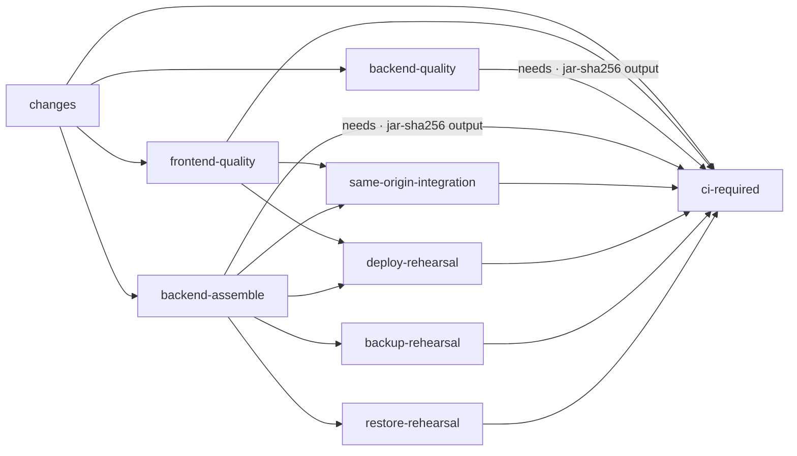
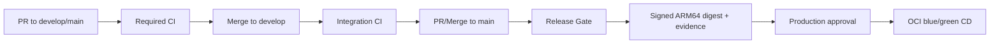

# BokriLog MVP CI 계획 (1.4.0)

> 1.4.0은 2026-11-18 기준 as-built 새 버전이다. 절 번호 §1~§18과 결정 이름 CI-D1~CI-D6은 1.3.0과 같다. 바뀐 절은 제목에 `[1.4 개정]`을 달았다. 구현되지 않은 계획은 지우지 않고 계약으로 남겼고, 항목마다 `미구현 — 주인 deferred <번호>`를 달았다. 바뀐 곳의 근거는 문서 끝의 변경 기록 절에 있다. job timeout은 실측 표(§3)와 보정 규칙·권장값(§10)만 적었고 `ci.yml` 값은 바꾸지 않았다. 권장값 적용은 deferred 205가 맡고, 그 값은 deferred 209가 이 문서 §10의 표로 보정했다. 같은 폴더의 `ARCHITECTURE-SPINE.md`·`PORTFOLIO-SOLUTION-DESIGN.md`(1.1), `../../EPIC-IMPLEMENTATION-READINESS-1.1.md`(`ERD-1.1.0`)와 함께 읽는다.
>
> 이 문서가 인용하는 파일 줄 번호(`ci.yml:496` 등)는 `develop` 커밋 `7d220a3` 기준이다.

## 1. 목적과 범위 [1.4 개정]

이 문서는 BokriLog의 CI 설계 정본이다. 현재 React/Vite·Spring Boot·PostgreSQL·Nginx 풀스택의 자동 검증부터 최종 ARM64 release candidate까지, 품질 게이트가 언제 어떻게 확장되는지를 고정한다.

CI는 코드를 운영 환경에 배포하지 않는다. 계획상 CI의 마지막 책임은 검증된 release evidence와 불변 image digest를 만드는 것이다. Production CD는 운영자 승인 뒤 그 digest를 다시 빌드하지 않고 OCI의 inactive 슬롯에 전달한다.

> as-built(1.4): CI는 release evidence도 image digest도 만들지 않는다. 미구현 — 주인 deferred 125. production CD workflow도 없다. 미구현 — 주인 deferred 207. 지금 CI의 마지막 책임은 병합 가능 여부 하나(`ci-required`)다. 운영 배포는 운영자가 `deploy/production/deploy.sh`로 하고, 그 gate가 release manifest를 소비 쪽에서 검사한다(CI-D4·§12).

이 문서는 workflow를 구현하지 않는다. 구현 계약은 CI chore SPEC(`spec-ci-foundation.md`·`spec-ci-critical-path.md`·`spec-ci-backend-assemble-job.md`·`spec-ci-test-forks.md`·`spec-ci-flaky-run-verdicts.md`)과 job을 더한 스토리 SPEC(1.2·3.7·3.8·3.9·3.10)이 소유한다.

### 실행 프로필 (as-built)

1.3.0이 적은 frontend-only 단일 `ci-required` job은 Story 1.2(PR #9, 2026-09-06)에서 병렬 구조로 갈렸다. 그 뒤 job이 더해져 지금은 아래 9개 job이다. 모두 `ubuntu-24.04`에서 돈다(`.github/workflows/ci.yml`).

| job | 하는 일 | 기다리는 job |
| --- | --- | --- |
| `changes` | PR merge commit 검증, committed-secret 검사, CI 스크립트 계약 시험, 변경 분류 | — |
| `frontend-quality` | typecheck·ESLint·stylelint·Prettier·build·Vitest·Chromium E2E, `dist` 업로드 | `changes` |
| `backend-quality` | Gradle `build`(컴파일·Modulith 경계·Testcontainers 시험·jar), jar SHA-256 output. jar는 올리지 않는다 | `changes` |
| `backend-assemble` | Gradle `bootJar`(시험 없음), jar SHA-256 output, jar 업로드. backend jar의 유일한 생산자 | `changes` |
| `same-origin-integration` | 경보 규칙 시험, 동일 출처 검증, Nginx origin Chromium 회귀 | `frontend-quality`·`backend-assemble` |
| `deploy-rehearsal` | 배포 gate 시험, blue/green 배포 리허설(Story 3.8) | `frontend-quality`·`backend-assemble` |
| `backup-rehearsal` | 백업 스크립트 시험, MinIO 백업 리허설(Story 3.9) | `backend-assemble` |
| `restore-rehearsal` | 복원 스크립트 시험, 격리 복원 리허설(Story 3.10) | `backend-assemble` |
| `ci-required` | 선행 8개 job의 결과와 jar digest 일치를 집계 | 위 8개 전부(`if: always()`) |

- **경로.** 문서-only 변경은 `changes`와 `ci-required`만 돈다. 제품 변경은 9개가 모두 돈다. 다만 PR의 변경이 전부 `frontend/**`·`_bmad-output/**`·최상위 `*.md`이면 `backup-rehearsal`·`restore-rehearsal`을 승인된 비적용으로 건너뛴다(§5). Frontend-only·backend-only 변경에서 반대편 품질 job을 건너뛰는 분류는 없다. 미구현 — 주인 deferred 202.
- **최대 동시 runner.** 1.3.0은 기본 PR 경로의 peak를 2개로 잡았다. 지금 제품 변경 run은 `changes` 뒤 3개가 열리고, `backend-assemble`이 끝나면 백업·복원 리허설이, `frontend-quality`까지 끝나면 통합·배포 리허설이 열린다. 구조상 최대는 5개(`backend-quality`·통합·배포·백업·복원)이고 2026-11-04~17 develop push 19회 중 18회가 그 5개에 닿았다(§3). 같은 PR의 이전 실행만 취소하고 다른 PR은 독립적으로 돈다.
- **시간 목표.** 1.3.0의 "PR wall-clock p95 8분"은 최적화 trigger로 그대로 둔다. 실측 제품 run은 중앙값 15.6분으로 목표를 넘는다(§3). 그 뒤 조정 순서와 남은 후보는 §10·§17에 있다. 목표 자체의 재설정은 deferred 208이다.
- Branch protection이 참조하는 이름은 전환 전후 모두 `ci-required`다. 이 job은 검사를 직접 하지 않고 판정만 한다(CI-D5).

## 2. 상속하는 아키텍처 불변식

이 계획은 다음 결정을 재해석하거나 약화하지 않는다.

| 상속 결정 | CI가 보존하는 계약 |
| --- | --- |
| AD-2·AD-3 | Java/Spring과 Spring Modulith 경계를 빌드·구조 시험으로 검증한다. |
| AD-4 | React/Vite 정적 SPA와 같은 origin의 `/api` 경계를 통합 시험한다. |
| AD-9 | 금융 계산은 `BigDecimal` 기반 고정 정책과 승인 예제로 재현한다. |
| AD-10·AD-11 | 인증·자격정보는 실제 secret 없이 stub으로 실패 경로와 redaction을 먼저 검증한다. |
| AD-12 | Worker drain, 단일 expand migration, inactive API 검증, Nginx cutover와 rollback 호환 순서를 보존한다. |
| AD-14 | JUnit, Testcontainers, provider stub, promtool, k6와 log 검증은 개발·CI 또는 통제된 배포 runner에서만 실행한다. |
| AD-15 | OCI A1 2 OCPU/12GB 운영 VM에서 build와 무거운 시험을 실행하지 않는다. |
| AD-20 | 모든 사용자 소유 aggregate의 교차 사용자 접근 차단을 통합 시험한다. |

## 3. 현재 기준선 [1.4 개정]

2026-11-18 기준 구현 상태는 다음과 같다. 1.3.0의 2026-09-04 frontend-only 기준선과 첫 Ubuntu 실측(전체 경로 55~97초)은 옛 문서(`../architecture-BokriLog-2026-08-24/CI-PLAN.md` §3)에 그대로 남는다.

- 제품 코드는 셋이다. `frontend/`는 React 19.2.x·Vite 8.2.x·TypeScript strict SPA다. `backend/`는 Java 25·Spring Boot 4.1.1·Gradle wrapper이고 시험은 PostgreSQL 18.6 Testcontainers를 쓴다. `deploy/`는 Nginx 동일 출처 compose(개발·CI)와 운영 배포·백업·복원 스크립트다.
- Node major는 `frontend/.nvmrc`의 24다. JDK는 `actions/setup-java`의 Temurin 25이고 Gradle toolchain 자동 프로비저닝은 꺼져 있다. 의존 버전의 권위 원본은 `frontend/package-lock.json`과 Gradle 빌드 스크립트다. Gradle dependency lockfile은 없다(§9·§10).
- 저장소는 private이고 계정은 GitHub Pro다. `ubuntu-24.04` 기본 러너는 2 vCPU다. PR #133에서 Gradle 시험 executor가 2개로 접힌 것으로 확인했다(`spec-ci-test-forks.md`).
- Ruleset `protect-integration-branches` 하나가 `develop`·`main`에 같은 규칙을 건다(§13, 2026-11-18 API 확인).
- 시험 수와 job별 단계는 각 SPEC과 실행 로그가 소유한다. 이 문서는 수를 적지 않는다.

### 실측 (2026-11-04~11-17 develop push)

출처는 2026-11-04~11-17 develop push run 36회다. PR #133(시험 fork 분할) 머지 run `41755502750`부터 PR #168 머지 run `44083728255`까지다. 그중 제품 변경 run은 19회이고 나머지 17회는 문서-only다. 두 run은 실패했다. `42134981077`은 `same-origin-integration`, `42549803177`은 `backup-rehearsal`이 실패했고 둘 다 `ci-run-verdicts.md`에 행이 있다. 표에는 결론이 `success`인 job 실행만 넣었고, 실패한 두 run의 다른 성공 job도 셌다. 그래서 n은 제품 job이 18~19이고, 문서-only run에서도 도는 `changes`·`ci-required`는 34~36이다. 값은 `completed_at − started_at`이고 단위는 분, 소수 첫째 자리까지다.

재현 절차는 다음과 같다. 스크립트는 저장소에 두지 않는다.

1. run 목록: `gh run list --workflow ci.yml --branch develop --event push --limit 80 --json databaseId,conclusion,createdAt` → `createdAt`의 날짜(UTC)가 2026-11-04~2026-11-17인 run. run 결론으로는 거르지 않는다.
2. run마다 job: `gh api 'repos/{owner}/{repo}/actions/runs/<databaseId>/jobs?per_page=50'` → `jobs[]` 중 `conclusion == "success"`인 것만. 단계는 각 job의 `steps[]` 중 `conclusion == "success"`인 것만.
3. 시간: job·단계마다 `completed_at − started_at`(초 ÷ 60). job 이름(`name`)별로 n·최소·중앙값·최댓값을 낸다.
4. run 단위 값: 결론이 `success`인 run만 쓴다. wall-clock은 `max(jobs[].completed_at) − run.createdAt`이다. 제품 변경 run은 `backend-quality`가 `success`인 run이다. 추정 billed 값은 job마다 올림한 분의 합이다.

**표본의 한계.** develop push의 성공 job뿐이다. PR run, 실패·취소된 job(예: 37분 멈춘 `backup-rehearsal`, 느린 apt 미러로 취소된 `frontend-quality` — `ci-run-verdicts.md`), cache miss가 난 실행은 표본에서 빠지거나 따로 가려지지 않았다. 그래서 최댓값은 정상 실행의 꼬리이지 최악이 아니다. 표가 p95 대신 최댓값을 쓰는 이유는 n≈18에서 p95가 상위 1건과 사실상 같기 때문이다.

| job | n | 최소 | 중앙값 | 최댓값 | 지금 job timeout |
| --- | ---: | ---: | ---: | ---: | ---: |
| `changes` | 36 | 0.2 | 0.2 | 0.4 | 5 |
| `frontend-quality` | 19 | 3.5 | 4.5 | 5.8 | 8 |
| `backend-quality` | 19 | 8.7 | 11.5 | 13.6 | 20 |
| `backend-assemble` | 19 | 0.5 | 0.8 | 1.4 | 8 |
| `same-origin-integration` | 18 | 6.9 | 7.8 | 8.8 | 20 |
| `deploy-rehearsal` | 19 | 6.1 | 8.0 | 8.6 | 30 |
| `backup-rehearsal` | 18 | 9.7 | 14.1 | 16.0 | 50 |
| `restore-rehearsal` | 19 | 4.2 | 5.2 | 6.7 | 40 |
| `ci-required` | 34 | 0.1 | 0.1 | 0.3 | 1 |

단계 timeout이 있는 단계와 각 job의 주 단계는 같은 출처로 다음과 같다.

| job → 단계 | n | 최소 | 중앙값 | 최댓값 | 지금 단계 timeout |
| --- | ---: | ---: | ---: | ---: | ---: |
| `frontend-quality` → `Vitest` | 19 | 1.8 | 2.3 | 2.8 | 4 |
| `frontend-quality` → `Chromium headless shell 설치` | 19 | 0.3 | 0.3 | 1.5 | 3 |
| `frontend-quality` → `Chromium E2E` | 19 | 0.3 | 0.4 | 0.5 | 4 |
| `backend-quality` → `Gradle 빌드` | 19 | 8.5 | 11.3 | 13.4 | 없음 |
| `backend-assemble` → `Gradle bootJar` | 19 | 0.3 | 0.6 | 1.2 | 없음 |
| `same-origin-integration` → `경보 규칙 시험` | 18 | 0.1 | 0.2 | 0.3 | 5 |
| `same-origin-integration` → `동일 출처 검증` | 18 | 2.2 | 2.4 | 2.6 | 없음 |
| `same-origin-integration` → `Chromium headless shell 설치` | 18 | 0.3 | 0.3 | 0.6 | 3 |
| `same-origin-integration` → `Story 1.1 회귀 (Nginx origin)` | 18 | 4.0 | 4.6 | 5.3 | 8 |
| `deploy-rehearsal` → `배포 gate 시험` | 19 | 0.3 | 0.5 | 0.6 | 3 |
| `deploy-rehearsal` → `배포 리허설` | 19 | 5.5 | 7.3 | 7.8 | 20 |
| `backup-rehearsal` → `백업 스크립트 시험` | 18 | 0.0 | 0.0 | 0.1 | 3 |
| `backup-rehearsal` → `백업 리허설` | 18 | 9.5 | 13.9 | 15.8 | 40 |
| `restore-rehearsal` → `복원 스크립트 시험` | 19 | 0.1 | 0.2 | 0.2 | 3 |
| `restore-rehearsal` → `복원 리허설` | 19 | 3.9 | 4.8 | 6.3 | 30 |

run 단위 값도 같은 출처에서 쟀다. 성공한 run만 셌고, run 생성부터 마지막 job 완료까지다.

| 값 | n | 최소 | 중앙값 | 최댓값 |
| --- | ---: | ---: | ---: | ---: |
| 제품 변경 run wall-clock(분) | 17 | 12.7 | 15.6 | 17.4 |
| 문서-only run wall-clock(분) | 17 | 0.4 | 0.4 | 0.6 |
| 제품 변경 run의 job별 올림 분 합(추정 billed runner-minute) | 17 | 48 | 57 | 63 |
| run 생성 → `changes` 시작 대기(초) | 17 | 2 | 3 | 4 |

제품 변경 run 17회 중 14회는 `backup-rehearsal`이 가장 늦게 끝났다. 임계 경로는 `changes → backend-assemble → backup-rehearsal`이다. 백업·복원 리허설을 건너뛰는 frontend-only PR의 임계 경로는 실측이 없어 추론이다. 중앙값으로 `changes → frontend-quality → deploy-rehearsal`(0.2 + 4.5 + 8.0 ≈ 12.7분)이 `backend-quality`(11.5분)보다 길다. 이 표가 §10 timeout 보정과 §17 재검토의 출발점이다. PR 경로의 실측은 따로 모으지 않았다. PR도 같은 그래프를 돌고 분류만 다르다(§5).

## 4. 채택한 CI 운영 모델 [1.4 개정]

### CI-D1 — 실행 기반

- **결정:** GitHub-hosted Actions를 사용한다.
- **금지:** OCI production VM을 self-hosted runner로 사용하지 않는다.
- **이유:** 소스·PR·status check를 한 시스템에서 연결하고, 매 실행을 깨끗한 runner에서 재현하며, Jenkins controller·agent·plugin을 1인 운영 범위에 추가하지 않는다. PR 코드를 production 자원·Docker socket·배포 secret과도 분리한다.

OCI를 배포 대상으로 쓰는 것과 CI runner를 GitHub에 두는 것은 충돌하지 않는다. CI가 검증·빌드·서명한 불변 artifact를 만들고, 별도 권한의 CD가 OCI로 전달한다.

| 개발자 관점 | GitHub Actions | Jenkins | BokriLog 판단 |
| --- | --- | --- | --- |
| PR 연동 | GitHub check·ruleset과 직접 연결 | webhook, credential과 plugin 구성이 필요 | Actions 우세 |
| 운영 부담 | hosted runner와 관리형 실행기 | controller, agent, plugin, backup·patch 운영 | 1인 MVP에는 Actions 우세 |
| 격리·재현 | 실행마다 깨끗한 hosted 환경 | agent image와 workspace 청소를 직접 보장 | Actions 우세 |
| 특수 환경 | hosted runner 제약, 필요 시 전용 runner | 폐쇄망·특수 hardware·복잡한 사내 연동에 유연 | 현재는 불필요, 성장 시 Jenkins 재검토 |
| OCI 배포 | OIDC/credential을 분리한 후 OCI 호출 가능 | OCI 호출 가능 | 둘 다 가능하며 배포 대상은 선택 기준이 아님 |
| 비용 | 사용량과 private repo quota 관리 | 인프라·운영시간까지 직접 부담 | 현재 작은 팀·짧은 CI에는 Actions 우세 |

따라서 Jenkins가 기능적으로 부족해서 제외한 것이 아니다. 현재 팀 규모와 코드 호스팅 위치에서는 Jenkins의 자유도보다 운영 표면적이 더 큰 비용이므로 GitHub Actions를 선택한다.

### CI-D2 — 세 실행 경로 [1.4 개정]

| 경로 | 목적 | 배포 권한 | 초기 시간 목표 |
| --- | --- | --- | ---: |
| PR 필수 CI | 병합 전 빠른 결함 차단 | 없음 | 중앙값 3분 이하, p95 5분 이하 |
| `develop` 통합 CI | 실제 merge commit과 넓은 호환성 검증 | 없음 | p95 10분, timeout 20분 |
| `main` Release Gate | CD가 소비할 불변 artifact와 증거 생성 | registry write만 | p95 20분, timeout 40분 |

시간 목표는 GitHub Actions 측정값으로 재보정한다. 예산을 넘는다는 이유로 필수 보안·계산 계약을 제거하지 않고 job 경계, 캐시, 실행 빈도와 병렬 구조를 조정한다.

> as-built(1.4): 세 경로는 아직 하나의 그래프다. PR(`develop`·`main` 대상), push(`develop`·`main`), `workflow_dispatch`가 모두 §1의 같은 job 그래프를 돌고, 차이는 `changes`의 분류뿐이다. push·dispatch의 제품 변경은 백업·복원 리허설을 항상 돈다(§5).
> - `develop` 통합 CI가 PR보다 더 넓게 보는 호환성 검증(WebKit)은 없다. 미구현 — 주인 deferred 13.
> - `main` Release Gate 경로는 없다. 미구현 — 주인 deferred 207. 그 경로가 만들 `Signed ARM64 digest + evidence`도 없다. 미구현 — 주인 deferred 125.
> - 시간 목표: §3 실측의 제품 변경 run은 중앙값 15.6분·최댓값 17.4분이다. PR 필수 CI 목표(중앙값 3분·p95 5분)와 통합 CI 목표(p95 10분)를 모두 넘는다. 1.4는 목표를 재보정하지 않고 실측만 적는다. 목표 재설정은 미구현 — 주인 deferred 208. 그때까지 조정은 §10의 순서를 따른다. job timeout은 목표가 아니라 멈춘 job을 끊는 상한이고, job마다 다르다(§3·§10).

### CI-D3 — 기능과 함께 성장하는 게이트

존재하지 않는 backend, container 또는 Terraform을 미리 흉내 내지 않는다. 새 기능의 완료 PR은 그 기능 코드, 자동시험과 필요한 CI 게이트를 함께 추가한다. 구현되지 않은 미래 게이트는 이 문서의 계약으로만 유지한다.

### CI-D4 — 하나의 검증 가능한 release identity [1.4 개정]

- **정본:** `registry/repository@sha256:<digest>` 형식의 `linux/arm64` 단일 OCI manifest가 release subject다.
- API와 Worker는 역할 인자만 다르고 같은 subject를 실행한다.
- migration은 같은 image의 불변 경로에서 실행하며 그 bytes의 `migration_artifact_digest`를 별도로 기록한다. CD 서버의 checkout이나 이동 가능한 tag에서 migration을 가져오지 않는다.
- SBOM, provenance, 시험 요약과 migration attestation은 모두 이 subject를 참조한다.
- versioned canonical JSON evidence를 승인된 CI workload identity로 서명한다. CD는 evidence 문자열이 아니라 digest, 서명, issuer, workflow identity와 subject를 검증한다.

> as-built(1.4): CI의 ARM64 image build·SBOM·서명·evidence 생성은 미구현 — 주인 deferred 125. 소비 쪽만 있다. 운영 배포 gate `deploy/production/preflight.sh`가 release manifest(`deploy/production/release.env.example` 형식)의 `<repo>@sha256:` image, `platform=linux/arm64`, migration 버전·종류, SBOM·서명 파일 SHA-256을 검사한다. 실제 이미지 아키텍처와 `cosign verify`·`cosign verify-attestation --type spdxjson`도 본다. CI 리허설(`--rehearsal`)은 실제 아키텍처·cosign 검사 셋을 건너뛴다(Story 3.8). API·Worker가 같은 jar를 `BOKRILOG_ROLE`로 나눠 쓰는 것은 구현됐다(SPINE 1.1).

### CI-D5 — 고정된 required gate 판정 [1.4 개정]

Branch protection은 이름이 고정된 `ci-required` 하나를 참조한다. 이 job은 `needs`에 모든 선행 job을 명시하고 `if: always()`로 실행되는 짧은 aggregator다. 계획의 `not_applicable`은 GitHub 고유 상태가 아니라 classifier가 출력한 승인 사유 enum이다. 실제 `skipped`는 그 사유와 예상 목록이 일치할 때만 허용하며 `failure`, `cancelled`, `not_run`, 빈 값과 예상하지 않은 `skipped`는 실패다.

PR에서는 첫 job이 이벤트가 고정한 `github.sha`를 checkout하고 이를 `merge_sha`로 기록한다. `pull_request` 이벤트의 `github.sha`가 곧 그 시점의 merge commit이다. `refs/pull/<PR 번호>/merge`를 다시 해석하지 않는다. 그 ref는 움직이므로 이벤트보다 새 merge commit을 집을 수 있다. 이 commit의 두 parent가 `base_sha`와 `head_sha`인지 확인하며, 부모를 읽으려면 checkout의 `fetch-depth`가 2 이상이어야 한다. merge commit이 없거나 부모가 일치하지 않으면 실패한다. 모든 후속 job은 움직이는 ref가 아니라 이 정확한 `merge_sha`를 checkout한다. Aggregator는 최소 `pull-requests: read` 권한으로 현재 head와 target base를 다시 조회하고 둘 중 하나가 바뀌었거나 조회가 실패하면 fail-closed한다. Aggregator timeout은 1분이다. `develop`·`main` push 경로는 synthetic merge 없이 event의 정확한 `commit_sha`를 사용한다.

> as-built(1.4): 구현된 것은 다음과 같다.
> - `ci-required`는 8개 job을 모두 `needs`에 두고 `if: ${{ always() }}`, timeout 1분, `contents: read`로 돈다. 판정은 `.github/scripts/aggregate-results.sh`가 한다(`ci.yml:764-800`).
> - 통과는 `success`와 "예상한 `skipped`" 둘뿐이다. 기대치는 `docs-only`가 정하고, 백업·복원 리허설 둘만 `backup-restore`를 따로 본다. 빈 값은 옛 분류기로 보고 `success`를 기대한다. 그 밖의 값은 실패로 세고 가장 엄격한 `success`를 기대한다. `changes`가 실패하면 원인 하나만 보고하고 끝난다(`aggregate-results.sh:98-170`).
> - 판정은 하나 더 있다. `backend-assemble`·`backend-quality`가 모두 `success`이면 두 job output `jar-sha256`이 둘 다 소문자 64자 hex이고 같아야 한다(`aggregate-results.sh:214-254`, `spec-ci-backend-assemble-job.md`).
> - PR merge commit의 부모 검증은 `.github/scripts/verify-merge-commit.sh`가 한다. 부모 둘이 이벤트의 base·head와 순서까지 같아야 하고, 아니면 종료 1과 `::error::`다(`verify-merge-commit.sh:28-45`). `changes`는 `fetch-depth: 0`으로 checkout한다. 분류와 gitleaks의 commit 범위 스캔이 전체 이력을 요구하기 때문이다(`spec-ci-foundation.md`).
> - 모든 job은 각자 같은 `github.sha`를 checkout한다. push·dispatch도 이벤트의 `github.sha`다.
>
> 미구현은 둘이다. 첫 job이 `merge_sha`를 output으로 내 후속 job에 넘기는 것, 그리고 aggregator가 head·base를 다시 조회하는 것(`pull-requests: read`)이다. 미구현 — 주인 deferred 201. 지금 head가 바뀌면 같은 PR의 이전 실행을 `concurrency`가 취소하고, base가 바뀌면 ruleset의 strict 필수 검사가 최신 base와의 통합을 요구한다. 이 둘이 재조회를 대신하는 것은 아니다.

### CI-D6 — release 생성과 production 배포의 분리 [1.4 개정]

여러 release candidate build는 병렬로 수행할 수 있다. Production promotion/CD는 environment별 durable deployment lease와 fencing token으로 직렬화하고, migration 직전부터 관찰 성공 또는 rollback 완료까지 lock을 유지한다. 실행 중인 production job은 더 새 commit 때문에 자동 취소하지 않는다.

> as-built(1.4): CI에는 release candidate(image) build가 없다. 미구현 — 주인 deferred 125. production promotion·CD workflow도 없다. 미구현 — 주인 deferred 207. 운영 배포는 운영자가 `deploy/production/deploy.sh`를 실행한다. 배포·백업·복원·tombstone 내보내기는 `state_dir/.lock` 하나로 직렬화한다(Story 3.8~3.10, PSD 1.1 §8). CI의 `deploy-rehearsal`은 그 절차를 일회성 스택에서 리허설할 뿐이고, green은 운영 배포의 증거가 아니다.

## 5. 이벤트와 브랜치 정책 [1.4 개정]

| 이벤트 | 실행 경로 | 설명 | as-built(1.4) |
| --- | --- | --- | --- |
| feature branch push, PR 없음 | 실행하지 않음 | 로컬 반복까지 hosted minute을 소비하지 않는다. | 구현. 트리거는 `develop`·`main` 대상 `pull_request`와 `push`, `workflow_dispatch`뿐이다(`ci.yml:56-63`). |
| PR → `develop` | PR 필수 CI | feature·fix·chore·docs 병합 전 검증이다. | 구현. 제품 변경은 §1의 9개 job, 문서-only는 `changes`·`ci-required` 둘이다. |
| push → `develop` | 통합 CI | 실제 merge commit을 재검증한다. | 제품 변경이면 PR과 같은 9개 job이고 `backup-restore=true`라 백업·복원 리허설도 항상 돈다. 문서-only push는 `changes`·`ci-required` 둘뿐이다. 넓은 호환성(WebKit)은 미구현 — 주인 deferred 13. |
| PR → `main` | PR 필수 CI + release validation | release·hotfix의 출시 가능성을 검증한다. | PR 필수 CI만 돈다. `release-validation`은 미구현 — 주인 deferred 207. 분류기는 target branch를 보지 않으므로 frontend·문서만 바뀐 release PR은 `backup-restore=false`로 백업·복원 리허설을 건너뛴다. 계획의 "`main`은 전체 gate"보다 약하다. 미구현 — 주인 deferred 206. |
| push → `main` | Release Gate | 배포하지 않고 release candidate를 만든다. | `develop` push와 같다(제품 변경 9개 job, 문서-only는 `changes`·`ci-required` 둘). Release Gate 경로는 미구현 — 주인 deferred 207, 그 산출물(image·SBOM·서명·evidence)은 미구현 — 주인 deferred 125. |
| 수동 진단 | 배포 권한 없는 선택 검사 | 임의 ref를 진단할 수 있지만 release evidence나 배포 입력이 될 수 없다. | 구현(`workflow_dispatch`). 비교 기준이 없어 `no-comparison-base`로 전체를 돈다. |
| 수동 release 재생성 | 보호된 `main` SHA의 Release Gate | 임의 ref·외부 evidence URL을 금지하고 최초 실행과 같은 계약을 적용한다. | 미구현 — 주인 deferred 207. |

Story 3.8에서 여는 `main` PR의 `release-validation`은 일반 품질·same-origin 검사가 끝난 뒤 한 job으로 실행한다. WebKit, migration/rollback 호환과 ARM64 build 가능성을 검증하되 registry push·서명·production secret 사용은 금지한다. Timeout은 15분이다. `ci-required`는 이 결과까지 기다린다. WebKit 필수 검사가 준비되기 전에는 Production Release Gate를 활성화하지 않는다.

> as-built(1.4): Story 3.8은 `release-validation`을 열지 않았다. 미구현 — 주인 deferred 207. 그 job이 볼 ARM64 build 가능성은 125의 image build가 생겨야 의미가 있다. migration·rollback 호환의 일부(전환 전·후 실패 rollback·contract 거부)는 `deploy-rehearsal`이 모든 제품 변경에서 리허설한다. Story 3.8 SPEC과 `rehearse-deploy.sh`가 그 시나리오를 소유한다.

일반 release PR은 target이 최신 `develop`의 descendant이고 해당 통합 CI가 성공했음을 검증한다. 긴급 hotfix는 별도 승인과 사유를 요구하고 merge 뒤 `develop` backport를 추적한다. 상태 조회 실패, ancestry 불일치 또는 실패한 통합 상태는 `main` aggregator와 Release Gate를 중단한다.

> as-built(1.4): release PR의 descendant·통합 상태 검증은 미구현 — 주인 deferred 207.

`pull_request.branches`는 source branch가 아니라 PR의 target branch를 뜻한다. 기본 trigger는 `pull_request`와 `push`의 `develop`, `main`, 그리고 `workflow_dispatch`다.

Required workflow 전체에는 top-level `paths` 필터를 적용하지 않는다. workflow가 생략돼 status가 생성되지 않는 분기를 막는다. `test-ci-scripts.sh`가 `paths`·`paths-ignore`가 없음을 단정한다. 변경 경로는 `changes` job이 분류하고 `ci-required`가 그 분류로 기대치를 정한다.

### 변경 분류 (as-built)

`changes`의 `변경 분류` 단계가 `.github/scripts/classify-changes.sh`를 실행해 출력 셋을 낸다. 같은 값을 `GITHUB_OUTPUT`과 job summary에 남기고, 종료 코드는 항상 0이다.

| 출력 | 값 | 판정 |
| --- | --- | --- |
| `docs-only` | `true`·`false` | 바뀐 경로가 전부 `_bmad-output/**` 또는 최상위 `*.md`(슬래시 없는 경로)일 때만 `true`다. `.github/**`·`frontend/**`·`backend/**`·`deploy/**`·`_bmad/**`·`scripts/**`·lockfile·최상위의 `.md` 아닌 파일은 모두 `false`다(`classify-changes.sh:118-142`). |
| `reason` | `docs-only`·`product-change`·`no-comparison-base`·`empty-diff` | 비교 기준이 없거나(dispatch·브랜치 신규 생성·사라진 `before`·git 실패) diff가 비면 `docs-only=false`다(`classify-changes.sh:63-116`). |
| `backup-restore` | `true`·`false` | PR이고 바뀐 경로가 전부 건너뛰기 목록(`frontend/**`·`_bmad-output/**`·최상위 `*.md`) 안일 때만 `false`다. 목록 밖 경로·비교 기준 없음·빈 diff·push·dispatch는 `true`다(`classify-changes.sh:18-25,144-148`, `spec-ci-critical-path.md`). |

- 비교 기준은 PR이면 검증된 merge commit의 첫 부모, push면 `github.event.before`(0이 아니고 저장소에 있을 때)다.
- `git diff --no-renames -z`라서 rename은 변경 전·후 경로가 모두 평가된다. 한글·공백 경로는 `core.quotePath=false`와 NUL 구분으로 바이트 그대로 읽는다.
- PR에서는 체크아웃된 head가 아니라 target base의 승인된 분류기(`git show <base_sha>:.github/scripts/classify-changes.sh`)를 실행한다. base에 없으면 head의 정의를 쓰고 경고를 남긴다(`ci.yml:156-189`). 그 선택 블록은 `test-ci-scripts.sh`가 `ci.yml`에서 직접 단정한다.
- 백업·복원 게이트는 `!= 'false'`다. 출력을 모르는 옛 분류기의 빈 값이면 돈다.
- 분류기는 PR의 target branch를 보지 않는다(`classify-changes.sh:144-148`은 이벤트 이름만 본다). 그래서 `main` 대상 release·hotfix PR도 frontend·문서만 바뀌면 백업·복원 리허설을 건너뛴다. 미구현 — 주인 deferred 206.

| 변경 분류 | PR 필수 job | `develop` 통합 job | `main` release job | as-built(1.4) |
| --- | --- | --- | --- | --- |
| 제품 frontend | frontend 품질·Chromium | frontend 품질·Chromium·활성화 후 WebKit | frontend 품질·Chromium·WebKit·release validation | 제품 job 9개가 돈다. PR에서 변경이 전부 `frontend/**`·문서이면 백업·복원 리허설만 건너뛴다(`main` 대상 PR도 같다 — 206). 반대편(backend) 비적용은 미구현 — 주인 deferred 202. WebKit은 13, release validation은 207이다. |
| backend/API/DB | backend 품질·관련 통합 | backend·DB·same-origin 통합 | 전체 제품·migration·release validation | 9개 job 전부다. frontend 비적용은 미구현 — 주인 deferred 202. 리허설을 백엔드 PR의 필수 경로에서 뺄지는 deferred 164다. |
| deploy/image/migration | 관련 전체 제품·배포 정적 검증 | 전체 통합 | 전체 release gate | 9개 job 전부다. release gate 경로는 207, 그 산출물은 125다. |
| 문서만 | 문서/BMAD 검사, 제품 job은 승인된 비적용 | 동일 | release artifact를 만들지 않음 | 구현. `changes`(secret 검사·CI 계약 시험·분류)와 `ci-required`만 돈다. BMAD 검사는 미구현 — 주인 deferred 16. |

Workflow, classifier, lockfile, Dockerfile, migration, deploy 또는 build/test script가 바뀌면 `문서만`으로 분류할 수 없고 관련 전체 gate를 강제한다. 분류 규칙과 허용 사유 enum은 workflow 구현 SPEC의 시험 대상이다. 지금은 `test-ci-scripts.sh`가 임시 git fixture로 고정한다.

하나의 변경이 여러 분류에 속하면 예상 job의 합집합을 실행하며 우선순위로 범위를 줄이지 않는다. Rename·삭제는 변경 전 경로와 변경 후 경로를 모두 평가한다. 분류 실패나 알려지지 않은 경로는 관련 전체 gate를 실행하는 fail-closed 상태다. Frontend-only와 backend-only 변경은 반대편을 승인된 비적용 상태로 둘 수 있지만 API 계약, 공통 설정, workflow, lockfile, build/test script는 양쪽 관련 gate를 강제한다. Classifier와 그 규칙을 바꾸는 PR은 target base의 승인된 정의로 감지해 전체 관련 gate를 실행하며, PR이 수정한 classifier가 자기 검사를 축소할 수 없다.

> as-built(1.4): 위 문단 가운데 "반대편을 승인된 비적용 상태로 둘 수 있다"만 미구현 — 주인 deferred 202. 나머지(합집합·rename 양쪽·fail-closed·base의 승인된 분류기)는 구현됐다. 백업·복원 리허설 분류는 허용 목록이 아니라 건너뛰기 목록이다. 새 경로가 조용히 리허설을 건너뛰지 않게 하려는 것이다.

같은 PR에 새 commit이 오면 이전 PR 검사는 concurrency group으로 취소한다. Group key는 workflow identity와 target branch·PR 번호를 함께 포함해 같은 PR의 이전 실행만 취소하고 다른 PR은 독립적으로 진행한다. `develop` push, `main` Release Gate, 수동 진단과 production CD는 서로 다른 group을 사용한다. 취소된 이전 실행 결과는 merge 판단이나 artifact 발행에 사용할 수 없으며, production CD에는 자동 취소를 적용하지 않는다.

> as-built(1.4): group은 `workflow-event_name-(PR base ref 또는 github.ref)-(PR 번호 또는 run_id)`다. `cancel-in-progress`는 `pull_request`에서만 켜진다. push·dispatch는 run마다 group이 달라 서로 취소하지도 직렬화하지도 않는다(`ci.yml:71-77`). Release Gate·production CD의 group은 그 경로가 없어 해당 없다(207).

## 6. 현재 단계의 필수 CI [1.4 개정]

1.3.0의 첫 구현은 하나의 `ci-required` job이었다. Story 1.2가 그것을 §1의 구조로 나눴다. 아래는 `changes`와 `frontend-quality`의 as-built 단계다. 나머지 job의 단계와 timeout은 §8이 적는다.

`changes` (timeout 5분):

1. 저장소 checkout — `ref: github.sha`, `fetch-depth: 0`, `persist-credentials: false`
2. PR merge commit 검증 — PR에서만, `verify-merge-commit.sh`
3. committed-secret 검사 — gitleaks(§11)
4. CI 스크립트 계약 시험 — `test-ci-scripts.sh`, 조건 없이 분류 앞에서
5. 변경 분류 — target base의 승인된 분류기(§5)

`frontend-quality` (timeout 8분, `docs-only != 'true'`):

1. 저장소 checkout(`ref: github.sha`)
2. `frontend/.nvmrc` 기준 Node 24 준비와 `frontend/package-lock.json` 기준 npm 다운로드 캐시
3. `npm --prefix frontend ci --prefer-offline --no-audit --fund=false`
4. `npm --prefix frontend run typecheck`
5. `npm --prefix frontend run lint` — ESLint(타입 인지). 경고도 실패다
6. `npm --prefix frontend run lint:css` — stylelint. `DESIGN.md` 네 범주의 토큰 참조 강제
7. `npm --prefix frontend run format:check` — Prettier 서식 검사
8. `npm --prefix frontend run build`
9. Vitest — 단계 timeout 4분(2분 → 4분, PR #87)
10. `npm --prefix frontend exec -- playwright install chromium --with-deps --only-shell` — 단계 timeout 3분(`spec-ci-flaky-run-verdicts.md`)
11. 이미 생성한 `dist`를 대상으로 CI 모드 Playwright(`test:e2e:run`) — 단계 timeout 4분
12. 통합 입력 업로드(`frontend-dist-<run_id>-<run_attempt>`, retention 1일, `if-no-files-found: error`, `overwrite: false`) — producer 성공 조건이다
13. 실패·timeout·취소 시 report, trace와 screenshot 업로드(retention 7일)

`test:e2e`는 `vite build && playwright test`이므로 CI에서 명시적인 build 단계와 함께 실행하면 동일한 build가 중복된다. 그래서 로컬 완결 명령 `test:e2e`를 유지한 채 `playwright test`만 수행하는 `test:e2e:run`을 분리했다(2026-09-04 적용). CI는 11번 단계와 `same-origin-integration`의 회귀 단계에서 `test:e2e:run`을 쓴다.

### 초기 실행 설정 [1.4 개정]

- Hosted image는 Playwright 지원 Ubuntu 고정 버전 `ubuntu-24.04`다. `ubuntu-latest`는 쓰지 않는다.
- Workflow token은 top-level과 모든 job에서 `contents: read`다. `changes`만 `pull-requests: read`를 더한다. 변경 분류가 아니라 gitleaks-action의 PR commit 목록 조회 때문이다.
- 변경 분류는 `fetch-depth: 0`과 `git diff`를 쓴다(`spec-ci-foundation.md`의 선택). 다른 job은 기본 얕은 checkout이다.
- 분류 규칙을 target base에서 읽을 때는 `git show <base_sha>:<경로>`를 쓴다(§5).
- PR에는 repository, environment 또는 provider secret을 전달하지 않는다. workflow가 쓰는 비밀은 gitleaks에 넘기는 `github.token` 하나다.
- `pull_request_target`은 쓰지 않는다.
- npm·Gradle 다운로드 캐시만 쓰고 `node_modules`는 캐시하지 않는다.
- Playwright browser cache는 없다. §3 실측의 설치 단계는 중앙값 0.3분이다. 느린 apt 미러의 꼬리(관측 5분 44초·6분 23초, `ci-run-verdicts.md`)는 단계 상한 3분이 이름 있는 실패로 끊는다.
- `--only-shell` 설치는 어느 project도 `channel`을 지정하지 않을 때만 성립한다. Playwright는 channel 없는 headless Chromium을 `chromium-headless-shell`로 해석한다. `channel: 'chromium'`을 추가하거나 headed 실행을 필수 경로에 넣으면 설치와 실행이 어긋나므로 그때는 전체 Chromium을 설치한다.
- 1.3.0은 "PR build의 `dist`는 보관하지 않는다"고 적었다. 지금 `dist`는 통합·배포 리허설의 입력이므로 성공 실행에서도 retention 1일로 올린다. 장기 보존하지 않는다는 원칙(§10-6)은 그대로다.
- 실패 진단 artifact만 7일 보관한다.
- Required Playwright 실행은 retry 0이고 최초 실패부터 trace를 `retain-on-failure`, screenshot을 `only-on-failure`로 보존한다. 재시도는 배포 권한 없는 별도 진단 실행에서 `--retries=N`으로만 덮어쓴다(`frontend/playwright.config.ts:96-127`).
- `globalTimeout`은 자체 preview(`frontend-quality`)에서 180초, 주입된 origin(`same-origin-integration`, `PLAYWRIGHT_BASE_URL`)에서 420초다. 각각 단계 timeout 4분·8분보다 짧아 진단 업로드 시간을 남긴다. 420초는 Story 2.11(300초)과 2.17(420초)이 올린 값이다.
- 외부 action은 full commit SHA로 고정한다. 허용 집합은 `actions/checkout`·`setup-node`·`setup-java`·`upload-artifact`·`download-artifact`와 `gitleaks/gitleaks-action`이다. `test-ci-scripts.sh`가 "모든 `uses`가 40자리 SHA"와 action@SHA 집합을 단정한다(`test-ci-scripts.sh:1711-1717`).
- timeout은 `frontend-quality` job 8분, Vitest 4분, Chromium 설치 3분, E2E 4분이다. 1.3.0의 시작값은 job 8분·Vitest 2분·Playwright 4분이었다. Timeout은 실패이며 report·trace·screenshot 등 비밀정보가 없는 자료를 업로드한다. 실측과 권장값은 §3·§10에 있다.

ESLint 10(typescript-eslint strict·stylistic 타입 인지, React hooks·refresh, perfectionist import 정렬, 파일군별 Vitest·Testing Library·Playwright), stylelint 17(`stylelint-config-standard` + `declaration-strict-value`로 `DESIGN.md` 네 범주의 토큰 참조 강제), Prettier 3을 `frontend/`에 도입했다. 이 셋은 2026-09-05 `spec-frontend-lint-policy.md`에서 필수 단계로 승격됐고 지금은 `frontend-quality`의 5~7번 단계다. 규칙이 실제로 위반을 잡고 준수 코드를 통과시키는지는 `frontend/lint-policy.test.ts`가 Vitest 단계에서 fixture로 고정한다. 인라인 예외는 이유가 붙은 disable 주석만 허용하며 이유 없는·불필요한·범위가 틀린 disable은 양쪽 도구에서 오류다. 정적 접근성 검사(`eslint-plugin-jsx-a11y`)는 ESLint 10 peer 미지원으로 제외했고 `deferred-work.md`에 남겼다. 렌더 결과의 접근성은 기존 E2E axe 검사가 담당한다.

## 7. 브라우저 실행 정책 [1.4 개정]

| 실행 경로 | Chromium | WebKit | Firefox·OS matrix |
| --- | --- | --- | --- |
| PR → `develop` | 필수 | 미실행 | 미실행 |
| push → `develop` | 필수 | 초기 advisory, 승격 후 필수 | 미실행 |
| PR → `main` | 필수 | 필수 | 미실행 |
| Release Gate | 필수 | 필수 | 미실행 |

Chromium은 모든 PR의 빠른 회귀 게이트다. 초기 CI에서는 Chromium만 required로 둔다. WebKit은 `develop`에서 advisory로 시작하고, 10회 실행에서 제품 실패를 가리지 않는 안정성과 통합 p95 10분 예산을 확인한 뒤 required로 승격한다. 이 측정에서 critical path, 브라우저 설치 중복과 billed runner-minute을 비교해 frontend job 내부 실행과 별도 browser job 중 더 작은 방식을 선택하며, 별도 job이면 최대 동시 runner 예산도 따로 정한다. `main` release 전에는 반드시 required여야 한다. 모바일 우선 UX의 `100dvh`, safe-area, `focus-visible`, 확대·리플로 위험을 다루되 실제 iPhone Safari 검증을 대체했다고 간주하지 않는다.

> as-built(1.4): `frontend/playwright.config.ts`의 project는 `chromium`(Desktop Chrome) 하나다. Chromium은 모든 제품 변경 경로에서 두 번 돈다. `frontend-quality`는 자체 preview를, `same-origin-integration`은 Nginx origin을 대상으로 한다. 위 표의 WebKit 칸은 모든 경로에서 미구현 — 주인 deferred 13. `main` 경로의 Release Gate는 207이다.

Firefox나 Windows·macOS runner는 지원 브라우저 정책, 실제 결함 또는 사용자 비율이 필요성을 보일 때 추가한다. 단순한 조합 확대는 CI 시간 예산을 소비할 근거가 아니다.

## 8. 기능 구현 단계별 확장 [1.4 개정]

| 도입 시점 | CI에 추가하는 검증 | 계획한 실행 위치 | as-built(1.4) |
| --- | --- | --- | --- |
| Story 1.1 | TypeScript, Vite build, Vitest, Chromium 접근성·키보드·리플로·네트워크·저장소 E2E | 단일 `ci-required` | `frontend-quality` |
| Story 1.2 완료 전 (2026-09-05) | ESLint·stylelint·format check와 정책 시험(`lint-policy.test.ts`) | 단일 `ci-required`, 이후 frontend 품질 | `frontend-quality` |
| Story 1.2 | Java 25, Gradle, Spring Boot build/test, Nginx root·`/api`·오류, Story 1.1 회귀 | `backend-quality`, `same-origin-integration` | 같음. 동일 출처 검증은 `deploy/compose/verify-same-origin.sh --keep-stack`이다 |
| Story 1.3 이후 | PostgreSQL Testcontainers, migration, schema validation, 교차 사용자·삭제 상태 | backend/integration | `backend-quality`의 `Gradle 빌드` 한 단계 안. 별도 단계·서비스 컨테이너 없이 러너의 docker 데몬을 쓴다 |
| Story 1.4~1.11 | OIDC stub, state·nonce·PKCE·JWS, 세션 회전, redaction, 삭제 경로 | backend/integration | `backend-quality`. 브라우저 성공 왕복은 `same-origin-integration`(`dev-oidc` 스텁, 주입 origin) |
| Epic 2 | Bybit stub, pagination·rate limit·미인식 사건, 결정적 `BigDecimal` 계산, publication·fencing | backend/integration | `backend-quality`와 `same-origin-integration` |
| Story 3.7 | telemetry golden, 고카디널리티·민감정보 누출, promtool rule test | observability 검사 | 누출·allowlist 시험은 `backend-quality`. promtool은 `same-origin-integration`의 `경보 규칙 시험`(`check-alert-rules.sh`, 단계 5분) |
| Story 3.8 | ARM64 build·boot smoke, SBOM·서명, migration·rollback 호환, 제한된 k6 | Release Gate | `deploy-rehearsal`이 gate 고정 입력과 blue/green 리허설(migration·rollback 시나리오)을 모든 제품 변경에서 돈다. ARM64 build·boot smoke·SBOM·서명은 미구현 — 주인 deferred 125, 제한된 k6는 미구현 — 주인 deferred 207 |
| Story 3.9 | — | — | `backup-rehearsal`(MinIO 두 개, `backup.sh` 시나리오). green은 실저장소의 증거가 아니다 |
| Story 3.10 | — | — | `restore-rehearsal`(격리 복원 리허설). green은 실제 복원의 증거가 아니다 |
| Epic 4~5 | 광고 fail-open과 삭제·복원 자동시험; 실제 승인·훈련은 별도 launch gate | integration/release | `backend-quality`·`same-origin-integration`(주입 origin 삭제 왕복 e2e)·`restore-rehearsal`. 실제 승인·훈련은 출시 게이트(G-4·G-5)다 |
| CI 임계 경로 chore (2026-10-15) | 백업 리허설을 `deploy-rehearsal`에서 떼고 `backup-restore` 분류 도입 | — | `backup-rehearsal`이 `backend-assemble`만 기다린다(`spec-ci-critical-path.md`) |
| CI jar 생산자 chore (2026-11-03) | backend jar 생산자 분리와 digest 대조 | — | `backend-assemble`과 `ci-required`의 jar SHA-256 판정(`spec-ci-backend-assemble-job.md`) |
| CI 시험 fork chore (2026-11-04) | 백엔드 시험 JVM 분할 | — | `maxParallelForks = 3`, CI 러너는 fork 2(`spec-ci-test-forks.md`) |
| Epic 5 회고 AI-4 (2026-11-10) | Chromium 설치 단계 상한과 비-green 실행 원장 | — | 두 설치 단계 3분, `ci-run-verdicts.md`(`spec-ci-flaky-run-verdicts.md`) |

### Story 1.2 이후 job 구조 [1.4 개정]

상단 실행 프로필의 두 품질 job은 첫 job이 검증한 동일한 `head_sha`, `base_sha`와 PR merge-ref의 실제 `merge_sha`를 입력받아 그 commit을 checkout한다. Frontend는 기존 `dist`와 identity·producer·digest metadata를, backend는 실행 가능한 artifact와 같은 metadata를 전달한다. 이름에는 workflow run ID, run attempt, PR 번호와 `merge_sha`를 포함하고 overwrite를 금지한다. 시험 성공뿐 아니라 필요한 digest 생성과 upload까지 producer 성공 조건이며 하나라도 실패하면 job을 실패시킨다.

> as-built(1.4): 생산자는 둘이다. `frontend-quality`가 `frontend-dist-<run_id>-<run_attempt>`를, `backend-assemble`이 `backend-jar-<run_id>-<run_attempt>`를 올린다. 둘 다 retention 1일, `if-no-files-found: error`, `overwrite: false`이고, upload 실패는 그 job의 실패다. 이름에 PR 번호·`merge_sha`가 없고 producer·digest metadata도 함께 가지 않는다. job은 output이 아니라 각자 `github.sha`를 checkout한다. 미구현 — 주인 deferred 201. 이름에 `run_attempt`가 들어가 `Re-run failed jobs`로는 복구할 수 없다. 재실행은 `Re-run all jobs`다(deferred 19).

`same-origin-integration`은 현재 run의 두 artifact만 내려받아 producer, run, SHA와 checksum을 검증하며 다시 build하지 않는다. 취소되거나 대체된 실행의 artifact는 재사용하지 않는다. Integration 입력은 해당 검사가 필요한 run에만 만들고 retention은 1일로 제한한다.

> as-built(1.4): jar 소비 job은 넷이다(`same-origin-integration`·`deploy-rehearsal`·`backup-rehearsal`·`restore-rehearsal`). 넷 모두 현재 run의 이름으로만 내려받고 다시 빌드하지 않는다. "소비한 jar = 시험이 돈 jar"는 생산자 쪽에서 지킨다. `backend-assemble`과 `backend-quality`가 같은 커밋에서 각자 jar를 만들고 SHA-256을 job output으로 낸다. `ci-required`가 두 값의 일치를 판정한다. bootJar는 `backend/build.gradle.kts`의 `isPreserveFileTimestamps = false`·`isReproducibleFileOrder = true`로 바이트 단위 결정적이다(`build.gradle.kts:244-256`). 소비 job이 내려받은 jar를 그 digest와 대조하는 것은 미구현 — 주인 deferred 165. frontend `dist`의 checksum 대조도 없다. 미구현 — 주인 deferred 201.

Same-origin 검사는 API schema, controller·DTO, CORS·proxy, auth cookie·session, frontend API client, runtime config 또는 Nginx route가 바뀌면 필수다. 이때 양쪽 품질 job은 integration 입력을 생성해야 한다. `ci-required`는 모든 선행 job을 `needs`로 참조해 예상 결과와 evidence를 검증하고, 개별 job 이름이 바뀌어도 branch protection 대상 이름은 유지한다.

> as-built(1.4): same-origin 검사를 경로별로 고르지 않는다. 모든 제품 변경에서 돈다. 배포·백업·복원 리허설을 백엔드 변경 PR의 필수 경로에서 뺄지는 deferred 164가 정한다. 통합 job은 `frontend-quality`가 한 `npm ci`와 Chromium 설치를 되풀이한다. 이 중복은 deferred 20이다.

Backend 단일 job은 관련 코드에서 compile, unit test와 Modulith 경계 검사를 항상 실행한다. PostgreSQL Testcontainers와 migration 검사는 DB·repository·migration 변경에 실행하고, 인증·사용자 격리·금융 계산 경계 변경은 연관 통합 검사를 강제한다. 시작 timeout은 backend job 10분, Testcontainers 단계 5분, same-origin job 5분이다. Gradle 다운로드 cache는 npm과 별도 namespace를 쓰고 OS, toolchain과 lockfile을 key에 포함한다.

> as-built(1.4):
> - `backend-quality`는 `bash backend/gradlew --project-dir backend --no-daemon build` 한 단계로 compile·Modulith 경계·Testcontainers 시험·jar를 모두 돈다. Testcontainers를 변경 경로로 고르지 않고 매번 돈다. 단계를 쪼개지 않는 것은 `test-ci-scripts.sh`가 단계 목록을 전문으로 고정하기 때문이다.
> - 시험 클래스는 JVM(fork)에 class 단위 round-robin으로 나뉜다. `maxParallelForks = 3`이고 실제 수는 `min(3, --max-workers)`라 CI 러너에서는 2다. fork마다 PostgreSQL 컨테이너가 하나다(`build.gradle.kts:170-190`, `spec-ci-test-forks.md`).
> - 1.3.0의 시작값(backend 10분·Testcontainers 단계 5분·same-origin 5분)과 지금 값은 다르다. 지금은 `backend-quality` 20분(단계 timeout 없음), `backend-assemble` 8분, `same-origin-integration` 20분이다. 통합 job 20분은 `ci.yml` 주석의 단계 예산 표 합(내려받기 1 + 동일 출처 검증 5 + `npm ci` 2 + Chromium 설치 3 + 회귀 8 + 정리 1)과 같다. 그 표는 단계 timeout과 다르다. 실제 단계 timeout은 `경보 규칙 시험` 5분(`ci.yml:496`)·`Chromium headless shell 설치` 3분(`:537`)·`Story 1.1 회귀` 8분(`:542`) 셋뿐이다. 예산 표가 5분을 준 `동일 출처 검증`과 `npm ci`·내려받기에는 단계 timeout이 없다. 예산 표가 "내려받기 1분 안"에 넣은 `경보 규칙 시험`에는 5분 단계 timeout이 있다. 단계 timeout 합(16분)과 job 20분의 차이 4분이 timeout 없는 단계의 몫이다. 각 값이 올라간 경위는 `ci.yml`의 해당 job 주석과 `DEVELOPMENT.md` `## CI`가 소유한다. 실측과 권장값은 §3·§10에 있다.
> - Gradle cache는 `actions/setup-java`의 `cache: gradle`(npm과 별도 namespace)이다. key는 OS와 `cache-dependency-path` hash다. `backend-quality`는 `backend/*.gradle.kts`, `backend-assemble`은 `backend/build.gradle.kts`를 쓰고 둘 다 wrapper properties를 더한다. 두 job의 key를 일부러 갈라 assemble이 시험 classpath 없는 cache를 먼저 저장하지 않게 했다. 저장소에 Gradle lockfile은 없다.
> - 리허설 셋의 timeout은 `deploy-rehearsal` 30분(gate 시험 3·배포 리허설 20), `backup-rehearsal` 50분(스크립트 시험 3·백업 리허설 40), `restore-rehearsal` 40분(스크립트 시험 3·복원 리허설 30)이다. 각 job의 green은 운영 배포·실저장소·실제 복원의 증거가 아니다.

`changes` job은 target base의 승인된 분류 규칙으로 경로 분류와 모든 PR의 secret scan을 순서대로 처리한 뒤 품질 job을 연다. SAST·dependency 검사는 해당 품질 job 안에서 실행하고 container·공급망 전체 검사는 Release Gate에 둔다. 따라서 보안 검사가 추가돼도 기본 PR의 peak runner는 2개를 넘지 않는다.

> as-built(1.4): `changes`의 순서는 merge commit 검증 → secret 검사 → CI 계약 시험 → 분류다(§6). 품질 job 안의 SAST는 미구현 — 주인 deferred 21이다. 21은 backend 포매터·정적 분석·아키텍처 규칙 게이트이고, 보안 정적 분석도 그 결정에 묶는다. dependency 검사는 미구현 — 주인 deferred 203. container 검사는 미구현 — 주인 deferred 203, SBOM을 포함한 공급망 산출물은 미구현 — 주인 deferred 125다. peak runner는 보안 검사 없이도 이미 5개다(§1).

## 9. 테스트 환경과 외부 의존성 경계 [1.4 개정]

### PR과 일반 통합 CI

- PostgreSQL은 Testcontainers로 실행한다.
- OAuth, Bybit와 광고 제공자는 결정적인 local stub을 사용한다.
- production credential, 사용자 금융자료와 실제 광고 요청을 사용하지 않는다.
- 부하 테스트는 stub 또는 BokriLog가 소유한 endpoint만 대상으로 실행한다.
- 같은 commit과 lockfile은 외부 서비스 상태와 무관하게 같은 판정을 낼 수 있어야 한다.

> as-built(1.4): lockfile은 frontend의 `package-lock.json`뿐이다. backend에는 Gradle dependency lockfile이 없고 버전은 `backend/build.gradle.kts`의 선언과 Spring Boot BOM(`platform(...)`)이 고정한다. 같은 commit의 Gradle 해석 결과가 바뀌지 않는다는 것은 lockfile이 아니라 그 선언에 기댄다(§10-2의 예외).

### 정기·출시 검증

Bybit API 변경과 지원 사건 유형 재검증은 PR의 필수 성공 여부와 분리한다. 실제 provider test account가 필요하면 승인된 격리 환경에서 최소 권한과 별도 secret을 사용하고 실패 원인을 제품 회귀와 외부 가용성으로 구분한다.

다음 항목은 green CI로 대체하지 않는다.

- production OAuth client와 redirect URI 승인
- 실제 Bybit read-only account와 reserved IP 확인
- 광고 provider·소재·데이터 흐름·접근성 승인
- 개인정보·법률 검토
- OCI entitlement와 예상 비용 확인
- 실제 백업 복원과 비상정지 훈련
- production inactive 슬롯의 smoke와 telemetry 도착

## 10. 속도와 재현성 정책 [1.4 개정]

1. 타입·구성·build처럼 빠른 실패를 browser·container 준비보다 먼저 찾는다.
2. lockfile을 항상 사용하고 CI에서 의존 버전을 갱신하지 않는다.
3. cache miss에서도 완전히 재생성할 수 있는 cache만 사용한다.
4. cache에 secret, build credential 또는 사용자 데이터를 넣지 않는다.
5. PR마다 ARM64 image를 registry에 push하지 않는다.
6. release가 아닌 PR의 성공 `dist`, test DB와 container layer를 장기 보존하지 않는다.
7. Required Playwright는 retry 0이다. flaky 조사용 재시도는 별도 비필수 진단에서 수행하고 원본 실패를 지우지 않는다.
8. fail-fast는 job 시간을 줄이는 수단이지 필수 결과를 생략하는 수단이 아니다.

> as-built(1.4): 2번을 빼면 1~8이 지켜진다. 2번은 frontend만 성립한다. `npm ci`가 `package-lock.json`을 쓰고 갱신하지 않는다. backend에는 Gradle dependency lockfile이 없어 예외다. 버전은 빌드 스크립트 선언과 Spring Boot BOM이 정한다(§9). 5번은 image를 아예 만들지 않아 성립한다. 6번은 통합 입력을 retention 1일로 지킨다. 7번은 재실행 규칙으로 구체화됐다. green이 아닌 시도는 재실행하기 전에 `_bmad-output/implementation-artifacts/ci-run-verdicts.md`에 한 행을 쓴다. PR이면 그 행의 커밋이 새 run을 띄워 재실행을 대신한다. 원인을 모르면 defer 번호를 단다. 재실행은 `Re-run all jobs`뿐이다(deferred 19). 절차는 `DEVELOPMENT.md` `### 간헐 실패`가 소유한다(`spec-ci-flaky-run-verdicts.md`).

속도와 비용은 같은 값으로 취급하지 않는다. 최근 10회와 월간 추세에서 PR wall-clock 중앙값·p95, queue 대기, job별 실행시간, PR당 총 billed runner-minute, 취소된 이전 실행의 소비 시간과 월간 예상량을 따로 기록한다. GitHub-hosted runner 사용량은 job별 실행시간을 기준으로 계산되므로 작게 나눈 job과 별도 aggregator도 비용을 늘릴 수 있다.

Foundation SPEC은 적용 시점 private repository의 월간 Actions 한도를 확인해 수치 예산을 고정한다. 예상 사용량 70%에서 경고하고 90%에서 advisory·정기 검사의 빈도와 cache를 먼저 조정한다. Required gate를 조용히 생략하지 않으며 한도 부족이 예상되면 추가 hosted 사용량과 production과 분리된 ephemeral self-hosted runner의 총소유비용을 비교한다.

> as-built(1.4): 측정은 상시 기록이 아니다. 필요할 때 §3의 재현 절차(GitHub job API의 시작·완료 시각)로 잰다. 1.4의 표(§3)가 그 한 번이고, 스토리·chore SPEC과 `DEVELOPMENT.md` `## CI`에 PR별 실측이 흩어져 있다. 비-green 시도는 `ci-run-verdicts.md`가 원장이다. 월간 Actions 한도 확인, 수치 예산, 70%·90% 경고, PR당 billed runner-minute·월간 예상량의 정기 기록은 미구현 — 주인 deferred 204. §3의 추정 billed 값은 제품 변경 run 하나에 중앙값 57분이다.

시간 예산을 넘으면 다음 순서로 조정한다.

1. 중복 build·설치 제거
2. cache hit율과 다운로드 병목 측정
3. 느린 suite의 job 내부 배치와 Testcontainers 범위 조정
4. release 전용 검사를 PR 경로에서 분리
5. fail-closed 변경 분류를 유지한 관련 job skip
6. 시험 수가 충분히 커진 뒤 Playwright sharding 검토

> as-built(1.4): 적용된 조정은 넷이다. 1번 — 통합·리허설은 `dist`·jar를 다시 빌드하지 않는다. 다만 통합 job의 `npm ci`·Chromium 설치 중복이 남았다(deferred 20). 3번 — 백엔드 시험 fork 분할(`spec-ci-test-forks.md`)과 jar 생산자 분리(`spec-ci-backend-assemble-job.md`)다. 4·5번 — 백업 리허설 분리와 `backup-restore` 분류(`spec-ci-critical-path.md`)다. 리허설 셋을 백엔드 PR의 필수 경로에서 빼는 결정은 deferred 164다.

Backend 도입 후 PR wall-clock p95가 8분을 반복적으로 넘으면 병렬화 여부가 아니라 cache hit율, 중복 설치, suite 배치, job 내부 단계와 sharding을 재검토한다. 필수 계약을 줄여 시간을 맞추지는 않는다.

### timeout 보정 규칙과 권장값 (1.4 신설)

Job timeout은 목표가 아니라 멈춘 job을 끊는 상한이다. 1.4는 아래 규칙으로 권장값만 정한다. `ci.yml`은 바꾸지 않았다. 적용은 deferred 205가 맡고, 권장값은 deferred 209가 이 표로 보정했다. 적용하는 변경은 `ci.yml` 주석의 단계 예산 표와 `test-ci-scripts.sh`의 단정을 함께 고친다.

- **범위.** §3 실측 최댓값으로 범위를 잡는다. 하한은 `ceil(최댓값 × 1.5)`분, 상한은 `ceil(최댓값 × 2.5)`분이다. 정상 실행의 꼬리를 흡수하면서도 멈춘 실행을 빨리 끊는 폭이다. p95가 아니라 최댓값을 쓰는 것은 n≈18에서 p95가 상위 1건과 사실상 같기 때문이다.
- **권장.** 지금 값이 범위 안이면 그대로 둔다. 하한 아래면 하한을 권장한다. 상한 위면 범위 안의 가장 큰 5분 배수를, 그런 값이 없으면 상한을 권장한다.
- **절대 하한.** 내리는 권장값은 5분 미만이 되지 않는다. §3 표본이 성공한 develop push job뿐이라 cache miss·느린 미러·콜드 이미지 pull의 꼬리가 빠져 있기 때문이다. 이 하한이 범위 상한과 부딪히면 하한을 따른다. 지금 5분 미만인 값(`ci-required` 1분)을 올리지는 않는다.
- **단계 합.** 단계 timeout이 있는 job의 권장값은 같은 job의 단계 timeout 합 + timeout 없는 단계 여유 2분 이상이어야 한다. timeout 있는 단계가 모두 상한까지 가도 job 상한이 아니라 그 단계 이름으로 실패하게 하려는 하한이다. 범위 상한과 부딪히면 단계 합을 따르고 표에 그렇게 적는다. 여유 2분은 timeout 없는 단계의 실측 합보다 작을 수 있다(통합 job의 `동일 출처 검증`만 최대 2.6분이다).
- **단계 낮춤.** job 권장값이 단계 값 이하가 되면 그 단계도 함께 낮춘다. 단계 권장값은 위 단계 합 조건을 지키는 값 이하로, 그 단계 실측의 하한(`ceil(최댓값 × 1.5)`) 이상으로 잡는다.
- **적용 전 재측정.** §3은 develop push의 성공 job만 담는다. PR run, 실패·취소된 job, cache miss 실행이 빠져 있다. 205를 적용하기 전에 이들을 포함해 다시 잰다(§3 재현 절차의 run·job 결론 필터를 풀고, cache 적중 여부는 setup 단계 로그로 가른다). 권장값이 바뀌면 그 값을 쓴다.
- **재보정.** 다음 셋 중 하나면 같은 규칙으로 다시 계산한다. 실측 n이 다시 20회 쌓일 때, job 구성(단계·시험 묶음)이 바뀔 때, 어떤 job의 실측 최댓값이 지금 timeout ÷ 1.5를 넘을 때다. 마지막은 시험 건수가 늘며 job이 서서히 길어지는 경우를 잡는다.

| job | 실측 최댓값 | 범위(분) | 단계 timeout 합 + 2 | 지금 | 권장 | 판정과 함께 바꿀 단계 |
| --- | ---: | --- | --- | ---: | ---: | --- |
| `changes` | 0.4 | 1~1 | 해당 없음(단계 timeout 없음) | 5 | 5(유지) | 범위로는 1이지만 절대 하한 5분을 따른다 |
| `frontend-quality` | 5.8 | 9~15 | 13(Vitest 4 + Chromium 설치 3 + E2E 4 + 2) | 8 | 13 | 범위 하한 9보다 단계 합 13이 커서 13. 범위 안이다 |
| `backend-quality` | 13.6 | 21~34 | 해당 없음(단계 timeout 없음) | 20 | 21 | 지금 값이 범위 하한 아래라 올린다 |
| `backend-assemble` | 1.4 | 3~4 | 해당 없음(단계 timeout 없음) | 8 | 5 | 범위로는 4지만 절대 하한 5분을 따른다(범위 상한 4와 부딪힌다) |
| `same-origin-integration` | 8.8 | 14~22 | 18(경보 규칙 시험 5 + Chromium 설치 3 + 회귀 8 + 2) | 20 | 20(유지) | 범위 안이고 단계 합 18 이상이다 |
| `deploy-rehearsal` | 8.6 | 13~22 | 20(gate 3 + 배포 리허설 15 + 2) | 30 | 20 | `배포 리허설` 20 → 15(실측 7.8, 하한 12) |
| `backup-rehearsal` | 16.0 | 24~40 | 40(스크립트 시험 3 + 백업 리허설 35 + 2) | 50 | 40 | `백업 리허설` 40 → 35(실측 15.8, 하한 24) |
| `restore-rehearsal` | 6.7 | 11~17 | 15(스크립트 시험 3 + 복원 리허설 10 + 2) | 40 | 15 | `복원 리허설` 30 → 10(실측 6.3, 하한 10) |
| `ci-required` | 0.3 | 1~1 | 해당 없음(단계 timeout 없음) | 1 | 1(유지) | 범위 안이다. CI-D5의 aggregator 1분 그대로 |

리허설 셋의 "단계 timeout 합 + 2"는 낮춘 단계 값으로 계산했다. `backend-quality`는 지금 값이 하한보다 작아 올리는 쪽이다. 실측 최댓값 13.6분이 지금 상한 20분의 68%로, 위 재보정 조건(20 ÷ 1.5 ≈ 13.3)에도 이미 걸린다. `frontend-quality` 13분은 느린 apt 미러로 Chromium 설치가 3분 상한에 걸려도 그 단계 이름으로 실패하게 한다. 복원 리허설 10분은 하한 그대로이므로 적용 뒤 첫 실측들을 함께 본다.

## 11. 보안과 공급망 정책 [1.4 개정]

- PR workflow의 기본 권한은 read-only다.
- Build와 test job은 production environment를 참조하지 않는다.
- Release Gate의 package write와 Production CD의 배포 권한을 분리한다.
- Production secret은 승인된 environment에만 두며 PR context에서 사용할 수 없다.
- Action은 full commit SHA로 고정하고 GitHub Actions와 npm/Gradle 의존 업데이트를 별도 review PR로 관리한다.
- Privileged workflow는 default branch의 승인된 정의만 사용하고, 보호된 `main`의 서명 evidence digest만 입력받는다. PR head artifact, 임의 ref와 외부 evidence URL을 배포 입력으로 금지한다.
- 처음에는 package-manager 다운로드 cache만 허용한다. Release Gate는 PR이 쓴 실행 가능 cache나 build output을 소비하지 않으며, 향후 build cache는 content hash와 신뢰 영역을 분리한다.
- CI 로그, artifact와 cache에는 token, session, credential, email, provider payload와 금융값을 기록하지 않는다.
- Committed secret 검사는 모든 PR에서 실행한다. 빠른 incremental SAST는 관련 제품 코드 PR에서, dependency·license 검사는 lockfile 변경과 정기/main 경로에서, container 검사는 Dockerfile·image 변경 또는 Release Gate에서, 전체 공급망 검사는 `main` Release Gate에서 실행한다. 검증된 Critical 취약점은 차단하고 High는 owner·사유·보완책·만료일이 있는 시간 제한 waiver만 허용한다. 정확한 도구는 foundation SPEC에서, container scan은 Story 3.8에서 선택한다.
- `npm audit`처럼 결과가 시간에 따라 바뀌는 외부 검사를 단독 merge gate로 두지 않고 고정된 advisory snapshot, triage와 위 waiver 정책을 함께 적용한다.
- Release image는 SBOM과 signature를 포함하고 배포 전 둘을 다시 검증한다.

> as-built(1.4):
> - **권한.** top-level과 모든 job이 `contents: read`다. `changes`만 gitleaks의 PR commit 조회를 위해 `pull-requests: read`를 더한다. 어떤 job도 `environment:`를 참조하지 않고 저장소·environment secret을 쓰지 않는다. checkout은 모두 `persist-credentials: false`다.
> - **Release Gate·privileged workflow.** registry package write(GHCR 게시)는 미구현 — 주인 deferred 125. privileged workflow와 Release Gate cache 격리는 그 경로가 없어 미구현 — 주인 deferred 207.
> - **action 고정.** 구현됐다. `test-ci-scripts.sh`가 SHA 고정과 허용 집합을 단정한다. 의존 자동 갱신 도구는 없고 갱신은 사람이 연 review PR로 한다.
> - **cache.** npm·Gradle 다운로드 cache만 있다(`setup-node`·`setup-java`).
> - **committed secret 검사.** `changes`가 모든 이벤트에서 `gitleaks/gitleaks-action` v3.0.0을 SHA로 고정해 돈다. 스캐너는 `GITLEAKS_VERSION` 8.24.3이고, 리뷰 코멘트와 결과 artifact는 끄고 job summary만 켠다. 예외는 `.gitleaksignore` 한 줄과 근거 주석으로만 둔다. 탐지가 나면 규칙을 완화하지 않고 리터럴을 없앤다(`ci.yml:123-142`).
> - **SAST.** 미구현 — 주인 deferred 21.
> - **dependency·license 검사와 Critical·High waiver.** 미구현 — 주인 deferred 203. `npm ci`는 `--no-audit`로 돈다.
> - **container 검사.** 미구현 — 주인 deferred 203. Story 3.8은 container scan 도구를 고르지 않았다.
> - **전체 공급망 검사, release image의 SBOM·signature.** CI 쪽은 미구현 — 주인 deferred 125. 배포 전 재검증은 운영 gate `preflight.sh`가 소비 쪽에서 한다(CI-D4).

## 12. Release Gate와 CD 인계 계약 [1.4 개정]

> as-built(1.4): 이 절 전체가 미구현이다. 산출물(canonical JSON evidence, ARM64 image, attestation, 서명)의 생산은 미구현 — 주인 deferred 125. Release Gate 경로와 production CD workflow는 미구현 — 주인 deferred 207. 아래 계약은 그 구현이 따를 정본으로 남긴다. 지금 있는 것은 소비 쪽 일부다. `deploy/production/release.env.example`이 release manifest 형식(`<repo>@sha256:` image, `linux/arm64`, migration 버전·종류, SBOM·서명 파일과 SHA-256)을 정한다. `deploy/production/preflight.sh`가 배포 gate에서 그 manifest와 실제 이미지 아키텍처, `cosign verify`, SBOM attestation을 검사한다(Story 3.8, CI 리허설에서는 실제 아키텍처·cosign 검사를 건너뛴다). evidence의 `test_evidence`·`workflow_identity`를 CI가 채울 수단이 없으므로 아래 CD 시작 조건 1·2는 지금 어느 배포에서도 성립하지 않는다.

Release Gate는 성공한 보호 `main` commit에서 canonical JSON release evidence를 생성한다. Schema와 정책은 versioned이며 canonical serialization의 digest를 승인된 CI workload identity로 서명한다.

| 필드 | 계약 |
| --- | --- |
| `schema_version` | evidence JSON schema와 canonicalization 규칙 버전 |
| `commit_sha` | 검증한 정확한 Git commit |
| `release_version` | 변경 불가능한 release 식별자 |
| `image_subject` | `registry/repository@sha256:<digest>` 형식의 `linux/arm64` API·Worker 공통 subject |
| `migration_artifact_digest` | 같은 image의 불변 migration bundle bytes digest |
| `attestations` | 동일 subject를 참조하는 SBOM·provenance·migration·시험 attestation의 digest/URI |
| `tested_predecessor_subjects` | old binary+new schema를 검증한 정확한 predecessor subject 목록 |
| `compatible_schema_range` | startup과 rollback이 허용하는 schema 범위 및 정책 버전 |
| `test_evidence` | 필수 suite별 `passed/failed/not_run`, count, report digest와 정책 버전 |
| `workflow_identity` | workflow path, protected ref, issuer, run ID와 attempt |
| `evidence_digest` | canonical JSON의 digest와 그 digest에 대한 서명 참조 |
| `created_at` | UTC 생성 시각 |

필수 suite가 하나라도 `failed` 또는 `not_run`이면 evidence를 release 가능 상태로 서명하지 않는다. 같은 SHA의 제품 시험 실패는 코드 또는 시험 변경이 있는 새 commit으로만 해소한다. 확인된 infrastructure failure만 수동 재실행할 수 있고 최초 attempt, actor, 사유와 모든 결과를 evidence에 남긴다. Candidate tag와 evidence key는 commit SHA와 run attempt를 포함해 유일하며 overwrite하지 않는다. 탐색용 mutable tag는 promotion이 성공한 뒤에만 갱신한다. Candidate 승인 유효기간은 image·signature·attestation 보존기간보다 짧아야 하며 만료된 candidate는 promotion하지 않고 보호된 `main`에서 다시 생성한다.

CD는 다음을 모두 만족할 때만 시작한다.

1. evidence가 성공한 보호 `main` commit과 default branch의 승인된 workflow identity에 귀속된다.
2. evidence 서명, issuer, workflow identity, digest와 모든 attestation subject가 `image_subject`와 일치한다.
3. migration과 rollback compatibility가 성공했다.
4. 운영자가 production environment 배포를 승인했다.
5. OCI resource·비용·restriction 사전검사가 성공했다.
6. 공개 기능에 필요한 versioned launch-readiness manifest의 외부 승인·훈련 결과·approver·만료일이 유효하다. 없거나 만료된 기능은 flag 또는 공개 베타에서 차단한다.

PR → `main`은 기능·호환성만 검증하며 image push나 서명을 하지 않는다. Merge 뒤 `main` Release Gate만 clean build, ARM64 image push, 서명과 evidence 생성을 수행한다. Candidate에서 production registry로 옮길 때는 재빌드 없는 digest-preserving copy만 허용하고 대상 registry에서 subject, signature와 attestations를 다시 검증한다. Registry write principal과 production deploy principal은 분리하며 current와 rollback window 안의 predecessor evidence는 보존한다.

CI는 실제 운영의 predecessor나 배포 성공을 결정하지 않는다. CD는 위 조건을 다시 검증하고 동일 digest만 OCI inactive 슬롯에 전달한다. Durable lease, migration 복구, predecessor CAS, Nginx cutover, 관찰 상태와 append-only deployment record의 상세 계약은 [PORTFOLIO-SOLUTION-DESIGN.md의 배포 구조](./PORTFOLIO-SOLUTION-DESIGN.md#8-배포-구조-11-개정)가 소유한다. `VERIFIED` 전에는 출시 완료로 표시하지 않는다. `develop` 통합 CI 실패는 main promotion과 Release Gate를 차단하고 담당자와 revert 또는 수정 결정을 추적 가능한 기록에 남긴다.

Registry, GitHub-to-OCI 인증과 signing/attestation 공급자는 Story 3.8 구현 SPEC에서 당시 공식 지원과 위협 모델을 확인해 결정한다. Private repository의 GitHub-native 기능을 무료라고 가정하지 않으며, 도구 선택으로 subject·identity·서명 검증 계약을 약화하지 않는다.

> as-built(1.4): Story 3.8은 소비 쪽 서명 검사로 `cosign`(keyless 신원·issuer는 운영자 소유 host 사실)을 골랐다. 레지스트리(GHCR 후보)·빌드·서명·게시는 미구현 — 주인 deferred 125다. 그 항목은 release 브랜치·태그 한정의 공급망 chore다. 그 산출물을 받는 Release Gate·CD 경로는 미구현 — 주인 deferred 207.

## 13. Branch protection [1.4 개정]

Workflow를 먼저 `develop`에 올리고 GitHub-hosted Ubuntu에서 정상 실행한 뒤 보호 규칙을 건다. `pull_request`의 workflow 정의는 PR head에서 읽는다. 따라서 workflow보다 먼저 분기한 토픽 브랜치는 `ci-required`를 만들지 않고 필수 검사가 영구 대기로 남는다. 열려 있는 토픽 브랜치는 workflow 병합 뒤 rebase한다.

> as-built(1.4): 두 브랜치에 같은 ruleset 하나가 걸린다. `protect-integration-branches`(enforcement `active`, bypass 없음)가 `refs/heads/develop`·`refs/heads/main`에 아래 규칙을 건다(2026-11-18 `gh api repos/{owner}/{repo}/rulesets` 확인).
> - `deletion`·`non_fast_forward` 차단
> - `pull_request` 필수 — 허용 병합 방식은 `merge` 하나, 필수 승인 0
> - `required_status_checks` — `ci-required` 하나, strict(최신 base와 통합 검증)

### `develop`

- PR 필수
- 전후 모두 고정 이름 `ci-required` 필수
- direct push, force push와 삭제 차단
- 최신 대상 브랜치와 통합한 merge 결과 검증

> as-built(1.4): 네 항목 모두 위 ruleset으로 구현됐다.

### `main`

- direct push 금지
- release 또는 hotfix PR 필수
- Chromium·WebKit과 release validation 필수
- Production 배포 성공은 merge 조건으로 만들지 않는다. Merge 뒤 생성된 release candidate를 별도 승인한다.

> as-built(1.4): `main`은 `develop`과 같은 규칙이다. direct push 금지와 PR 필수는 구현됐다. release·hotfix 브랜치만 받는다는 제한은 ruleset에 없다(`CLAUDE.md`의 git flow 규칙으로만 지킨다). Chromium은 `ci-required` 안에서 필수다. WebKit은 미구현 — 주인 deferred 13, release validation은 미구현 — 주인 deferred 207. release candidate가 없으므로 별도 승인도 없다(125·207).

계정이 GitHub Pro이므로 이 private 저장소에서 branch protection과 ruleset을 쓸 수 있다. 2026-09-04 확인: `branches/main/protection`이 요금제 403이 아니라 `404 Branch not protected`를 반환하고 `environments`가 정상 응답한다.

Story 3.8이 요구하는 environment required reviewer와 artifact attestation은 private 저장소에서 Team 이상을 요구할 수 있다. 그 시점에 실제 제공 범위를 다시 확인한다. 강제 수단이 없으면 동일한 효과의 ruleset 또는 immutable release ref와 검증된 승인 체계를 마련할 때까지 Production CD를 fail-closed로 비활성화한다. 수동 PR 규칙만으로 production release 신뢰를 대체하지 않는다.

> as-built(1.4): Production CD workflow가 없어 fail-closed 상태 그대로다. environment required reviewer 확인은 미구현 — 주인 deferred 207, artifact attestation 확인은 125가 그 산출물을 만들 때 한다.

## 14. BMAD 도구와 문서 검증 [1.4 개정]

BMAD Python은 제품 runtime이 아니다. `scripts/check-bmad-env.sh`를 모든 제품 PR에 실행하지 않는다. 다음 경로가 바뀔 때만 별도 `bmad-contract` 검사 대상으로 삼는다.

- `_bmad/**`
- `.agents/skills/**`
- `.claude/skills/**`
- `.codex/**`
- `scripts/check-bmad-env.sh`
- `uv.toml`

> as-built(1.4): `bmad-contract` 검사는 미구현 — 주인 deferred 16. 위 경로는 `_bmad-output/**`가 아니므로 `docs-only=false`로 분류된다. 그래서 그 경로만 바뀐 PR도 제품 job 9개가 다 돌지만 BMAD 계약 자체를 보는 게이트는 없다. 최상위 `uv.toml`도 `.md`가 아니라 제품 변경이다.

의미·정책 판단이 필요한 PRD, UX, Architecture와 Epic 문서는 lint 통과만으로 승인하지 않고 사람 또는 지정된 review workflow가 검토한다.

## 15. 문서와 구현 소유권 [1.4 개정]

| 관심사 | 권위 원본 |
| --- | --- |
| CI 원칙·단계·시간 예산·timeout 보정 규칙·CD 인계 | 이 `CI-PLAN.md`(1.4.0) |
| 시스템과 배포 불변식 | 같은 폴더의 `ARCHITECTURE-SPINE.md`(1.1) |
| 상세 운영·배포 순서 | 같은 폴더의 `PORTFOLIO-SOLUTION-DESIGN.md`(1.1) |
| 하위 구현 계약 | `../../EPIC-IMPLEMENTATION-READINESS-1.1.md`(`ERD-1.1.0`) |
| 기능별 Acceptance Criteria | `epics.md`와 Story SPEC |
| CI 구현 계약 | `implementation-artifacts/spec-ci-foundation.md`(첫 CI), `spec-1-2-same-origin-shell.md`(병렬 구조), `spec-ci-critical-path.md`, `spec-ci-backend-assemble-job.md`, `spec-ci-test-forks.md`, `spec-ci-flaky-run-verdicts.md`, 그리고 job을 더한 스토리 SPEC(3.7·3.8·3.9·3.10) |
| 실행 workflow | `.github/workflows/ci.yml` |
| CI 판정 논리와 그 계약 시험 | `.github/scripts/*.sh`(계약 시험 `test-ci-scripts.sh`) |
| 로컬 재현 명령과 job별 timeout 경위 | `DEVELOPMENT.md` `## CI` |
| 비-green 실행 판정 | `implementation-artifacts/ci-run-verdicts.md` |
| 미결 항목과 해소 | `deferred-work.md`(추가만)·`deferred-work-resolutions.md` |

문서와 workflow가 충돌하면 아키텍처 불변식을 먼저 지키고, 이 계획과 구현 SPEC을 함께 갱신한다. Workflow에만 새로운 정책을 숨기지 않는다. 계획의 결정을 바꿀 때는 이 문서를 덮어쓰지 않고 새 버전으로 발행한다.

### 추적 위치

첫 CI 구현은 제품 스토리가 아니라 저장소 정비 작업이다. `epics.md`의 45개 스토리와 `sprint-status.yaml`은 승인된 제품 범위만 추적하며, `sprint_plan.py`는 `epics.md`와 매칭되지 않는 `development_status` 항목을 orphan으로 삭제한다. 따라서 CI 작업을 그 파일에 손으로 추가하지 않는다.

> as-built(1.4): `spec-ci-foundation.md`(status `done`)를 시작으로 CI 작업은 스토리 밖 chore·fix SPEC으로 진행했고, 완료 근거는 `deferred-work-resolutions.md`에 남겼다. 회고 액션이 CI 작업을 지목하면 `sprint-status.yaml`의 `action_items`가 그 액션을 추적한다. 이 결정은 `epics.md`와 ERD를 변경하지 않는다.

## 16. 도입 순서와 완료 조건 [1.4 개정]

### 계획 문서 완료

- 이 문서가 Architecture Spine의 companion으로 연결된다.
- 기존 PRD·Architecture·Epic·CD 순서와 충돌하지 않는다.
- 현재와 미래 CI를 구분하고 미구현 기능을 성공으로 가장하지 않는다.
- 시간 예산, secret 경계와 CI-CD artifact 계약이 명시돼 있다.

> as-built(1.4): 1.4.0은 SPINE·PSD 1.1의 companion이다. 미구현 계획에는 모두 `미구현 — 주인 deferred <번호>`를 달았다.

### 첫 CI 구현 완료

- `spec-ci-foundation.md`가 승인된다.
- PR과 `develop`·`main` push에서 의도한 경로가 실행된다.
- 깨끗한 Node 24 환경에서 install, typecheck, build, Vitest와 Chromium E2E가 성공한다.
- 현재 frontend-only 프로필은 별도 classifier·aggregator 없이 단일 `ci-required` job으로 실행된다.
- Ubuntu에서 E2E process가 timeout 없이 정상 종료된다.
- 실패 진단 artifact가 secret 없이 생성된다.
- `ci-required`가 기대 job의 `success`만 허용하고 취소·미실행·예상 밖 skip을 차단한다.
- Required Playwright retry가 0이고 실패 trace가 남는다.
- 최근 10회의 실행시간을 측정하고 목표와 비교한다.
- 실패한 `ci-required`가 병합을 강제로 차단한다. 강제 수단이 없으면 보호가 필요한 branch에 CI 완료를 선언하지 않는다.
- 검사가 실제로 성공한 뒤에만 해당 deferred CI 항목을 해결된 것으로 기록한다.

> as-built(1.4): 모두 충족됐다. 단일 job 프로필은 Story 1.2가 §1의 구조로 대체했다. 실행시간 비교는 1.4의 §3이 2026-11-04~17 develop push로 다시 했다(제품 job n=18~19, `changes`·`ci-required`는 문서-only run 포함 n=34~36). 그 결과 목표(CI-D2)를 넘는다는 것을 적었다. 목표 재설정은 deferred 208이다.

### 장기 CI-CD 인계 완료

- Release Gate가 동일 canonical ARM64 subject에 묶인 SBOM, provenance, migration, 시험 attestation과 서명 evidence를 만든다.
- CD가 evidence 없는 image나 이동 가능한 tag를 배포할 수 없다.
- Production 승인이 CI 권한과 분리된다.
- 실제 inactive 슬롯 smoke와 telemetry 확인 뒤에만 Nginx를 전환한다.
- Durable lock, predecessor CAS, 멱등 deployment ID와 append-only production record가 검증된다.
- `VERIFIED` 전에는 production 출시 완료로 표시하지 않는다.

> as-built(1.4): image·SBOM·서명·evidence 생산은 미구현 — 주인 deferred 125, 그것을 받는 Release Gate·CD 경로는 미구현 — 주인 deferred 207. 운영 배포 절차(`deploy.sh`의 gate·감사 원장·inactive 슬롯 검증·cutover)는 Story 3.8이 만들었다. 다만 CI 리허설만 통과했고 운영 배포는 미검증이다(출시 증거 `ops-deploy-smoke-3.8`).

## 17. 재검토 조건 [1.4 개정]

- 현재 PR p95 5분 또는 `ci-required` timeout 8분을 반복적으로 초과하면 queue·job·runner-minute을 분리 측정하고 cache, 중복 설치, suite 배치와 sharding을 재검토한다. Backend 도입 뒤에는 wall-clock p95 8분을 같은 최적화 trigger로 사용한다.
- WebKit이 10회 측정에서 안정성과 통합 p95 시간 예산을 충족하면 비용이 더 작은 job 배치로 `develop` required에 승격한다. Browser 결함이나 실제 지원 정책이 요구하면 PR 승격, Firefox 또는 OS matrix를 검토한다.
- Rollback window 종료와 contract migration은 운영 승인, retention 확인과 복구훈련 증거가 있을 때만 진행한다.
- GitHub Actions 사용량이 별도 runner의 총소유비용보다 커지면 전용 ephemeral runner를 비교한다. Production VM은 후보에서 제외한다.
- 다중 repository·폐쇄망·특수 hardware·전담 DevOps 조직이 생기면 Jenkins를 재평가한다.
- 유료 사용자 또는 가용성 계약이 생기면 CI뿐 아니라 OCI host와 CD 신뢰 경계도 함께 재설계한다.

> as-built(1.4):
> - `ci-required`는 이제 1분짜리 aggregator라 첫 항목의 "timeout 8분"은 해당이 없다. 쓰이는 trigger는 wall-clock p95 8분이다. §3의 제품 변경 run이 중앙값 15.6분이므로 trigger는 발동한 상태다. 목표 자체의 재설정은 미구현 — 주인 deferred 208. 남은 후보는 통합 job의 설치 중복(deferred 20), 리허설의 PR 경로(deferred 164), timeout 권장값 적용(deferred 205, 값은 209)이다. 측정은 §3의 재현 절차로 다시 한다.
> - WebKit 측정은 시작하지 않았다. 미구현 — 주인 deferred 13.
> - 사용량 비교의 입력(월간 한도·예산)이 없다. 미구현 — 주인 deferred 204.
> - 백업 리허설 job이 대개 임계 경로의 끝이다(§3). 리허설 구조를 바꾸면 §3 표와 §10 권장값을 다시 계산한다.
> - 어떤 job의 실측 최댓값이 지금 timeout ÷ 1.5를 넘으면 §10 규칙으로 다시 계산한다. 지금 `backend-quality`(13.6분 > 20 ÷ 1.5)가 이미 그렇다.

## 18. 구현 시 확인할 공식 기준

정확한 action version과 플랫폼 기능은 구현 시점에 다음 공식 문서에서 다시 확인한다.

- GitHub Actions Node.js CI: <https://docs.github.com/en/actions/tutorials/build-and-test-code/nodejs>
- GitHub Actions workflow와 job 개념: <https://docs.github.com/en/actions/get-started/understand-github-actions>
- GitHub-hosted runner 선택: <https://docs.github.com/en/actions/how-tos/write-workflows/choose-where-workflows-run/choose-the-runner-for-a-job>
- GitHub Actions cache: <https://docs.github.com/en/actions/reference/workflows-and-actions/dependency-caching>
- GitHub workflow artifact 전달: <https://docs.github.com/en/actions/concepts/workflows-and-actions/workflow-artifacts>
- GitHub job 실행시간과 과금 확인: <https://docs.github.com/en/actions/how-tos/monitor-workflows/view-job-execution-time>
- GitHub Actions Java/Gradle CI: <https://docs.github.com/en/actions/tutorials/build-and-test-code/java-with-gradle>
- GitHub Actions secure use: <https://docs.github.com/en/actions/reference/security/secure-use>
- GitHub required status checks: <https://docs.github.com/en/repositories/configuring-branches-and-merges-in-your-repository/managing-protected-branches/about-protected-branches>
- GitHub Actions concurrency: <https://docs.github.com/en/actions/how-tos/write-workflows/choose-when-workflows-run/control-workflow-concurrency>
- GitHub artifact attestations: <https://docs.github.com/en/actions/how-tos/secure-your-work/use-artifact-attestations/use-artifact-attestations>
- GitHub deployments and environments: <https://docs.github.com/en/actions/reference/workflows-and-actions/deployments-and-environments>
- Playwright CI: <https://playwright.dev/docs/ci>
- Playwright best practices: <https://playwright.dev/docs/best-practices>

## 1.3 → 1.4 변경 기록

근거는 바뀐 문장을 확인한 파일이다. 줄 번호는 `develop` `7d220a3` 기준이다. 대괄호는 그 차이를 넘겨준 deferred 항목이다.

- **frontmatter·머리** — version 1.4.0, `updated` 2026-11-18, `supersedes`를 더했다. companion을 `EPIC-IMPLEMENTATION-READINESS-1.1.md`로 바꿨다. `source`·`PORTFOLIO-SOLUTION-DESIGN.md`는 같은 폴더의 1.1을 가리킨다. 머리에 줄 번호 기준 커밋을 적었다. 근거: `spec-ci-plan-new-version.md`, SPINE·PSD 1.1 frontmatter.
- **§1 목적과 범위** — 단일 job·3-job 그래프를 9-job 그래프와 job 표로 바꿨다. `ci-required`의 `needs`는 모두 실선이고 jar digest output은 그 간선의 레이블이다. peak runner 2개를 실측 5개로 고쳤다. evidence·image 미구현(125), CD workflow 미구현(207), 반대편 비적용 미구현(202), 시간 목표 재설정(208)을 표시했다. 근거: `.github/workflows/ci.yml:84-800`(job 9개와 `needs`), §3 실측. [deferred 146·185]
- **§3 현재 기준선** — 2026-09-04 frontend-only 기준선과 Ubuntu 6회 실측을 풀스택 기준선으로 바꿨다. 2026-11-04~17 develop push의 job·단계·run 실측 표, 재현 절차(`gh` 명령·필터·계산), 표본의 한계를 새로 실었다. frontend-only PR의 임계 경로는 실측 없는 추론으로 적었다. 근거: GitHub job API(run `41755502750`~`44083728255`, 36회), `backend/build.gradle.kts:170-190`(fork), ruleset API. [deferred 185]
- **§4 CI-D2** — 세 경로가 하나의 그래프임을 적었다. Release Gate 경로 미구현(207), 그 산출물 미구현(125), 통합 경로의 WebKit 미구현(13), 시간 목표 대비 실측 초과와 목표 재설정 미구현(208)을 표시했다. 근거: `ci.yml:56-63`(트리거), §3. [Epic 3 회고 R-3]
- **§4 CI-D4** — ARM64·SBOM·서명·evidence 미구현(125)과 소비 쪽 gate를 적었다. 근거: `deploy/production/preflight.sh`, `deploy/production/release.env.example`.
- **§4 CI-D5** — aggregator as-built를 적었다(needs 8·`always()`·1분·기대치·jar digest). `merge_sha` output과 aggregator 재조회는 "결정 변경"이 아니라 미구현(201)으로 적었다(SPEC Ask First의 기본값). `fetch-depth: 0`을 적었다. 근거: `ci.yml:107-110,764-800`, `aggregate-results.sh:98-170,214-267`, `verify-merge-commit.sh:28-45`.
- **§4 CI-D6** — image build 부재(125), production CD 부재(207), `deploy.sh`·`state_dir/.lock` 직렬화를 적었다. 근거: PSD 1.1 §8, `spec-3-8-blue-green-deploy.md`.
- **§5 이벤트와 브랜치 정책** — 이벤트 표에 as-built 열을 더했다. PR·push 행에 문서-only 실행(`changes`·`ci-required`만)을 적었다. 분류 출력 셋(`docs-only`·`reason` 4종·`backup-restore`)과 문서-only 정의, base의 승인된 분류기를 적었다. 반대편 비적용(202), `main` 대상 PR의 백업·복원 리허설 건너뛰기(206), `release-validation`·release PR 검증·수동 release 재생성(207), BMAD 검사(16)를 미구현으로 표시하고 concurrency group의 실제 key를 적었다. 근거: `classify-changes.sh:18-30,63-154`, `ci.yml:71-77,156-189`, `spec-ci-critical-path.md`. [deferred 146]
- **§6 현재 단계의 필수 CI** — 실행 순서를 `changes`·`frontend-quality` 단계로 바꿨다. Vitest 2 → 4분, Chromium 설치 3분, `globalTimeout` 180/420초, `dist` 1일 보관, `pull-requests: read`의 이유, browser cache 미도입의 근거, action 허용 집합을 적었다. 근거: `ci.yml:89-296`, `frontend/playwright.config.ts:96-127`, `test-ci-scripts.sh:1569-1592,1704-1717`, `spec-ci-flaky-run-verdicts.md`.
- **§7 브라우저 실행 정책** — Chromium project 하나와 모든 경로의 WebKit 미구현(13), Release Gate 경로(207)를 적었다. 근거: `frontend/playwright.config.ts:122-127`.
- **§8 기능 구현 단계별 확장** — 표에 as-built 열과 CI chore 넷의 행을 더했다. 리허설 셋, `backend-assemble`, jar SHA-256 대조, fork 분할, 실제 timeout을 적었다. 통합 job 20분이 단계 timeout 합이 아니라 주석 예산 표의 합이라는 것을 적었다. Story 3.8의 ARM64·SBOM·서명 미구현(125)과 k6 미구현(207), 소비 job jar 대조 미구현(165), `dist` checksum·artifact metadata 미구현(201), SAST(21)·dependency·container(203) 미구현, `Re-run failed jobs` 불가(19), 설치 중복(20), 리허설 PR 경로(164)를 표시했다. 근거: `ci.yml:298-762`(단계 timeout `:496,537,542`), `build.gradle.kts:170-190,244-256`, `spec-ci-backend-assemble-job.md`, `spec-ci-test-forks.md`, `spec-ci-critical-path.md`. [deferred 146·185]
- **§9 테스트 환경과 외부 의존성 경계** — lockfile 문장에 Gradle dependency lockfile이 없다는 단서를 달았다. 근거: `backend/build.gradle.kts:23-57`(플러그인·BOM `platform(...)`), 저장소에 Gradle lockfile 없음.
- **§10 속도와 재현성 정책** — 2번(lockfile)의 backend 예외, 재실행 원장, 측정 장소를 적었다. 사용량 예산 미구현(204), 적용된 조정과 남은 후보를 적었다. timeout 보정 규칙(범위·절대 하한 5분·단계 합·적용 전 재측정·재보정 조건)과 권장값 표를 새로 실었다. 적용은 deferred 205, 값의 보정은 209다. 근거: `ci-run-verdicts.md`, §3, `spec-ci-plan-new-version.md` Design Notes와 리뷰 patch. [deferred 185]
- **§11 보안과 공급망 정책** — 권한·gitleaks 설정·action 고정의 as-built를 적었다. SAST(21), dependency·license·container·waiver(203), GHCR 게시·SBOM·서명(125), privileged workflow·Release Gate cache 격리(207)를 미구현으로 표시했다. 근거: `ci.yml:68-69,90-94,123-142`, `test-ci-scripts.sh:1711-1717`.
- **§12 Release Gate와 CD 인계 계약** — 절 전체가 미구현(산출물 125, 경로·CD 207)임을 머리에 적었다. 소비자 `release.env.example`·`preflight.sh`를 적었다. PSD 링크를 1.1 절 제목 anchor로 고쳤다. 근거: `deploy/production/preflight.sh`, `deploy/production/release.env.example`.
- **§13 Branch protection** — `develop`·`main`이 같은 ruleset이라는 것과 그 규칙을 적었다. `main`의 WebKit(13)·release validation(207) 미구현과 environment reviewer 확인(207)을 표시했다. 근거: 2026-11-18 `gh api repos/{owner}/{repo}/rulesets/22277469`.
- **§14 BMAD 도구와 문서 검증** — `bmad-contract` 미구현(16)과 그 경로의 실제 분류를 적었다. 근거: `classify-changes.sh:129-141`.
- **§15 문서와 구현 소유권** — 권위 표를 1.1 문서·ERD-1.1.0·CI chore SPEC·스크립트·`ci-run-verdicts.md`로 갱신했다.
- **§16 도입 순서와 완료 조건** — 첫 CI 완료 조건의 충족과 장기 인계 미구현(125·207)을 적었다.
- **§17 재검토 조건** — `ci-required` timeout trigger의 해당 없음, 발동한 wall-clock trigger와 목표 재설정(208), 남은 후보(20·164·205·209), timeout 재계산 조건, WebKit(13), 사용량(204)을 적었다.
- **바꾸지 않은 절** — §2·§18과 CI-D1·CI-D3의 본문.
