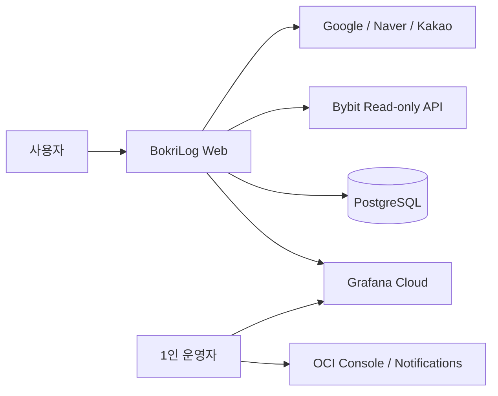
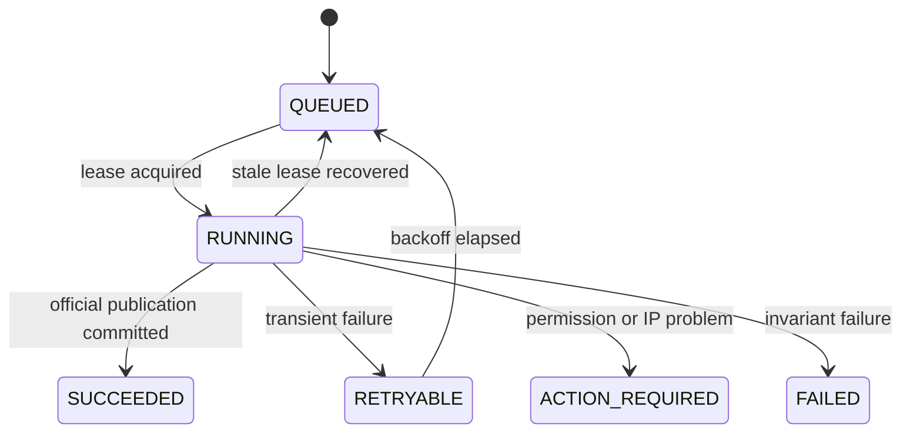
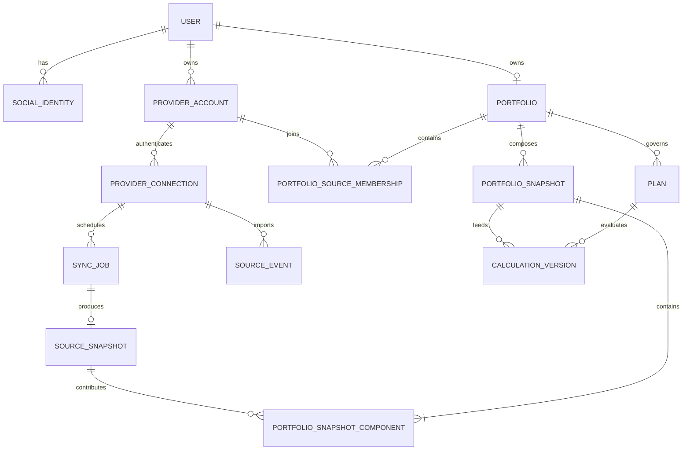

# BokriLog MVP 상세 설계 (1.1)

> 1.1은 Epic 1~5의 as-built를 반영한 새 버전이다. 절 번호는 1.0과 같고, 바뀐 절은 제목에 `[1.1 개정]`을 단다. 바뀐 곳마다 근거는 문서 끝 `## 1.0 → 1.1 변경 기록`에 있다. 같은 폴더의 `ARCHITECTURE-SPINE.md`(1.1)와 함께 읽는다.

## 1. 설계 요약

BokriLog는 사용자의 금융소스를 하나의 통합 포트폴리오로 보고 그 현재가치와 외부 자금흐름을 기준으로 복리 계획의 진행 상태를 계산하는 서비스다. MVP 화면은 읽기 전용 Bybit UTA 하나만 연결하며, 내부에서는 사용자별 `USD` 포트폴리오에 `BYBIT` source 하나가 포함된 형태로 시작한다. 거래를 실행하거나 투자 판단을 추천하지 않는다.

초기 운영 구조는 한 명이 관리할 수 있는 모듈형 모놀리스다. API와 Worker는 같은 Spring Boot 코드베이스와 이미지로 만들되 서로 다른 프로세스로 실행한다. PostgreSQL 하나가 업무 데이터, 세션, 동기화 작업 큐를 담당한다. 운영 서버에는 Nginx, Spring API, Worker, PostgreSQL, Grafana Alloy만 상주시킨다.

핵심 전략은 단일 서버를 복잡한 분산 시스템으로 만들지 않되, 나중에 분리할 경계를 코드와 데이터 소유권으로 미리 증명하는 것이다.

## 2. 시스템 컨텍스트와 신뢰 경계

- 브라우저는 공식 금액과 상태를 계산하지 않는다.
- Bybit는 현재 UTA 가치와 거래 원문의 권위 제공자다.
- BokriLog는 계획·계산·검증 상태의 권위 제공자다.
- Grafana Cloud에는 운영 telemetry만 전송하며 금융·식별·자격 증명 데이터는 보내지 않는다.
- OCI 계정을 잃어도 복구할 수 있도록 키와 백업 사본 하나는 OCI 밖에 둔다.

## 3. 모듈 설계 [1.1 개정]

소유 데이터는 migration V1~V33의 `CREATE TABLE`이다(괄호는 만든 migration, 열·제약만 바꾼 migration은 표 이름 뒤에 "변경" 또는 "열"로 적는다).

| 모듈 | 소유 데이터 | 공개 책임 | 금지 사항 |
| --- | --- | --- | --- |
| identity | `identity_account_lifecycle`·`identity_account`·`identity_social_link`(V1), `identity_deletion_request`(V30, V33 열), `identity_deletion_run`·`identity_deletion_step`(V31, V32·V33 열), `identity_deleted_identity`·`identity_deletion_completion_session`(V33) | 계정 소유권·접근 판정·삭제 상태의 유일한 권위, 소셜 identity 매핑, 재가입 차단 | 이메일만으로 계정 병합, HTTP·서블릿·Spring Security 의존 |
| source | `source_provider_account`·`source_connection`·`source_credential`(V4, V16 열) | 안정적 제공자 계정, 연결 검증·해제, provider-neutral 조회 port와 Bybit adapter | 포트폴리오·계산·계획 상태 변경 |
| portfolio | `portfolio`·`portfolio_source_membership`(V4), `portfolio_snapshot`·`portfolio_snapshot_component`·`portfolio_current_snapshot`(V5) | 기준통화, source 구성과 불변 합산 스냅샷, `publication_sequence` 포인터 | 제공자 원문 조회·계획 공식 계산 |
| sync | 작업 표 여섯(`sync_job` V5·`sync_initial_collection_job` V7·`sync_cashflow_classification_job` V8·`sync_cashflow_conversion_job` V9·`sync_plan_publication_job` V10·`sync_plan_sync_job` V11), source snapshot(`sync_source_snapshot` V5), 원 사건·수집 증거(`sync_initial_*` V7·V12), 판정·환산(`sync_cashflow_*`·`sync_calculable_cashflow` V8·V9), 사용자 열 없는 공유 시장 증거(`sync_market_*` V9), 계산·공식 포인터·이력(`sync_plan_calculation*`·`sync_official_plan_result*` V10·V11·V12), 정밀 검증(`sync_plan_verification_*` V12), 후속 계획 기준(`sync_next_plan_baseline` V15) | 작업 수락, Worker lease·drain(`WorkerLease`·`DrainParticipant`), 공식 계획 결과 승격 | 외부 호출 중 DB 트랜잭션 유지 |
| plan | `plan_condition_intent`·`plan_condition_confirmation`·`plan_condition_idempotency`(V6), `plan_definition`(V10), `plan_end`(V13), `plan_completion`(V14) | portfolio에 귀속된 불변 계획 입력, 활성 계획 단일성, 중도 종료·자연 완료 사실, `PlanPublicationPort` 구현 | 제공자 원문 수정 |
| calculation | 없음(정책 버전 상수·순수 value object) | 재현 가능한 복리 지표 결정 함수 | 영속화, DB·Spring·시계·다른 모듈 의존, `double`/`float`, 코인별 현재가치 재산출 |
| engagement | `engagement_ad_consent_decision`(V26), `engagement_ad_attempt`(V27 — 자격·건너뜀 결정 행이 곧 reservation, V28 `transition_consumed_at`, V29 SHOW·Vitals 보고 표지), 비식별 `engagement_ad_vital_sample`(V29) | 광고 동의, 수동 동기화 광고 자격·빈도 제한, transition 소비, 브라우저 계측 판독과 성능 kill switch 판정 | 광고를 결과 성공 조건으로 사용, GPT 호출(브라우저 몫) |
| operations | `operations_restriction`(V4, V18·V19·V20·V29 변경), `operations_audit_event`(V17), `operations_signal_policy`·`operations_signal`(V19), `operations_notice_incident`·`operations_notice_version`(V21), `support_calendar_year`·`support_business_calendar`·`support_inquiry`(V22), `operations_backup_event`(V24), `operations_deletion_tombstone`(V25, V32 열), `operations_deletion_backup_generation`·`operations_tombstone_export`(V32) | 범위별 정지·강한 신호·수동 복구·공지·문의·운영 command·감사 원장, 백업 기록, tombstone과 백업 파기 추적 | 자동 복구, 다른 모듈 데이터 직접 변경 |
| 루트 패키지(SPINE AD-24) | 업무 표는 `action_grant`(V3) 하나. `spring_session`·`spring_session_attributes`(V2)는 루트가 구성하는 Spring Session 프레임워크 스키마이고, identity가 그 표에 직접 SQL을 쓰는 결합은 deferred 27이다 | 인증 표면, 모든 컨트롤러, 민감 command 공통 부품, 계정 삭제 실행자, 모듈 port 구현, 일회성 역할 runner | 모듈 `internal`·소유 테이블 직접 접근 |

1.0 표의 `frequency_cap` 표는 없다 — 빈도 제한은 `engagement_ad_attempt`의 ELIGIBLE 행에서 계산하고 transition은 같은 표의 열이다. `plan_revision` 표도 없다 — 계획 입력은 `plan_definition` 한 행이 불변이고 바뀌는 것은 계산 버전과 포인터다.

Spring Modulith 테스트(`ModuleBoundaryTest`)는 모듈 간 허용되지 않은 의존과 순환 참조를 빌드 단계에서 실패시킨다. 각 모듈은 다른 모듈의 공개 application API만 호출하며 다른 모듈의 `internal` 패키지(그 안의 `JdbcClient` 저장소)와 소유 테이블에 직접 접근하지 않는다. ORM entity는 없다.

인증 세션이 유일한 내부 `user_id`를 정한다. 모든 사용자 소유 query, command, job과 publication은 application API와 repository query에서 이 ID로 scope하며 client가 보낸 owner ID는 신뢰하지 않는다. 타 사용자 target과 미존재 target은 동일한 외부 오류 계약을 사용한다. CI는 각 aggregate에 대해 두 사용자 간 수평 권한 상승 통합 테스트를 실행한다.

## 4. 동기화 처리 [1.1 개정]

### 요청 경로

1. API는 인증 사용자와 계획의 portfolio 및 활성 source 연결 상태를 확인한다.
2. 동일 source의 실행 중 작업이 있으면 그 작업 ID를 반환한다.
3. 없으면 `sync_job`을 짧은 트랜잭션으로 생성하고 HTTP 202를 반환한다.
4. Worker가 lease와 heartbeat로 작업을 선점한다.
5. 외부 호출은 DB 트랜잭션 밖에서 수행한다.
6. 원 사건, source snapshot, portfolio snapshot 후보와 계산 버전을 추가 전용으로 기록한다.
7. 검증이 모두 끝났을 때만 공식 포인터를 짧은 트랜잭션으로 교체한다.

`sync`가 작업 표 여섯, 정규화 source fact, source snapshot, 계산 결과와 plan별 공식 결과 포인터를 소유하고 `portfolio`가 membership, 구성 component, portfolio snapshot과 portfolio별 현재 snapshot 포인터를 소유한다. `source` adapter는 provider-neutral DTO만 반환하고 `calculation`은 부작용 없는 결정 함수로 portfolio value 기반 결과 값만 반환한다. `sync` publication application service가 outer Spring `REQUIRED` 트랜잭션을 열고 portfolio public command가 mandatory join한다. 이 경로의 `REQUIRES_NEW`, 비동기·after-commit 발행과 다른 모듈 repository 직접 접근은 금지하며 어느 단계든 실패하면 candidate와 pointer 변경을 모두 롤백한다.

> as-built(1.1): 위 상태도는 1.0의 개념 모델이다. 실제 작업은 단계마다 표가 하나씩, 모두 여섯이고 상태 집합이 표마다 다르다. `RETRYABLE`·`ACTION_REQUIRED` 상태는 없고, 실패는 그 표의 종단 상태와 CHECK가 닫은 `failure_code`로 끝난다(예: 증분 동기화의 `FAILED`·`BLOCKED`·`NEEDS_REVIEW`와 `SOURCE_REJECTED`·`PROVIDER_UNAVAILABLE`). 같은 페이지 안의 재시도는 ERD §2.5가 정한다. 표 목록과 상태 집합은 SPINE 1.1 AD-16이 소유한다.

상태 전환에는 예상 이전 상태를 조건으로 넣어 두 Worker가 동시에 성공 처리하지 못하게 한다. 모든 write에는 작업 행의 `fencing_generation`과 살아 있는 `lease_until`(30초)을 술어로 포함한다. source별 `sync_sequence`는 없고, 공식 portfolio pointer는 portfolio별 `publication_sequence`, 공식 plan-result pointer는 plan별 예상 `pointer_version`으로 CAS한다. lease를 잃은 Worker는 0행 갱신을 보고 아무것도 쓰지 않고 멈추며 종단 상태를 따로 갖지 않는다 — RUNNING 중 lease가 끊긴 시도는 다음 claim이 그 표의 중단 code(`SYNC_INTERRUPTED`·`PUBLICATION_INTERRUPTED`)로 맺는다.

source fact의 정체성은 `UNIQUE(provider_account_id, source_id)`이고 revision 열은 없다. `provider_account_id`는 `(provider, verified_external_account_id)`로 안정적으로 식별하고 자격 증명·connection 교체 때 재사용하며 connection ID는 수집 provenance로만 남긴다. 원문 semantic hash와 사건 시각을 함께 저장한다. 같은 id·같은 hash의 재수집은 no-op이고, 같은 id의 다른 hash는 정정이 아니라 충돌이다 — `PROVIDER_ID_CONFLICT` 관측으로 격리하고 강한 신호 `SOURCE_ID_CONFLICT`로 영향 계획 발행을 멈추며 자동 supersede·합산하지 않는다. source fact 행은 고치지 않고, 정밀 검증의 `SUPERSEDED`는 "저장됐지만 관측되지 않아 새 후보에서 빠진 사건"을 뜻하는 검증 기록이다. stable ID가 없는 endpoint의 fallback은 공개 베타 전 문서화한 allowlist로만 허용한다.

### 신선도 정책

Bybit의 wallet balance와 transaction log에는 공통 스냅샷 토큰이 없다. BokriLog는 다음 두 시간을 분리한다.

- `measured_at`: 현재 `totalEquity`가 측정된 시각
- `cashflow_verified_through`: 외부 자금흐름을 확인한 마지막 시각

일상 조회는 전체 이력을 다시 읽지 않는다. 마지막 watermark 이전의 24시간 또는 주기적 7일 중첩 구간부터 닫힌 상한까지 모든 페이지를 수집한 뒤에만 watermark를 전진시킨다. 최근 입출금이 아직 보이지 않으면 사용자가 다시 동기화한다. 30일 초과 장기 미접속은 계속/새 계획 선택 뒤 하나의 catch-up 작업으로 처리한다. 계획 종료는 전체 이력 재조회를 하지 않고 완전성 증거의 공백과 마지막 미확정 구간만 검증한다. Bybit의 조회 가능 범위 때문에 2년을 넘는 이력을 거래소에서 재구성할 수 있다고 약속하지 않는다.

## 5. 계산 계약

권위 입력은 불변 portfolio snapshot의 기준통화 합계, 검증된 외부 자금흐름, 불변 계획 입력이다. MVP의 portfolio snapshot은 활성 Bybit source snapshot 하나로 구성되고 그 source의 권위 값은 Bybit `totalEquity` 원문 문자열이므로 화면 값은 기존 설계와 동일하다. BokriLog는 코인별 잔액과 가격으로 Bybit 현재가치를 다시 계산하지 않고 다음 서비스 고유 지표만 계산한다.

- 현재 계획금액
- 계획 대비 차이
- 외부 자금흐름을 반영한 조정 최종 목표
- 남은 기간의 필요 등가수익률
- 목표 수익 달성도

모든 숫자는 문자열에서 `BigDecimal`로 파싱한다. 내부 계산은 DECIMAL128 34자리와 HALF_EVEN을 사용하고, 표시 단계에서만 HALF_UP 2자리로 반올림한다. 입력, 결과, 계산 정책 버전을 함께 저장해 동일 입력을 재현한다.

## 6. 데이터 저장과 무결성 [1.1 개정]

- 사용자당 `USD` 기본 portfolio 하나와 MVP 활성 `BYBIT` membership 최대 하나: 조건부 유일 인덱스
- membership은 UTC 반개구간 `[included_at, excluded_at)`이고 같은 portfolio/provider account의 구간은 겹칠 수 없으며 admission과 최종 publication 때 모두 활성 상태여야 한다.
- portfolio당 활성 계획 최대 1개: 조건부 유일 인덱스
- source 연결당 실행 중 동기화 최대 1개: 조건부 유일 인덱스와 lease
- 외부 사건 중복 방지: `UNIQUE(provider_account_id, source_id)`와 semantic hash(같으면 no-op, 다르면 `PROVIDER_ID_CONFLICT` 격리); 동일 main UID의 connection 교체 뒤 재수집도 no-op
- 계산 결과 불변성: 계정의 허용 보존기간에는 update 대신 새 version
- 공식 결과: 검증된 source snapshot, portfolio snapshot과 calculation을 가리키는 포인터만 교체
- portfolio 기준통화는 생성 후 불변이며 MVP는 `USD`만 허용
- component는 `(portfolio_snapshot_id, membership_id)` 유일이고 source snapshot·기준통화 값·정책/가격 증거를 참조한다. MVP component는 정확히 하나이며 snapshot 합계와 Bybit `totalEquity`가 정확히 같다.
- component 관계 스키마는 향후 여러 membership을 표현할 수 있는 1:N 구조로 두되 MVP application command와 official publication은 component 수가 정확히 1이 아니면 거부한다. 스키마 호환성 시험은 두 synthetic component의 관계 표현 가능성을 확인할 수 있지만 이를 제품의 다중 source admission 성공으로 해석하지 않는다.
- MVP portfolio `measured_at`은 유일한 source snapshot의 제공자 측정시각이며 `composed_at`·`published_at`과 구분한다. 구성값은 같은 사용자·provider account, membership 시간 구간, 기준통화, supersession·restriction 조건을 만족해야 한다.
- 시간: 원본 UTC `timestamptz`, 계획 경계 해석은 `Asia/Seoul`

PostgreSQL을 작업 큐로 사용하면 DB와 작업 요청을 같은 짧은 트랜잭션에 기록할 수 있다. 작업 완료까지 트랜잭션을 유지하지 않으므로 장시간 잠금 병목은 만들지 않는다. broker와 transactional outbox는 독립 Worker 확장이나 다중 소비자가 실제 필요해질 때 도입한다(V25 `operations_deletion_tombstone`은 외부 tombstone 사본으로 내보낼 행을 담는 표이지 메시지 전달 outbox가 아니다). 검증된 계정 삭제는 추가 전용 규칙의 명시적 예외다.

향후 다른 금융소스를 추가할 때 plan이나 기존 `P0`를 소급 수정하지 않는 것을 설계 방향으로 삼는다. 새 membership의 포함 시점과 그 시점의 검증된 기준통화 가치에 대응하는 portfolio scope adjustment로 계획 비교의 연속성을 유지하는 방안도 현재는 **비실행 방향**이다. 평가시각·환율/가격 증거·반올림·실패·source 제거와 포함 source 간 transfer matching 규칙이 별도 AD와 Story로 채택되기 전에는 이 로직과 둘 이상의 활성 source를 구현하지 않는다. 따라서 이 모델은 확장 경계를 준비할 뿐 MVP에서 다중소스 합산이 가능하다고 약속하지 않는다.

## 7. 인증과 자격 증명 보안

### 사용자 인증

- Google/Naver/Kakao Authorization Code + PKCE
- `(issuer, subject)`를 전역 유일 외부 사용자 키로 사용하고 이메일 일치 자동 병합 금지
- 한 user에 여러 provider identity를 연결할 수 있으나 연결·해제는 최근 재인증과 원자적 확인 필요
- 마지막 로그인 수단 제거 금지, 실패 시 기존 매핑 유지
- HttpOnly, Secure, SameSite=Lax opaque 세션 쿠키
- Spring Session JDBC, session fixation 방어, CSRF 보호
- JWT 또는 금융 데이터를 localStorage에 저장하지 않음

### Bybit 연결 검증

연결 저장 전에 `/v5/user/query-api` 결과의 `readOnly=1`, supported UTA, expected user ID, 최소 조회 권한, OCI reserved IP whitelist와 실제 wallet read를 하나의 accepted result로 모두 검증한다. write capability, 모호하거나 초과된 permission, UID/IP 불일치와 live read 실패는 자격 증명·연결을 저장하지 않는다. API secret은 최초 입력 후 다시 반환하지 않고 교체 시 재입력만 허용한다. 권한·IP·만료 문제는 무한 재시도하지 않고 `ACTION_REQUIRED`로 전환한다.

### 암호화와 키

- AES-256-GCM과 CSPRNG 96-bit nonce
- `(key_version, nonce)` 유일성
- AAD: user, connection, credential, key version, algorithm version
- active key와 과거 decrypt-only key로 구성된 key ring
- DB·Git·로그·Terraform state에서 key/secret 제외
- 애플리케이션 key ring과 별도 백업 키의 복구 사본을 OCI 밖 비밀번호 관리자에 보관

단일 서버의 root 권한이 탈취되면 실행 중인 애플리케이션과 주입된 키가 함께 노출될 수 있다는 잔여 위험은 MVP에서 수용한다. 외부 KMS는 보안 등급이 높아질 때 도입한다.

## 8. 배포 구조 [1.1 개정]

### 운영 자원

- OCI home region A1 Flex 2 OCPU/12GB를 무과금 기준으로 사용
- boot volume 50GB와 별도 data volume을 사용하되 실제 무료 한도는 콘솔에서 확인
- regional reserved public IPv4를 Nginx와 Bybit egress에 사용
- 80/443만 공개하고 관리 접근은 제한
- 모든 운영 이미지는 `linux/arm64`로 CI 검증하고 digest로 고정

| 서비스 | 시작 상한 | 운영 방식 |
| --- | ---: | --- |
| Spring API | 슬롯당 768MiB | 평상시 한 슬롯, 배포 중 잠시 두 슬롯 |
| Worker | 512MiB | 배포 전 drain, 새 버전 하나만 재개 |
| PostgreSQL | 3GiB | `shared_buffers` 512MiB~1GiB에서 시작 |
| Alloy | 256MiB | 영속 queue/storage 경로 사용 |
| Nginx | 128MiB | 고정 진입점 |

2 OCPU 환경에서는 메모리보다 배포 중 CPU 경합을 먼저 검증한다. 서버에서 이미지를 빌드하거나 Testcontainers/k6를 실행하지 않는다.

### 배포 순서

1. CI에서 unit, Modulith, redaction, Testcontainers PostgreSQL + Bybit stub, promtool 검사를 통과한다.
2. 동일 ARM64 image digest를 서버에 전달한다.
3. 기존 Worker를 drain한다.
4. 별도 단일 migration job이 expand migration을 한 번 적용한다. API/Worker startup은 schema를 검증만 한다.
5. 기존 슬롯(old API + new schema)과 대기 슬롯에 readiness(`GET /api/status`)와 smoke를 실행한다. smoke는 curl로 미인증 경로 셋을 본다 — `GET /api/status` 200 `{"status":"UP"}`, `GET /api/auth/session` 200 미인증 본문, `GET /api/connections/bybit` 401 공통 오류 `UNAUTHENTICATED`. k6는 쓰지 않는다.
6. telemetry는 Grafana Cloud 도착이 아니라 그 슬롯의 관리 포트 Prometheus 출력에 공통 tag `env`·`role`이 붙어 있는지로 확인한다.
7. Nginx upstream include를 바꾸고 `nginx -t` 뒤 reload하고, 전환 뒤 smoke를 다시 실행한다.
8. 새 Worker 하나를 기동해 telemetry(`role="worker"`)를 확인하고 이전 API 슬롯을 정지한다. 별도 관찰 기간은 없다.
9. contract migration은 rollback 창이 닫히고(`deploy.sh close-window`) 이전 버전이 제거된 뒤 다음 배포에서 수행한다.

> as-built(1.1): 위 순서는 `deploy/production/deploy.sh` 한 스크립트이고 gate는 `preflight.sh`가 소유한다. 단계마다 일회성 `deploy-audit` 역할이 감사 원장에 `command=deploy` SYSTEM 행을 쓴다. 전환 전 실패는 대기 슬롯을 지우고 이전 Worker를 재개하며, 전환 뒤 실패는 upstream을 되돌린다(`ROLLED_BACK`). CI 리허설(`rehearse-deploy.sh`)만 통과했고 **운영 배포 미검증**이다.

### CI-CD 인계와 배포 직렬화

CD는 보호된 `main`의 Release Gate가 만든 서명 evidence를 입력으로 받고 image를 다시 빌드하지 않는다. Evidence의 issuer, workflow identity, commit, `linux/arm64` image subject, migration bundle, SBOM·provenance와 시험 결과가 같은 digest를 가리킬 때만 운영 승인을 받을 수 있다. Candidate와 evidence key는 commit SHA와 run attempt별로 유일하며 overwrite하지 않고, 탐색용 mutable tag는 promotion 성공 뒤에만 갱신한다.

Production 배포는 environment별 durable lease와 fencing token으로 직렬화한다. Lock 획득 뒤 append-only production record와 실제 active container에서 predecessor를 교차 확인하고, migration 직전과 Nginx cutover 직전에 target evidence와 predecessor를 compare-and-swap으로 다시 검증한다. Evidence가 실제 predecessor와의 old-binary/new-schema 호환 범위를 증명하지 못하면 중단한다. 기본 전진 배포는 현재 release의 descendant만 허용하며 downgrade와 rollback은 별도 승인과 사유가 필요하다.

Migration은 DB가 권위인 lock과 schema history 아래 같은 image의 불변 bundle만 사용한다. Timeout이나 연결 끊김은 성공으로 간주하지 않고 실제 schema와 history를 확인한 뒤 재시도한다. `deployment_id`로 migration과 cutover를 멱등하게 만들며 inactive readiness, smoke 또는 telemetry 확인이 실패하면 upstream을 바꾸지 않는다.

Append-only deployment record는 최소 `APPROVED → MIGRATED → INACTIVE_VERIFIED → CUTOVER → OBSERVING → VERIFIED` 상태를 가지며 실패와 `ROLLED_BACK`을 분리한다. Deployment ID, environment, 승인자, target·previous·evidence digest, migration, readiness·smoke·telemetry, cutover, Worker singleton, 관찰과 rollback 결과를 기록한다. Versioned observation policy의 시간, health, 오류율, telemetry와 queue 기준을 통과한 `VERIFIED` 전에는 출시 완료로 표시하지 않는다. 실행 중 production 배포는 더 새 commit 때문에 자동 취소하지 않으며, current와 rollback window 안의 predecessor image·evidence를 registry garbage collection에서 보호한다.

> as-built(1.1): 위 세 문단은 목표이고 지금 구현은 다음과 같다.
> - **evidence.** release manifest(`release.env`)가 `<repo>@sha256:` image, platform `linux/arm64`, migration 버전·종류, SBOM·서명 파일의 SHA-256을 싣고, gate가 실제 이미지 아키텍처와 `cosign verify`·`cosign verify-attestation --type spdxjson`을 본다. 서명 신원은 manifest가 아니라 운영자가 소유한 host 사실(`signer_identity`·`signer_issuer`)이다. 그 evidence를 만드는 CI Release Gate·이미지 공급망 파이프라인은 아직 없다(3.8 defer, CI 쪽은 deferred 185).
> - **직렬화.** durable DB lease·fencing token이 아니라 호스트 파일 잠금 `state_dir/.lock` 하나다(`lib.sh` `lock_acquire`, 소유자 기록·죽은 소유자는 `LOCK_STALE`로 거부만 한다). 배포·백업·복원·tombstone 내보내기가 같은 잠금을 쓴다. predecessor 대조는 상태 파일 `deploy.state`의 활성 슬롯과 실제로 도는 API 슬롯의 일치이고, 다르면 gate가 거부한다.
> - **기록.** 별도 deployment record 표가 없고 감사 원장 행이 기록이다. 단계는 배포 절차의 `GATE`·`DRAINED`·`MIGRATED`·`INACTIVE_VERIFIED`·`CUTOVER`·`VERIFIED`·`ROLLED_BACK`과 배포 밖의 운영 행동 `WINDOW_CLOSED`(`deploy.sh close-window` — rollback 창 닫기) 여덟이고(`DeployAuditApi.Step`), 결과는 `REQUESTED`(`GATE`만)·`COMPLETED`·`FAILED`다. 신호 중단은 `deploy.sh`가 단계 `INTERRUPTED`·code `SIGNAL`로 감사를 시도하지만 `INTERRUPTED`는 이 여덟에 없어 그 행은 기록되지 못한다(deferred 189). 1.0의 `APPROVED`·`OBSERVING`은 없다 — 승인 단계와 관찰 기간이 없고, `VERIFIED`는 새 Worker telemetry 확인과 이전 슬롯 정지 뒤다. 배포 operation ID는 `deploy_<UTC 시각>_<난수>`이다.

이 blue/green은 배포 실패만 완화한다. VM, PostgreSQL, volume, Nginx, OCI 리전 장애를 이중화하지 않는다.

## 9. 백업과 재해복구 [1.1 개정]

일일 자동 작업은 다음 순서다.

`pg_dump custom → 종료 검사 → 별도 키 암호화 → SHA-256 → pg_restore --list → OCI 업로드 → 외부 저장소 업로드 → 성공 metric`

> as-built(1.1): `deploy/production/backup.sh run`(systemd timer 하루 한 번)이 `pg_dump --format=custom` → `age -R` 암호화 → SHA-256(checksum 파일 둘째 줄에 `dump_started_at`) → `age -d | pg_restore --list` → 두 S3 호환 저장소(OCI·OCI 밖, rclone)의 `incoming/` 업로드와 원격 SHA-256 대조 → 둘 다 맞을 때만 `generations/` 이동 순서로 돈다(한쪽 이동이 실패하면 옮긴 쪽을 되돌린다). 결과는 일회성 `backup-record` 역할이 `operations_backup_event`(V24)에 쓰고 성공 metric은 그 기록에서 Worker가 낸다. 파기는 생성 후 29일 초과(예외 없음)와 수량·bytes 상한(마지막 성공 하나는 남긴다)이다. MinIO 리허설만 통과했고 **실저장소 미검증**이다.

두 저장소 업로드까지 끝나야 성공이다. 계정 삭제의 30일 파기 요구를 지키기 위해 모든 backup generation은 30일 안에 회전 삭제하고 저장 개수와 총 byte를 함께 제한한다. OCI 무료 전용 계정 Object Storage는 합산 20GB를 기준으로 70% 경고를 둔다.

- 공개 베타 RPO: 24시간 이하. 기준은 장애 시각 − 복원한 generation의 dump 시작 시각(checksum 파일 둘째 줄 `dump_started_at`, 없으면 generation 날짜 00:00 UTC)이다 — store object의 시각이 아니다. 넘으면 `restore.sh`가 `RPO_EXCEEDED`로 끝난다.
- RTO: Always Free capacity의 영향을 받는 best-effort
- A1을 8시간 내 확보하지 못하면 PAYG 또는 유료 VPS로 전환

OCI 밖 versioned recovery manifest에는 image digest, Terraform source와 state 복구법, DNS/TLS/OAuth/Grafana/backup 설정, 암호화 operational secret, key version과 bootstrap 순서를 둔다. plaintext secret은 Terraform state에 넣지 않는다.

월 1회 이 manifest만으로 격리 서비스를 재구축하고 key ring/백업 키, PostgreSQL, role/extension/migration, 불변식, 표본 Bybit 자격 증명 복호화, 로그인, Spring Session 폐기, reserved IP와 safe sync까지 검증한다.

> as-built(1.1): manifest는 저장소 밖에 버전을 붙여 두고(`recovery-manifest.example`이 양식, `check-recovery-manifest.sh`가 평문 비밀을 거부한다) 호스트 재구축은 `terraform=manual`이다 — Terraform source·state는 없다. 복원은 다른 호스트의 재구축이 아니라 `deploy/production/restore.sh`가 **같은 호스트의 빈 격리 compose 프로젝트**(`bokrilog-restore-*`)에 OCI 밖 저장소의 30일 안 generation 하나를 `tombstones/latest` 신선도 → checksum → key ID → `pg_restore` → migrate → tombstone 사본 → `restore-apply` 순서로 되살리고, 그 뒤에만 api·worker를 `env=restore`로 띄운다. 격리 환경에는 nginx·공개 포트·로그인 제공자·Bybit 값이 없으므로 로그인·reserved IP·safe sync는 검증하지 않는다(격리 환경 실제 provider 왕복과 훈련 증거 원장은 3.10 defer). `restore-apply`가 확인하는 것은 외부 tombstone과 맞은 계정의 재삭제, 세션 전체 폐기, 불변식, 자격정보 표본 복호화다. CI 리허설만 통과했고 **실제 복원 미검증**이다.

OCI 밖 서버로 복구하면 기존 reserved IP를 가져갈 수 없다. 이때 사용자는 새 송신 IP를 Bybit에 등록해야 하며 서비스는 그 전까지 `BYBIT_IP_REBIND_REQUIRED`를 표시한다.

## 10. 관측성과 테스트 [1.1 개정]

| 환경 | 관측 구성 | 테스트 실행 |
| --- | --- | --- |
| 개발 | Prometheus + Loki + Grafana + Alloy, 필요할 때만 | JUnit, Modulith, Testcontainers, stub, promtool, k6, logcli |
| CI | 임시 테스트 의존성 | 전체 품질 게이트와 ARM64 image 검사 |
| 운영 | Alloy → Grafana Cloud | 외부 synthetic와 제한된 배포 smoke만 |

> as-built(1.1): 개발 행 — 개발 관측 profile(Prometheus·Loki·Grafana·Alloy)과 `logcli`는 저장소에 없다(deferred 187). k6와 CI 행의 ARM64 image 검사도 없다(deferred 185).

> as-built(1.1): k6는 도입되지 않았고 배포 smoke는 curl 셋이다(§8). 운영 경보 규칙은 `deploy/observability/alerts.yml`(모든 selector `env="production"`, 미측정은 `...Unmeasured` `info`)이고 promtool 단위시험은 CI가 돈다. 애플리케이션은 게시하지 않는 관리 포트의 Actuator `prometheus` 하나만 내고, 운영 Alloy·Grafana Cloud·synthetic 연결은 아직 없다(3.8 defer).

metric label과 로그 필드는 allowlist한다. user ID, 계획 ID, request ID, 계정 ID, 원시 URL을 metric label로 사용하지 않는다. API key/secret, session/token, email, 자산 금액, Bybit payload/query string은 모든 telemetry에서 제거한다.

필수 경보는 외부 `GET /api/status` 5분 검사(`LivenessProbeFailed`), Alloy heartbeat 부재, backup age 26시간 초과, 동기화 실패율·queue age, DB connection, disk 70%/85%, memory pressure, Grafana Cloud 사용량 70%/85%다.

보안·사용자 행동 감사 원장은 PostgreSQL 추가 전용 테이블이 권위 원본이다. 원격 로그는 일시 손실 가능한 관측 자료이지 감사 원장의 대체물이 아니다.

## 11. 광고, 계정 삭제와 운영 통제 [1.1 개정]

### 광고

`engagement` 모듈은 광고 동의, 수동 동기화 성공 trigger 판정, 30분 및 일 3회 빈도 제한과 공급자 활성 판정을 소유하고, provider adapter는 브라우저(`frontend/src/ads/gptAdapter.ts`, `/ad-transition`에서만 load)에 있다. 자동·탭 재활성화 동기화에는 광고를 요청하지 않는다. 광고는 공식 결과가 저장된 뒤 금융값·계획값·신뢰 상태가 없는 중립 화면에서만 시도한다. 미채움, 차단, 오류, 비동의, 접근성 실패는 재요청 없이 같은 결과 화면으로 fail-open한다.

> as-built(1.1): 빈도 제한은 별도 `frequency_cap` 표가 아니라 `engagement_ad_attempt`의 ELIGIBLE 행에서 계산하고, 그 행이 reservation·노출 시도이며 transition 참조·소비 시각(V28)·SHOW 표지(V29)도 같은 행의 열이다. reservation은 대시보드가 자기 화면에서 접수한 MANUAL 동기화의 성공 직후 자격 판정에서 일어나고(`결과 보기` 클릭 시점이 아니다), 모든 결말은 `/dashboard`로 replace한다. 성능 kill switch(4.5)가 비식별 Vitals 표본으로 전역 `ADVERTISING` 제한(출처 `PERFORMANCE`)을 연다. 데이터 계약은 ERD-1.1.0 §8·§8.1이다.

### 계정 삭제

`identity`가 삭제 상태를 소유하고, 각 모듈의 deletion port를 호출하는 실행자는 루트 패키지다(SPINE 1.1 AD-19·AD-24). 최근 재인증 후 시작하며 즉시 모든 세션, 자격 증명과 민감 화면 접근을 차단한다. 일부 모듈이나 저장소 삭제가 실패하면 완료로 표시하지 않고 실패 범위와 재시도를 기록한다.

> as-built(1.1): 요청은 민감 command `delete-account`가 identity V30 요청 행과 `DELETION_IN_PROGRESS` 전환을 허가 소비와 한 트랜잭션에 쓰고, 요청 세션 하나만 상태 전용으로 남긴 채 다른 세션을 폐기한다(세션 ID 비회전 예외 — ERD-1.1.0 §5). 실행은 Worker의 `AccountErasureWorker`·`AccountErasureRun`이 V31 실행·단계 행으로 `CREDENTIALS`부터 `IDENTITY`까지 단계마다 한 트랜잭션으로 돌고, 자격정보 행은 첫 단계에서 지운다. 실패 단계는 `RETRY_NEEDED`로 멈추고 요청 세션의 재시도 또는 운영 command `requeue-deletion`이 다시 대기열에 넣는다. production은 G-5 전이라 닫혀 있다.

암호화된 최소 deletion tombstone을 서비스 데이터와 backup 밖에 backup 최대 수명 이상 유지하고 모든 restore 전에 적용한다. 운영 데이터와 해당 계정을 포함한 backup은 요청일부터 30일 안에 접근 불가·파기 상태가 되어야 한다. 법정 분리 보존의 정확한 필드, 법적 근거, 목적과 기간은 공개 베타 전 확정하지 못하면 출시를 차단한다.

> as-built(1.1): tombstone은 operations 소유 V25(+V32 열) outbox이고 Worker가 실행을 처음 집을 때 기록하며, 15분 timer의 `tombstone-export.sh`가 tombstone 전용 age key로 암호화해 OCI 밖 `tombstones/`에 올린다(사본 object는 24시간만 남기고, 행은 백업 파기 완료가 그 상태로 성공한 사본에 실린 뒤 보존 기한이 지나야 빠진다). 백업 파기는 V24 기록만 보는 Worker 판정(`BackupDestructionJudge`)이 영향 generation의 두 저장소 `PURGED`로 확인하고, 기한이 지나도 미완료면 백업을 앞당겨 지우지 않고 `OVERDUE` 경보만 낸다. 보존식·상태·재가입 차단·완료 세션·전체 완료는 ERD-1.1.0 §9다. 법정 분리 보존은 미결정 — 주인 G-5.

### 비상정지와 공지

`operations`가 신규 연결, 동기화, 계산 표시, 광고의 durable restriction과 사용자 service notice를 소유한다. scope는 plan, portfolio, calculation policy version, provider connection, sync, advertising, global feature이며 구체 scope가 global보다 우선한다. 관련 read, admission, lease, publication, display는 effective restriction을 fail-closed로 검사한다. 강한 신호는 60초 안에 설정 범위를 자동 정지하고, 범위를 특정할 수 없으면 신규 연결과 동기화를 전역 정지한다. 자동 복구는 금지하며 운영자가 사유, 증거와 복구 조건을 기록한 보호된 명령으로만 재개한다. 수행자, 시작·종료 시각, 영향 범위는 감사 원장에 남긴다.

사용자 문의 접수와 장애·복구 공지는 operations의 공개 상태로 연결하고, 영업일 3일 답변 목표를 운영 지표로 측정한다.

## 12. 운영 등급과 비용 통제

서비스는 하루 24시간 실행을 목표로 하지만 Always Free에는 SLA, capacity 보장, 정식 지원이 없다. 공개 베타 운영 등급은 `24×7 상시 실행 목표, best-effort, SLA 없음`이다. 주 2시간 목표는 서비스 제공 시간이 아니라 안정화 후 경보 확인·문의·복구 훈련·점검에 드는 운영 노동시간이다.

프로비저닝 전 home region, A1 제공 여부, 무료 전용 계정 2 OCPU/12GB entitlement, `Always Free eligible`, 예상 월 비용 0, reserved IP와 volume/object storage 실제 한도, 비용 경보와 quota를 확인한다.

최초 idle 회수, A1 capacity 8시간 실패, 유료 사용자 발생, 가용성 약속 필요 중 하나가 발생하면 Always Free를 주 운영 호스트에서 제외한다.

## 13. 실패 시나리오

| 실패 | 사용자 영향 | 자동 대응 | 운영자 대응 |
| --- | --- | --- | --- |
| Bybit 일시 오류 | 동기화 지연, 이전 공식값 유지 | backoff 후 제한 재시도 | 장기화 시 공지 |
| API 권한/IP 오류 | 연결 갱신 필요 | `ACTION_REQUIRED` | 사용자 안내 |
| Worker 중단 | queue 지연 | lease 만료 후 재선점 | queue age 확인 |
| 새 배포 실패 | 기존 버전 계속 제공 | upstream 전환 금지 | 로그·smoke 확인 |
| VM 전체 중단 | 서비스 불가 | 외부 synthetic 경보 | 재기동 또는 재생성 |
| A1 회수/capacity 부족 | 복구 지연 | 외부 경보 | 8시간 후 유료 호스트 전환 |
| data volume 손상 | 최신 DB 손실 | 없음 | 이중 백업 복원 |
| OCI 계정 접근 상실 | OCI 자원 접근 불가 | 없음 | 외부 키·백업으로 타 호스트 복원 |
| Grafana Cloud 장애 | 관측 일부 불가 | OCI 보조 경보 | 로컬 회전 로그 확인 |
| 일부 계정 삭제 실패 | 민감 접근은 차단, 삭제 진행 상태 유지 | 완료 처리 금지 | 실패 저장소 재시도·증거 기록 |
| 강한 보안/계산 신호 | 영향 범위 기능 정지 | 60초 내 restriction 설정 | 검증 후 수동 복구 |
| 광고 공급자 장애 | 광고 없이 결과 표시 | 즉시 fail-open | 장기화 시 광고 기능만 정지 |

## 14. 고도화 경로

| 관찰 신호 | 다음 단계 |
| --- | --- |
| DB polling 또는 다중 소비자 요구 | broker + transactional outbox |
| Worker가 API 자원을 지속 압박 | Worker를 별도 호스트로 이동 |
| RPO 24시간 불충분 | base backup + WAL PITR |
| 유료 사용자/가용성 계약 | 유료 주 호스트 + 복구 호스트/고정 egress |
| key 순환과 감사 요구 증가 | 외부 KMS/Vault |
| PostgreSQL 세션 병목 | Redis 세션 검토 |
| 금융 제공자 추가 | source port별 adapter와 제공자별 connection·원 사건 namespace |
| 둘 이상의 source를 같은 계획에 포함 | source별 cutoff·freshness와 기준통화 환산, membership 구간, 합산 snapshot 정책 |
| 포함 source 사이 자금 이동 | 양쪽 사건을 연결하는 transfer matching과 내부 이동 판정 |

## 15. 구현 기준선과 외부 출시 게이트 [1.1 개정]

- `ERD-1.1.0`(`../../EPIC-IMPLEMENTATION-READINESS-1.1.md`)으로 안전 중첩·장기 미동기화·Bybit 사건·ID·환산·강한 신호·Day 90 IP 정책을 고정한다. 이 항목들의 절(§2·§3·§6·§10)은 `ERD-1.0.0`과 같다.
- `AD-GPT-1.0`으로 광고 SDK·trigger·데이터 최소화·동의·fail-open 구현 계약을 고정한다.
- 실제 Google Ad Manager 계정·ad unit·소재·개인정보·접근성 승인은 production 광고 활성화 전에 확보한다.
- 법정 분리 보존 필드·근거·목적·기간·고지는 실제 계정 삭제와 공개 베타 전에 법률·개인정보 책임자가 승인한다.

미인식 사건이나 필수 환산 누락은 공식 결과 발행을 기본 거부한다. Day 90 이후 신규 IP 미제한 연결과 기존 미전환 연결의 동기화·재연결을 거부한다.

## 16. 포트폴리오에서 설명할 핵심

- Spring Modulith로 모듈 경계를 코드와 테스트로 강제한 점
- DB 작업 큐에서 요청 커밋과 장시간 외부 호출을 분리해 병목을 피한 점
- Bybit의 서로 다른 기준시각을 두 freshness timestamp로 표현한 점
- 거래소 현재가치는 재계산하지 않고 서비스 고유 계획 지표만 계산한 점
- append-only 버전과 공식 포인터로 늦은 사건을 재현 가능하게 정정한 점
- 단일 서버 blue/green의 효용과 고가용성이 아니라는 한계를 구분한 점
- OCI 계정 상실까지 고려해 키와 백업을 별도 신뢰 영역에 둔 점
- 개발 관측 스택과 운영 Grafana Cloud를 분리해 학습 가치와 운영 비용을 맞춘 점
- 무료 인프라 정책 변경을 검증하고 4/24 가정을 2/12로 교정한 점
- fencing token과 단조 sequence로 lease 만료 Worker의 stale publication을 차단한 점
- 계정 삭제 요구에 맞춰 append-only와 backup retention의 예외를 명문화한 점

이 문서의 수치와 서비스 버전은 초기 seed다. 구현 이후 실제 Compose, migration, module test, load test와 운영 대시보드가 상세 상태의 권위 원본이 된다.

## 1.0 → 1.1 변경 기록

근거는 바뀐 문장을 확인한 파일이다. 대괄호는 그 차이를 남긴 회고 항목이다(E<n>은 Epic n 회고).

- **§3 모듈 설계** — 소유 데이터를 migration V1~V33의 실제 표로 바꾸고 루트 패키지 행(업무 표 `action_grant` 하나, `spring_session*`은 루트가 구성하는 프레임워크 스키마이고 identity 결합은 deferred 27)을 더했으며 `frequency_cap`·`plan_revision`이 없음을 적었다. 근거: `backend/src/main/resources/db/migration/V1`~`V33`(`CREATE TABLE`), `V3__action_grant.sql`. [E2 R-7, E4 R-3, E1 item-9]
- **§4 동기화 처리** — `sync run`·`lease_generation`·`sync_sequence`·`LOST_LEASE`·revision 정체성을 작업 표 여섯·`fencing_generation`·중단 code·`UNIQUE(provider_account_id, source_id)`·충돌 격리로 고치고 상태도가 1.0 개념 모델이고 `RETRYABLE`·`ACTION_REQUIRED` 상태가 없음을 적었다. 근거: `V5`·`V7`~`V12` migration, `sync/internal/SyncLease.java`·`PlanSyncService.java`·`PlanPublicationService.java`·`InitialCollectionRepository.java`. [E2 R-4, E2 R-7]
- **§6 데이터 저장과 무결성** — 외부 사건 중복 방지의 유일성과 V25 tombstone outbox의 용도를 적었다. 근거: `V7__initial_source_event_collection.sql`, `V25__operations_deletion_tombstone.sql`. [E2 R-4, E3 R-3]
- **§8 배포 구조** — k6 smoke를 curl 셋으로(3.8 동결 문장의 "미인증 세션 401"이 아니라 `GET /api/auth/session` 200·`GET /api/connections/bybit` 401), Grafana 도착 확인을 관리 포트 tag 확인으로, durable lease를 파일 잠금으로, 배포 기록 상태를 `DeployAuditApi.Step` 여덟(`WINDOW_CLOSED` 포함)과 결과 셋으로 고쳤다(`APPROVED`·`OBSERVING` 없음, 신호 중단 단계 `INTERRUPTED`가 기록되지 못하는 차이는 deferred 189). 근거: `deploy/production/deploy.sh`(`close-window`·`on_signal`)·`preflight.sh`·`lib.sh`, `operations/DeployAuditApi.java`(`Step`)·`DeployAuditRunner.java`, `backend/src/main/resources/application.yml`(`deploy-audit`), `spec-3-8-blue-green-deploy.md`. [E3 R-2, E3 R-3]
- **§9 백업과 재해복구** — 백업 실제 순서, RPO 기준 `dump_started_at`(3.10 동결 문장의 "store object 시각"이 아니다), Terraform → `terraform=manual`, 다른 호스트 재구축 → 같은 호스트 격리 프로젝트 복원과 검증 범위를 적었다. 근거: `deploy/production/backup.sh`·`restore.sh`·`recovery-manifest.example`·`check-recovery-manifest.sh`, `spec-3-9-encrypted-backup.md`·`spec-3-10-isolated-restore.md`. [E3 R-2, E3 R-3]
- **§10 관측성과 테스트** — 외부 검사 경로 `/health/live`를 `GET /api/status`로 바꾸고 k6 미도입·Alloy 미연결을 적었다. 개발 행은 고치지 않고 as-built 주석만 달았다(개발 관측 profile·`logcli` 없음은 deferred 187, k6·CI ARM64 검사 없음은 deferred 185). 근거: `deploy/observability/alerts.yml`(`LivenessProbeFailed`), `StatusController.java`, `deploy/compose/compose.yaml`, `.github/workflows/ci.yml`. [E3 R-3]
- **§11 광고, 계정 삭제와 운영 통제** — adapter 위치(브라우저)·표 구성·reservation 시점·이동 대상, 삭제 상태와 실행자의 분리·실행 단계·재시도, tombstone·백업 파기 판정(외부 사본 24시간과 행 필터 — 3.10 동결 문장의 "35일 지난 object"가 아니다)을 적었다. 근거: `frontend/src/ads/gptAdapter.ts`, `frontend/src/session/useDashboardSync.ts`, `V27`~`V33` migration, `AccountErasureRun.java`, `BackupDestructionJudge.java`, `deploy/production/tombstone-export.sh`, `spec-4-2-ad-eligibility.md`·`spec-4-3-neutral-ad-transition.md`·`spec-5-1-account-deletion-request.md`~`spec-5-3-backup-destruction-tracking.md`. [E4 R-3, E3 R-2, E3 R-3, E5 R-3, E5 A-4]
- **§15 구현 기준선** — 기준 결정 버전을 `ERD-1.1.0`으로 바꿨다(그 항목들의 절은 1.0.0과 같다). 근거: `../../EPIC-IMPLEMENTATION-READINESS-1.1.md`. [E2 R-7]
